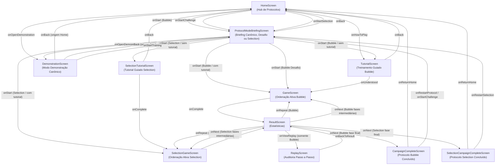

# 03 — Manual do Desenvolvedor Front-End

> **Documento canônico:** Guia técnico e manual prático de desenvolvimento da interface do **Sorting Station**.  
> **Status:** Ativo / Base de Verdade da Wiki  
> **Data:** 08/09/2026  
> **Dependências:** [`AGENTS.md`](../../AGENTS.md), [`CLAUDE.md`](../../CLAUDE.md), [`00-repository-inventory.md`](./00-repository-inventory.md), [`02-system-architecture.md`](./02-system-architecture.md).

---

## 1. Visão Geral da Stack Front-End

O front-end do **Sorting Station** opera como uma Single Page Application (SPA) client-side desenvolvida com as seguintes ferramentas e padrões:

- **React 19 (`^19.0.0`):** Utiliza componentes funcionais, hooks nativos (`useState`, `useEffect`, `useCallback`) e modo estrito de renderização (`React.StrictMode`).
- **TypeScript 5.7 (`^5.7.0`):** Compilação com checagem estrita de tipos (`"strict": true`, `"noFallthroughCasesInSwitch": true` em [`tsconfig.json`](../../tsconfig.json)).
- **Vite 8 (`^8.0.5`):** Servidor de desenvolvimento rápido com Hot Module Replacement (HMR) e suporte aos plugins de sandbox do Figma Make ([`vite.config.ts`](../../vite.config.ts)).
- **Tailwind CSS v4 (`^4.0.0`):** Configuração nativa via `@tailwindcss/vite`, sem arquivos legados `tailwind.config.js` ou `postcss.config.js`. Todo o tema é estendido via `@theme inline` dentro de [`src/index.css`](../../src/index.css).
- **Idioma e Tradução:** Sorting Station utiliza pt-BR como idioma canônico e desabilita tradução automática para preservar a terminologia pedagógica da interface (`<html lang="pt-BR" translate="no" class="notranslate">` e `<meta name="google" content="notranslate" />`).
- **Path Alias `@/`:** Configurado tanto no Vite ([`vite.config.ts`](../../vite.config.ts)) quanto no TypeScript ([`tsconfig.json`](../../tsconfig.json)), permitindo imports absolutos como `@/components/GameButton` a partir de qualquer arquivo.

---

## 2. Estrutura de Diretórios de `src/`

```text
src/
├── main.tsx             # Ponto de entrada React (createRoot, StrictMode e importação de index.css)
├── App.tsx              # Componente raiz: gerencia telas (screen), roteamento, práticas e resultado
├── index.css            # Folha de estilo global: fontes web, Tailwind v4, tokens @theme e animações
├── vite-env.d.ts        # Declarações de tipos do cliente Vite
├── screens/             # Telas completas da aplicação (orquestradas por App.tsx)
│   ├── bubble/          # [UX-REDESIGN-R2] Telas do Piloto End-to-End Bubble Sort V2
│   │   ├── BubbleModuleOverviewV2.tsx # Entrada limpa com metáfora de vizinhos e passos
│   │   ├── BubbleTutorialScreenV2.tsx # Tutorial em 4 passos com checkpoint de predição
│   │   ├── BubbleGameScreenV2.tsx     # Prática ativa sem poluição e com botões simétricos
│   │   └── BubbleResultScreenV2.tsx   # Resultado V2 com descoberta e micro-reflexão
│   ├── HomeScreen.tsx   # Hub Educacional Simétrico de Protocolos (Bubble, Selection, Insertion)
│   ├── ProtocolCard.tsx # Componente simétrico de cartão de protocolo para o Hub da Home
│   ├── protocolCatalog.ts # Catálogo desacoplado de metadados dos protocolos
│   ├── ProtocolModeBriefingScreen.tsx # Briefing intermediário orientado a dados com ação de demonstração
│   ├── PracticeSelector.tsx # Seletor Canônico de Práticas (Básica, Intermediária, Avançada, Desafio Early Exit)
│   ├── TutorialScreen.tsx # Tutorial explicativo com demonstração cíclica animada (Bubble)
│   ├── SelectionTutorialScreen.tsx # Tutorial interativo com engine real sobre [4, 1, 3] (Selection)
│   ├── InsertionTutorialScreen.tsx # Tutorial guiado com engine real sobre [4, 2, 3] (Insertion)
│   ├── GameScreen.tsx   # Ambiente de prática interativo do Bubble Sort (pares adjacentes)
│   ├── SelectionGameScreen.tsx # Ambiente de prática interativo do Selection Sort (INSPECT/COMMIT)
│   ├── InsertionGameScreen.tsx # Ambiente de prática interativo do Insertion Sort (deslocamentos e encaixe)
│   ├── ResultScreen.tsx # Relatório pós-exercício unificado: estatísticas factuais e reflexão pedagógica
│   ├── ReplayScreen.tsx # Reprodução retrospectiva Bubble com pseudocódigo sincronizado
│   ├── SelectionReplayScreen.tsx # Reprodução retrospectiva Selection com pseudocódigo sincronizado
│   ├── InsertionReplayScreen.tsx # Reprodução retrospectiva Insertion com pseudocódigo sincronizado
│   ├── DemonstrationScreen.tsx # Modo Demonstração Educacional canônico puro (Bubble, Selection, Insertion)
│   ├── PracticeSetCompleteScreen.tsx # Relatório canônico final de conclusão de conjunto de práticas (Bubble, Selection, Insertion)
│   ├── CampaignCompleteScreen.tsx # Wrapper de retrocompatibilidade delegando para PracticeSetCompleteScreen
│   └── SelectionCampaignCompleteScreen.tsx # Wrapper de retrocompatibilidade delegando para PracticeSetCompleteScreen
├── game/
│   ├── curriculum/      # Catálogo Curricular Transversal (practiceCatalog.ts, types.ts)
│   ├── briefing/        # Catálogo e tipos de dados para briefings orientados a dados (P1.10 / ADR 0010)
│   ├── campaign/        # Agregação pura de métricas da campanha (PhaseResult, calculateCampaignSummary)
│   ├── demonstration/   # Geração autônoma de demonstração via engines reais (Bubble, Selection, Insertion)
│   ├── generation/      # Geração procedural global e determinística de vetores (P1.9 / ADR 0009)
│   ├── persistence/     # Armazenamento local via localStorage (Schema v4 / ADR 0006, 0007, 0015 e 0021)
│   ├── replay/          # Modelo de quadros de replay e sincronização de pseudocódigo
│   ├── session/         # Métricas de telemetria descritiva e pontuação do protocolo
│   ├── sorting/         # Engines pedagógicas puras (Bubble, Selection, Insertion FSM)
│   └── tutorial/        # Guia pedagógico e definições dos tutoriais interativos
└── components/          # Componentes visuais atômicos e reutilizáveis
    ├── GameButton.tsx   # Botão estilizado com variantes sci-fi (primary, secondary, danger, ghost)
    ├── InstructionPanel.tsx # Faixa de feedback ao usuário com 4 tipos de severidade
    ├── NumberedBox.tsx  # Caixa de transporte com valor, etiquetas, papéis e animações de troca
    ├── InsertionHoleSlot.tsx # Vaga física aberta na esteira para encaixe de chave no Insertion Sort
    ├── InsertionSortPseudocodePanel.tsx # Painel de pseudocódigo sincronizado de 11 instruções do Insertion Sort
    ├── SelectionSortPseudocodePanel.tsx # Painel de pseudocódigo sincronizado do Selection Sort
    ├── PhaseHeader.tsx  # Cabeçalho fixo com protocolo, pílulas de fase e status do sistema
    └── StatsPanel.tsx   # Mostrador numérico duplo para comparações e trocas
```

---

## 3. Arquitetura de Telas e Navegação

A navegação da aplicação não utiliza rotas de URL, mas sim uma máquina de telas baseada no estado `screen` mantido em [`src/App.tsx`](../../src/App.tsx) (`"home" | "briefing" | "tutorial" | "selection-tutorial" | "insertion-tutorial" | "game" | "selection-game" | "insertion-game" | "result" | "replay" | "demonstration" | "campaign-complete" | "selection-campaign-complete" | "insertion-practice-complete"`).



### 3.1. `src/App.tsx` (Componente Raiz)
- **Responsabilidades:**
  - Container raiz da aplicação estruturado estritamente segundo a **Scrollable Screen Rule** ([`05-ux-design-system.md`](./05-ux-design-system.md#10-regra-canônica-de-telas-verticais-e-rolagem-scrollable-screen-rule)), operando com `<div className="w-full h-full min-h-screen overflow-x-hidden">`, eliminando cortes acidentais de viewport e garantindo o crescimento natural e scroll vertical livre para todas as telas (Hotfix PLATFORM-UI-H1);
  - Armazenar o estado global de navegação (`screen`: `"home" | "briefing" | "tutorial" | "selection-tutorial" | "insertion-tutorial" | "game" | "selection-game" | "insertion-game" | "result" | "replay" | "selection-replay" | "insertion-replay" | "demonstration" | "campaign-complete" | "selection-campaign-complete" | "insertion-practice-complete"`) ([`src/App.tsx`](../../src/App.tsx));
  - Armazenar o identificador ativo de briefing (`briefingModeId`: `"bubble-canonical" | "bubble-early-exit" | "selection-canonical" | "insertion-canonical"`);
  - Armazenar o contexto do Modo Demonstração (`demonstrationProtocol`: `"bubble" | "selection" | "insertion"` e `demonstrationReturnScreen`: `"home" | "briefing"`);
  - Armazenar o número da fase ativa (`phase`: `1 | 2 | 3`) ([`src/App.tsx`](../../src/App.tsx));
  - Armazenar o último resultado recebido (`result`: `GameResult | null`, união discriminada por `protocol: "bubble" | "selection" | "insertion"`) ([`src/App.tsx`](../../src/App.tsx));
  - Armazenar em memória os resultados acumulados de cada fase concluída (`phaseResults`: `PhaseResult[]` para Bubble, `selectionResults`: `SelectionGameResult[]` para Selection e `insertionResults` para Insertion);
  - Controlar o estado volátil de conclusão de tutorial da sessão (`hasCompletedSelectionTutorial`, `hasCompletedInsertionTutorial`), garantindo que o tutorial seja obrigatório na primeira execução e opcional subsequentemente na mesma sessão;
  - Definir as matrizes de fases procedurais do Bubble Sort (`PHASES`) e do Selection Sort (`SELECTION_PHASES`: F1 $n=4$, F2 $n=5$, F3 $n=6$);
  - Determinar semanticamente se há próxima fase (`hasNextPhase = phase < activePhases.length`);
  - Orquestrar a transição para `CampaignCompleteScreen` (Bubble), `SelectionCampaignCompleteScreen` (Selection) ou `PracticeSetCompleteScreen` (Insertion);
  - Forçar a remontagem de telas de gameplay através da prop `key={'game-phase-${phase}'}` ([`src/App.tsx`](../../src/App.tsx)).

### 3.2. `src/screens/HomeScreen.tsx`, `ProtocolCard.tsx` e `protocolCatalog.ts` (Redesign UX-HOME-R1 / ADR 0028)
- **Responsabilidades:** Ponto de entrada educacional da plataforma, projetado para acolhimento, orientação rápida (< 5s) e aprendizagem ativa sem ruído técnico excessivo. A Home organiza-se em 5 seções funcionais:
  1. **Seção A (Hero - `HomeHero.tsx`):** Apresentação límpida com crachá educacional, proposta de valor acessível, orientação explícita para iniciantes (*"Recomendamos começar pelo Bubble Sort com o tutorial interativo"*) e botões de ação imediata: primário largo `[ COMEÇAR PELO BUBBLE SORT ▶ ]` e secundário suave `[ COMO FUNCIONA ↓ ]`.
  2. **Seção B (Como Funciona - `HomeHowItWorks.tsx`):** Guia visual em 3 passos numerados (01. Escolha o Método, 02. Entenda a Lógica, 03. Pratique na Esteira).
  3. **Seção C (Retomada - `HomeContinueCard.tsx`):** Renderizado apenas quando há progresso factual salvo (`hasAnyProgress === true`), exibindo o resumo geral de práticas concluídas (X de 12), porcentagem, indicação do próximo módulo/fase recomendada e botão direto `[ CONTINUAR TREINAMENTO ▶ ]`.
  4. **Seção D (Catálogo de Módulos - `ProtocolCard.tsx`):** Grade responsiva (`grid-cols-1 md:grid-cols-2 2xl:grid-cols-4`) com subgrid em 4 linhas, selo `★ RECOMENDADO` no Bubble Sort, chips de tópicos práticos (`metadata.practiceItems`), painel compacto de status de aprendizado e hierarquia nítida de ações: primário full-width `[ INICIAR TREINAMENTO ]` + grid secundário de 2 colunas com `[ TUTORIAL ]` e `[ DEMONSTRAÇÃO ]`, seguido por slot inferior exclusivo de desafio no Bubble Sort.
  5. **Seção E (Rodapé Educacional):** Rodapé acolhedor indicando que o ambiente é 100% interativo, local e sem necessidade de conexão externa ou backend.
- **Catálogo Desacoplado (`src/screens/protocolCatalog.ts`):** Metadados puros de produto declarando id, nome, metáfora diegética, descrição pedagógica concisa, itens de prática, status operacional (`available` vs `coming_soon`), temas visuais de destaque e fases totais. Fornece ainda `getProtocolProgressSummary(id, saveData)` e a função agregadora `getStationOverallProgress(saveData)` para telemetria curricular de retomada.
- **Responsividade e Acessibilidade:** Conformidade com a Scrollable Screen Rule (`min-h-screen overflow-y-auto overflow-x-hidden pb-16 sm:pb-24`), opacidade atenuada nas esteiras decorativas de fundo (0.08) para eliminação de competição visual, botões semânticos reais com `focus-visible` e navegação limpa por teclado.
- **Callbacks e Props:** `saveData?: GameSaveSchema`, `onStartProtocol?: (id: ProtocolId) => void`, `onOpenTutorial?: (id: ProtocolId) => void`, `onOpenDemonstration?: (id: ProtocolId) => void`, `isChallengeUnlocked?: boolean`, `onStartChallenge?: () => void`. Mantém retrocompatibilidade com `onStart`, `onHowToPlay` e `onStartSelection`.

### 3.3. `src/screens/ProtocolModeBriefingScreen.tsx`
- **Responsabilidades:** Tela intermediária orientada a dados e 100% agnóstica a motores específicos, responsável pelo alinhamento pedagógico prévio e preparação cognitiva do operador antes de qualquer interação motora na esteira.
- **Destaques de Implementação:**
  - **Arquitetura Orientada a Dados (P1.10 / ADR 0010):** Não possui strings nem condicionais hardcoded de Bubble Sort. Recebe um contrato estrito `ProtocolModeBriefing` (definido em `src/game/briefing/types.ts`) e o renderiza visualmente de forma determinística;
  - **Pílula Superior de Status:** Exibe crachá luminoso temático (`badgeText`) com suporte a variantes visuais sci-fi (`cyan`, `amber`, `emerald`, `purple`);
  - **Painel de Objetivo Operacional:** Seção em destaque delimitando claramente a meta daquele modo de jogo;
  - **Procedimento na Esteira (Grid 2x2):** Quatro cartões concisos com ícones estilizados, títulos em fonte mono e descrições curtas e didáticas sobre a operação mecânica;
  - **Particularidades do Modo:** Caixa opcional estilizada em tons quentes ou ciano detalhando sutilezas teóricas (ex.: ausência de economia no pior caso para Early Exit, neutralidade de pontuação para comparações evitadas);
  - **Destaques de Telemetria:** Faixa horizontal inferior com 3 cartões apresentando as variáveis e restrições formais da rodada (ex.: Comparações Previstas, Critério de Término, Complexidade Temporal);
  - **Navegação Segura e Geração Tardia:**
    - Botão `[ ← VOLTAR ]`: Retorna à tela de seleção (`home` ou `campaign-complete`) sem gerar vetor, sem consumir sementes procedurais e sem mutação de progresso/storage;
    - Botão `[ ▶ ${briefing.startLabel} ]`: Botão de ação primário único que efetivamente dispara a geração procedural (`generateBubblePhaseArray(1)`) e inicia a rodada.
  - **Responsividade Desktop e Overflow Vertical Seguro (Hotfix):** Contêiner estruturado com `min-h-full overflow-y-auto justify-start pt-6 sm:pt-8 pb-16 sm:pb-24 px-4 sm:px-6`, eliminando a armadilha de clipping vertical por `justify-center`/`my-auto` e garantindo que o rodapé com os botões `[ ← VOLTAR ]` e `[ ▶ ${briefing.startLabel} ]` permaneça 100% visível e acessível em resoluções desktop comuns (1366x768, 1600x900, 1920x1080).
- **Callbacks e Props:** `briefing: ProtocolModeBriefing`, `onStart: () => void`, `onBack: () => void`.

### 3.4. `src/screens/TutorialScreen.tsx`
- **Responsabilidades:** Mini-treinamento interativo guiado que ensina fazendo a lógica elementar do Bubble Sort antes do início do turno real na Fase 1.
- **Destaques de Implementação:**
  - **Integração com a Sorting Engine:** Não possui código duplicado de Bubble Sort; utiliza diretamente `createBubbleSortState([3, 1, 2])`, `executeUserStep`, `getExpectedComparison` e `getSortedIndices`;
  - **Cenário Pedagógico Determinístico `[3, 1, 2]`:**
    - **Etapa 1:** Compara par 3 e 1. Decisão correta: `[⇄ TROCAR]`. Gera vetor `[1, 3, 2]` após animação simétrica de troca;
    - **Etapa 2:** Compara par 3 e 2. Decisão correta: `[⇄ TROCAR]`. Gera vetor `[1, 2, 3]`. Conclui a Passada 1, exibindo o elemento 3 consolidado (`OK`);
    - **Explicação de Passada:** Callout didático explicando que uma passada é a varredura da esquerda para a direita pela parte ainda desordenada da esteira, estabilizando a maior carga restante na posição definitiva;
    - **Etapa 3:** Compara par 1 e 2. Decisão correta: `[= MANTER]`. Demonstra que o algoritmo didático continua até a verificação formal de todos os pares previstos;
  - **Tratamento Formativo de Erro:** Se o operador escolher uma ação incorreta, o estado algorítmico NÃO avança, o vetor permanece inalterado e o `InstructionPanel` exibe explicação formativa orientando nova tentativa;
  - **Conclusão Explícita:** Painel comemorativo de encerramento destacando as competências praticadas, com CTA "INICIAR FASE 1 →" e opção "↺ REPETIR TREINAMENTO";
  - **Guarda Síncrona e Animações:** Utiliza `isActionLockedRef` e `animatingPair` com duração de 500ms, idêntica à esteira do `GameScreen`.
- **Callbacks:** `onBack: () => void`, `onUnderstood: () => void`.

### 3.5. `src/screens/SelectionTutorialScreen.tsx`
- **Responsabilidades:** Tutorial interativo guiado do protocolo Selection Sort ("Scanner de Carga Mínima", P2.1-C, ADR 0012) utilizando a `SelectionSortEngine` real como única fonte de verdade algorítmica sobre o vetor canônico `[4, 1, 3]`.
- **Destaques de Implementação:**
  - **Integração Real com FSM:** Guiado diretamente pelo estado imutável da `SelectionSortEngine` via `executeSelectionInspection` e `commitSelectionPass`;
  - **Diferenciação Cinestésica:** Ensina na prática que o Selection Sort opera por varredura sem movimentação física e executa no máximo uma transferência ao término da passada;
  - **Botoeira Contextual por Fase da FSM:**
    - Fase `INSPECT`: Botões `[ ✦ NOVO MÍNIMO ]` e `[ = MANTER CANDIDATO ]`;
    - Fase `COMMIT`: Botões `[ ⇄ TRANSFERIR MENOR CARGA ]` (quando $minIndex \neq i$) ou `[ ✓ CONSOLIDAR POSIÇÃO ]` (quando $minIndex = i$);
  - **Feedback Formativo Não Punitivo:** Erros do operador incrementam `gameState.errors`, mantêm a posição do scanner e do candidato inalteradas e exibem justificativa relacional factual ($A[j] < A[minIndex]$);
  - **Animação de Transferência:** Animação de permuta visual (500ms) executada exclusivamente na confirmação do commit, comprovando que o scanner não movimenta caixas na varredura;
  - **Dicas Pedagógicas Dinâmicas:** Explicam a comparação matemática formal da vez através de `getSelectionTutorialStepInfo`;
  - **Conclusão Segura:** Apresenta painel de conclusão ao ordenar `[1, 3, 4]` com botão `[ ✓ CONCLUIR TUTORIAL ]` retornando à tela inicial.
- **Callbacks:** `onComplete: () => void`, `onBack: () => void`.

### 3.6. `src/screens/GameScreen.tsx`
- **Responsabilidades:** Interface interativa de ordenação da fase atual integrada deterministicamente à Bubble Sort Engine.
- **Destaques de Implementação:**
  - Inicializa e mantém o estado algorítmico através de `createBubbleSortState(initialArray)`, tornando a engine a única fonte de verdade;
  - Rastreia o par obrigatório sob comparação através de `getExpectedComparison(gameState)`, eliminando seleções arbitrárias de caixas;
  - Mecânica pedagógica de decisão: oferece botões `[⇄ TROCAR]` e `[= MANTER]` validados via `executeUserStep(gameState, decision)`;
  - Cliques informativos nas caixas (`handleBoxClick`): orientam o jogador sem violar a sequência algorítmica;
  - Animação de troca física desacoplada (`animatingPair: { left, right }`): a caixa esquerda translada para a direita (`animate-swap-right`) e a direita para a esquerda (`animate-swap-left`) durante 500ms com bloqueio total de controles;
  - Guarda síncrona com `isActionLockedRef`: protege contra condições de corrida por múltiplos cliques ultra-rápidos antes do ciclo de renderização do React;
  - Feedback formativo contextualizado: exibe explicações conceituais claras sem antecipar a resposta antes da tomada de decisão;
  - Dica pedagógica (`handleHint`): instrui exclusivamente sobre o par atual em foco sem avançar o ponteiro; uso intencional é contabilizado de forma isolada via `sessionMetrics.hintsUsed` (ADR 0003);
  - Progresso real: calculado via `calculateBubbleSortProgress(gameState)` ($\frac{\text{passos}}{\text{total teórico}} \times 100\%$);
  - Consolidação formal: elementos fixados (`OK`) são derivados diretamente de `getSortedIndices(gameState)`;
  - **Esteira Contínua em Telas Estreitas (P1.5):** Layout com contêiner rolável horizontalmente (`overflow-x-auto min-w-max`) sem `flex-wrap`, mantendo a metáfora linear contínua da esteira com 4, 5 e 6 caixas sem quebras de linha em dispositivos móveis;
  - **Avaliação de Carga Cognitiva e Pseudocódigo no Gameplay (P1.5):** O painel de pseudocódigo sincronizado é intencionalmente restrito ao `ReplayScreen`. No `GameScreen`, o operador necessita de foco perceptivo-motor na tríade `Ação Atual` $\rightarrow$ `Consequência Imediata` $\rightarrow$ `Contexto Algorítmico`. Exibir 9 linhas de pseudocódigo em tempo real durante o jogo geraria divisão de atenção (*split-attention effect*), forçaria rolagem vertical contínua e aumentaria a carga cognitiva extrínseca sem benefício pedagógico comprovado;
  - Conclusão segura: monitora `gameState.completed` e dispara `onComplete(data: PhaseCompleteData)` após temporizador calibrado de 1200ms de feedback comemorativo;
  - **Suporte a Variantes (P1.8):** Recebe `variant?: BubbleSortVariant` e instancia `createBubbleSortState(initialArray, { variant })`. Sob `EARLY_EXIT`, exibe notificação comemorativa de término antecipado quando a esteira estabiliza sem trocas e despacha `variant`, `earlyExitTriggered` e `terminationPass` em `onComplete`.
- **Callbacks e Props:** `onComplete: (data: PhaseCompleteData) => void`, `initialArray: number[]`, `phase: number`, `totalPhases?: number`, `variant?: BubbleSortVariant`, `modeTitle?: string`.

### 3.7. `src/screens/SelectionGameScreen.tsx` (P2.1-D / ADR 0013)
- **Responsabilidades:** Interface interativa e cinestésica dedicada da campanha do Protocolo Selection Sort ("Scanner de Carga Mínima"), consumindo deterministicamente a `SelectionSortEngine` como única fonte de verdade algorítmica.
- **Destaques de Implementação:**
  - Inicializa o estado algorítmico imutável via `createSelectionSortState(initialArray)`;
  - **FSM Bimodal de Gameplay:**
    - Fase `INSPECT`: exibe a fórmula textual no banner da esteira (`A[j] < A[minIndex]`) comparando os valores concretos da rodada. Exibe a botoeira com `[ ✦ NOVO MÍNIMO ]` e `[ = MANTER CANDIDATO ]`, acionando exclusivamente `executeSelectionInspection`;
    - Fase `COMMIT`: esconde/desabilita as ações de inspeção e apresenta o botão de ação resolutiva: se $minIndex \neq i$, exibe `[ ⇄ TRANSFERIR MENOR CARGA ]`; se $minIndex === i$, exibe `[ ✓ CONSOLIDAR POSIÇÃO ]`, acionando exclusivamente `commitSelectionPass`;
  - **Diferenciação Cinestésica por Papéis Visuais (`NumberedBox`):**
    - Posição Alvo $i$: papel `target` (borda âmbar);
    - Candidato a Mínimo $minIndex$: papel `min` (borda púrpura) ou `target-min` (quando coincide);
    - Scanner Ativo $j$: papel `scan` (borda ciano pulsante) ou `scan-min`;
    - Elementos Consolidados: papel `sorted` (borda esmeralda `OK`);
  - **Animação de Troca de Longa Distância:**
    - Quando $minIndex \neq i$, injeta `swapDistance = Math.abs(i - minIndex)` no `NumberedBox` e aciona `animate-swap-right` no alvo e `animate-swap-left` no mínimo por 600ms com elevação $z$-index (`z-30`);
    - O scanner durante `INSPECT` é puramente estático/lógico, reforçando que a varredura não desloca cargas;
  - **Guarda Síncrona Rigorosa (`isActionLockedRef`):**
    - Impede condições de corrida causadas por duplo clique ultra-rápido antes do ciclo de renderização do React e durante o transcurso da animação de troca de 600ms;
  - **Feedback Formativo Não Punitivo:**
    - Decisões incorretas incrementam `gameState.errors`, mantêm os ponteiros intactos e exibem explicação relacional clara sem antecipar respostas;
  - **Dica Pedagógica Contextualizada (`handleHint`):**
    - Fornece orientação sobre a comparação da vez ($A[j]$ vs $A[minIndex]$) ou instrução de commit, contabilizada isoladamente em `hintsUsed`;
  - **Métricas e Pontuação do Protocolo:**
    - Temporizador monotônico (`elapsedTimeMs`) iniciado no primeiro frame e congelado na conclusão;
    - Pontuação calculada estritamente via $\max(0, 100 - \text{errors} \times 10 - \text{hintsUsed} \times 5)$ (ADR 0007), com peso zero para comparações, trocas e tempo;
  - **Conclusão Segura:**
    - Detecta `gameState.completed === true`, aguarda 1200ms de feedback comemorativo e despacha `onComplete(data: SelectionPhaseCompleteData)`.
- **Callbacks e Props:** `onComplete: (data: SelectionPhaseCompleteData) => void`, `initialArray: number[]`, `phase: number`, `totalPhases?: number`.

### 3.8. `src/screens/ResultScreen.tsx`
- **Responsabilidades:** Apresentar a avaliação de desempenho descritiva após a conclusão da ordenação da fase/exercício corrente (Bubble Sort Canônico, Bubble Modo Desafio, Selection Sort, Insertion Sort ou Casos do Algoritmo).
- **Destaques de Implementação:**
  - Renderiza o vetor final resultante consolidado com suporte a rolagem horizontal segura em mobile;
  - Apresenta contadores puramente factuais sob o título "MÉTRICAS DA FASE / EXERCÍCIO": Comparações (`comparisons`), Trocas (`swaps`), Decisões Incorretas (`errors`), Dicas Utilizadas (`hintsUsed`), Tempo de Operação e Pontuação do Protocolo;
  - **Suporte ao Contexto de Casos do Algoritmo (LEARNING-R3-A / ADR 0026):**
    - Recebe `activityContext?: 'practice' | 'case'`, `caseDefinition?: AlgorithmCaseDefinition` e `caseReflection?: string`;
    - Em contexto `case`:
      - Cabeçalho exibe badge temático `MÓDULO [NOME] — CASO DO ALGORITMO`;
      - Exibe o título do caso e o objetivo de aprendizagem;
      - Renderiza card de destaque de **Reflexão Pedagógica** factual gerada a partir das métricas reais da sessão;
      - Substitui os CTAs de avanço procedural (`PRÓXIMA PRÁTICA`, `NOVA ENTRADA`) por CTAs de caso: `[ ↺ REPETIR CASO ]` e `[ ← VOLTAR AOS CASOS ]`, preservando `[ ▶ VER EXECUÇÃO ]`;
  - **Suporte Multi-Protocolo (P2.1-D / ADR 0013 e P2.1-E / ADR 0014):**
    - Recebe `protocol?: "bubble" | "selection" | "insertion"`;
    - Para Bubble Sort: exibe badge ciano, pseudocódigo correspondente (canônico ou early exit) e botão `[ ▶ VER EXECUÇÃO ]`;
    - Para Selection Sort: exibe badge âmbar `◈ PROTOCOLO SELECTION SORT`, renderiza o pseudocódigo canônico de 13 instruções estruturadas em português (`SELECTION_SORT_PSEUDOCODE`), exibe o princípio pedagógico da busca gulosa do menor e habilita o botão `[ ▶ VER EXECUÇÃO ]` para auditoria retrospectiva (P2.1-E);
    - Para Insertion Sort: exibe badge esmeralda/âmbar, métricas de deslocamentos (*shifts*) e inserções diretas, pseudocódigo sincronizado de 11 instruções e botão `[ ▶ VER EXECUÇÃO ]`;
  - **Painel Comparativo do Modo Desafio (P1.8):** No modo `EARLY_EXIT`, exibe Comparações Executadas, Comparações Máximas Canônicas de Referência ($n(n-1)/2$), Comparações Evitadas ($\max(0, \text{canônicas} - \text{executadas})$) e Status de Early Exit (SIM/NÃO com passada de término);
  - **Nota Pedagógica de Otimização:** Esclarece a economia de passos ou explica o motivo de não haver economia em casos de pior caso;
  - **Eliminação de Heurística:** Remoção definitiva da antiga métrica arbitrária de "Eficiência (%)", substituída integralmente pela telemetria factual descritiva (ADR 0003);
  - **Responsividade e Scroll Seguro:** Layout com contêiner rolável verticalmente (`overflow-y-auto min-h-full`) e grid responsivo `grid-cols-1 md:grid-cols-2`, impedindo cortes em telas de baixa altura;
  - Suporta a prop semântica `hasNextPhase`: exibe "PRÓXIMA FASE →" ou "CONCLUIR PROTOCOLO →";
  - Botão "↺ REPETIR FASE / CASO" aciona `onRepeat()`; botão principal aciona `onNext()`.
- **Callbacks e Props:** `onRepeat: () => void`, `onNext: () => void`, `onViewReplay?: () => void`, `protocol?: "bubble" | "selection" | "insertion"`, `variant?: BubbleSortVariant`, `earlyExitTriggered?: boolean`, `terminationPass?: number`, `canonicalComparisons?: number`, `comparisonsAvoided?: number`, `activityContext?: 'practice' | 'case'`, `caseDefinition?: AlgorithmCaseDefinition`, `caseReflection?: string`.

### 3.9. `src/screens/CampaignCompleteScreen.tsx` e `src/screens/campaignCompleteConfig.ts`
- **Responsabilidades:** Tela unificada orientada a dados e encerramento técnico de campanhas ao término de todas as fases, parametrizada via dicionário declarativo de metadados (`src/screens/campaignCompleteConfig.ts`), eliminando duplicações e bifurcações `if` espalhadas no JSX.
- **Destaques de Implementação:**
  - Suporta os protocolos `bubble` e `selection` através de configuração tipada (`ProtocolCompleteConfig`):
    - Identidade visual temática (glows ciano/esmeralda no Bubble, púrpura/ciano no Selection);
    - Badges superiores e cabeçalhos narrativos personalizados;
    - Painel factual de 5 métricas globais (`completedPhases`, `totalComparisons`, `totalSwaps`, `totalErrors`, `totalHintsUsed`);
    - Rótulos pedagógicos específicos (ex.: "Trocas Adjacentes" vs "Trocas Totais / Transferências");
    - Nota pedagógica integrada com destaque de invariante (princípio fundamental do algoritmo);
  - **Relatório por Etapa:** Grid responsivo exibindo o resultado analítico de cada fase com vetores finais ordenados e Pontuação do Protocolo;
  - **Acesso ao Modo Desafio (P1.8):** Botão `[ ⚡ EXPERIMENTAR MODO DESAFIO: EARLY EXIT → ]` exibido quando `onStartChallenge` está disponível;
  - **Wrapper Ergonômico:** `src/screens/SelectionCampaignCompleteScreen.tsx` funciona como wrapper transparente e retrocompatível delegando para `CampaignCompleteScreen` com `protocol="selection"`.
- **Callbacks e Props:** `protocol?: "bubble" | "selection"`, `results: PhaseResult[]`, `totalPhases?: number`, `onReturnHome: () => void`, `onRestartProtocol?: () => void`, `onStartChallenge?: () => void`.

### 3.10. `src/screens/ReplayScreen.tsx`
- **Responsabilidades:** Reprodução visual somente-leitura da execução de qualquer fase concluída do Protocolo Bubble Sort (P1.3, ADR 0004), com pseudocódigo sincronizado em tempo real (P1.4, ADR 0005) e suporte à variante otimizada (P1.8, ADR 0008).
- **Destaques de Implementação:**
  - Consome os quadros puros imutáveis derivados por `buildReplayFrames(initialArray, history, { variant, earlyExitTriggered })`;
  - Exibe o **Quadro 0 (Estado Inicial)** com a carga antes do primeiro passo, seguido pelos quadros sequenciais (1..N);
  - Mostra em cada passo: número do passo (`PASSO X / Y`), badge de ação (`INITIAL`, `SWAP`, `KEEP`), valores comparados, passada, comparação da passada e explicação factual concisa;
  - **Quadro Final com Término Antecipado (P1.8):** Quando `earlyExitTriggered === true`, o quadro final consolida todos os elementos (`sortedIndices = [0..n-1]`) e anexa nota factual destacando que a ausência de trocas comprovou a ordenação do vetor, sem criação de frames fantasmas;
  - Destaque cinestésico do par ativo através de `NumberedBox` com prop `selected={true}` e consolidação de caixas ordenadas com `sorted={true}`;
  - **Pseudocódigo Sincronizado Dinâmico (P1.8):** Utiliza `BUBBLE_SORT_EARLY_EXIT_PSEUDOCODE` quando em Modo Desafio, iluminando `CHECK_EARLY_EXIT` e `BREAK_STATEMENT` quando a interrupção precoce ocorre;
  - Painel de controles completo: `[↺ REINICIAR]`, `[← ANTERIOR]`, `[▶ REPRODUZIR]` / `[⏸ PAUSAR]` e `[PRÓXIMO →]`;
  - Botão "← VOLTAR AO RESULTADO" (`onBackToResult`): retorna para `ResultScreen` preservando 100% das métricas em memória.
- **Props:** `initialArray: number[]`, `history: readonly StepRecord[]`, `phase: number`, `variant?: BubbleSortVariant`, `earlyExitTriggered?: boolean`, `onBackToResult: () => void`.

### 3.11. `src/screens/SelectionCampaignCompleteScreen.tsx` (P2.1-D / ADR 0013)
- **Responsabilidades:** Tela dedicada de encerramento e homologação do Protocolo Selection Sort ao término das 3 fases procedurais da campanha.
- **Destaques de Implementação:**
  - Cabeçalho temático com badge âmbar `◈ PROTOCOLO SELECTION SORT CONCLUÍDO`;
  - Painel global de 5 métricas consolidadas factuais:
    - Fases Concluídas ($3 / 3$);
    - Comparações Totais ($6 + 10 + 15 = 31$);
    - Trocas Físicas Totais (no máximo $3 + 4 + 5 = 12$);
    - Decisões Incorretas Totais (`totalErrors`);
    - Dicas Utilizadas Totais (`totalHintsUsed`);
  - Grade detalhada com o desempenho de cada fase (F1: 4 itens, F2: 5 itens, F3: 6 itens) exibindo comparações, trocas, erros, dicas, score e tempo;
  - Cartão didático de fechamento comparativo: ressalta a complexidade de comparações $O(n^2)$ idêntica ao Bubble Sort em contraposição à economia drástica de movimentações físicas ($O(n)$ trocas vs $O(n^2)$ trocas);
  - Botoeira de navegação:
    - `[ ⌂ VOLTAR AO INÍCIO ]`: reseta os resultados em memória da sessão e retorna à `HomeScreen`;
    - `[ ↺ REJOGAR SELECTION SORT ]`: direciona diretamente para o briefing do Selection Sort para novo ciclo.
- **Callbacks:** `onReturnHome: () => void`, `onRestartSelection: () => void`.

### 3.12. `src/screens/SelectionReplayScreen.tsx` (P2.1-E / ADR 0014)
- **Responsabilidades:** Auditoria retrospectiva da execução do Selection Sort em qualquer fase concluída, com sincronização em tempo real de pseudocódigo canônico de 13 instruções estruturadas e semântica bimodal de esteira.
- **Destaques de Implementação:**
  - **Derivação Pura e Imutável:** Consome exclusivamente `buildSelectionReplayFrames(initialArray, history)`, sem reexecutar o algoritmo de ordenação e sem criar frames fantasmas (`frames.length === history.length + 1`);
  - **Representação Tipificada de Quadros:**
    - `INITIAL` (Quadro 0): exibe a carga original na esteira antes da primeira ação do scanner;
    - `INSPECTION` (Quadros 1..N): exibe ALVO ($i$), SCAN ($j$), MÍN ($minIndex$), comparação concreta e manutenção ou atualização do candidato;
    - `COMMIT` (Quadros 1..N): distingue com clareza troca física real (`TRANSFERÊNCIA (SWAP)`) de consolidação direta sem troca (`CONSOLIDAÇÃO DIRETA (SEM TROCA)`);
  - **Resolução Semântica das Caixas:** Renderiza `NumberedBox` mapeando os papéis visuais `target`, `min`, `target-min`, `scan`, `scan-min`, `sorted` e `default`;
  - **Esteira com Rolagem Horizontal Controlada:** Container com `overflow-x-auto py-1 min-w-max mx-auto px-2`, eliminando qualquer risco de quebra de linha de blocos;
  - **Painel de Pseudocódigo Sincronizado:** Integração com `<SelectionSortPseudocodePanel frame={currentFrame} />`, destacando `INIT_MIN`, `IF_CONDITION`, `UPDATE_MIN`, `CHECK_SWAP` e `SWAP_STATEMENT`;
  - **Controles Completos de Reprodução:** `[↺ REINICIAR]`, `[← ANTERIOR]`, `[▶ REPRODUZIR]` / `[⏸ PAUSAR]` (com autoplay a 1200ms e auto-stop no último frame) e `[PRÓXIMO →]`;
  - **Preservação Absoluta de Métricas e Sessão:** O botão `[ ← VOLTAR AO RESULTADO ]` retorna para `ResultScreen` sem tocar em pontuação, erros, dicas, tempo ou progresso;
  - **Responsividade Defensiva Desktop:** Estruturado com `min-h-full overflow-y-auto justify-start pt-4 sm:pt-6 pb-16 sm:pb-24 px-4 md:px-6 gap-4 sm:gap-6`, prevenindo cortes verticais de CTAs em qualquer resolução desktop.
- **Props:** `initialArray: readonly number[]`, `history: readonly SelectionStepRecord[]`, `phase: number`, `onBackToResult: () => void`.

---

## 4. Catálogo de Componentes Reutilizáveis (`src/components/`)

### 3.13. `src/screens/InsertionGameScreen.tsx` (P2.2-D)
- **Responsabilidades:** Interface interativa de prática guiada do Insertion Sort, orientada a exercícios práticos (`basic`, `intermediate`, `advanced`) sem a linguagem legada de fases ou campanhas.
- **Destaques de Implementação:**
  - **Engine como Única Fonte de Verdade:** Utiliza exclusivamente `insertionSortEngine.ts` para todas as transições de estado, cálculos de progresso factual (`calculateInsertionSortProgress`) e detecção de encerramento;
  - **Trilho Aéreo Suspenso:** Quando `state.key !== null`, renderiza a chave suspensa acima da esteira com badge `CHAVE`, halo âmbar e indicação visual inequívoca de desacoplamento do vetor;
  - **Modelo de Vaga Única:** Renderiza `InsertionHoleSlot.tsx` exclusivamente na posição `state.holeIndex` (`null` na esteira). `NumberedBox` nunca recebe `null`;
  - **Regra Rígida de ORD:** Elementos em posições $\le \text{orderedBoundary}$ com valor não nulo recebem papel `sorted` com badge `ORD`. A vaga nunca recebe `ORD`;
  - **Papel Combinado `ordered-scan`:** Quando o scanner $j$ aponta para uma posição dentro da região ordenada, `NumberedBox` renderiza o papel `"ordered-scan"` com badge `ORD • SCAN`, fundo verde e borda ciano pulsante;
  - **Expressão Relacional Formal:** Exibe $A[j] (X) > \text{CHAVE} (K) ?$ durante `COMPARE_AND_SHIFT` sem antecipar a resposta, e $j < 0 \text{ CABECEIRA ALCANÇADA}$ em `INSERT_READY`;
  - **Botoeira Canônica `GameButton`:**
    - `[ ➔ DESLOCAR CARGA ]`: aciona `SHIFT_RIGHT` (desabilitado em `INSERT_READY`);
    - `[ ⇣ ENCAIXAR CHAVE ]`: aciona `INSERT_KEY`;
    - `[ ? DICA ]`: exibe dica contextual sem emoji de sistema no ícone;
    - `[ ↺ REINICIAR EXERCÍCIO ]`: reinicia mantendo estritamente o MESMO vetor;
  - **Telemetria e Ações:** Action locks síncronos com `isActionLockedRef`, telemetria com Comparações, Deslocamentos, Inserções, Erros e Dicas (zero menção a trocas).

### 3.14. `src/screens/PracticeSetCompleteScreen.tsx` (P2.2-D)
- **Responsabilidades:** Tela neutra orientada à plataforma educacional para celebração da conclusão do conjunto regular de práticas (`basic` + `intermediate` + `advanced`).
- **Destaques de Implementação:**
  - Substitui o conceito legado de campanha por "CONJUNTO DE PRÁTICAS CONCLUÍDO";
  - Exibe resumo estatístico agregado de todas as práticas (Comparações, Deslocamentos, Inserções, Erros, Dicas e Tempo);
  - Cartões de desempenho individual para Prática Básica, Prática Intermediária e Prática Avançada com o vetor final ordenado em caixas verdes;
  - Ações de repetição ou retorno à Central Logística (Home).

### 3.15. `src/screens/PracticeSelector.tsx`, Scaffolding Fading e Casos do Algoritmo (LEARNING-R2-B e LEARNING-R3-A)
- **Responsabilidades:** Seleção canônica de práticas regulares, desafios e Casos do Algoritmo para os módulos Bubble Sort, Selection Sort e Insertion Sort, integrando visualmente o catálogo transversal de práticas (`src/game/curriculum/practiceCatalog.ts`), o catálogo de casos (`src/game/curriculum/caseCatalog.ts`) e o perfil de andaime cognitivo (`src/game/curriculum/supportConfig.ts`).
- **Destaques de Implementação:**
  - **Seção "EXPLORAR CASOS" (LEARNING-R3-A / ADR 0026):**
    - Renderiza uma seção dedicada abaixo das práticas regulares quando `cases` estão disponíveis;
    - Desbloqueio dinâmico condicionado à conclusão da Prática Básica (`isModuleCasesUnlocked`);
    - Exibe cards de casos com visualização do vetor de entrada fixo determinístico (ex: `[10, 30, 20, 40, 50]`);
    - Status derivado: `BLOQUEADO` (com mensagem explicativa: "Conclua a Prática Básica para desbloquear"), `DISPONÍVEL` ou `CONCLUÍDO`;
    - Badge de perfil de suporte `SUPORTE REDUZIDO`;
    - Telemetria de recorde persistida (melhor pontuação, erros, tempo decorrido);
    - CTA direto: `[ EXECUTAR CASO ]` ou `[ REPETIR CASO ]`;
  - **Exibição dos Perfis de Suporte nas Práticas:** Cada card de prática regular exibe badge em caixa-alta e descrição de autonomia:
    - `SUPORTE COMPLETO` (verde/esmeralda): "Destaque dos pares sob análise e lembrete explícito da regra de ordenação.";
    - `SUPORTE REDUZIDO` (âmbar): "Foco no par ativo; você interpreta e decide se a regra requer ação.";
    - `AUTONOMIA MÁXIMA` (púrpura): "Foco factual nos elementos sem dicas da regra. Decisão inteiramente autônoma.";
  - **Diferenciação nas Telas de Gameplay (`GameScreen`, `SelectionGameScreen`, `InsertionGameScreen`):**
    - Todas as 3 telas recebem a prop `supportProfile: PracticeSupportProfile` (com fallback gracioso baseado em `phase` ou `level`);
    - Exibem badge temático correspondente no cabeçalho/painel de status;
    - **Graduação de Pistas Relacionais:**
      - *Bubble Sort:* A pergunta relacional explícita ($A[\text{left}] > A[\text{right}] ?$) e o banner comparativo só são exibidos em `full`. O badge avaliador de resposta prévia (`VERDADEIRO`/`FALSO`) foi definitivamente eliminado para evitar spoilers cognitivos. Em `reduced` e `minimal`, a pergunta desaparece e o aluno decide com base estritamente nos valores factuais das caixas ativas;
      - *Selection Sort:* A fórmula formal de comparação no banner ($A[j] < A[\text{minIndex}] ?$) é restrita a `full`. Em `reduced` e `minimal`, os ponteiros factuais (`Alvo (i)`, `Candidato Mín`, `Scanner (j)`) continuam integralmente visíveis, mas a fórmula de spoiler é omitida. No momento de `COMMIT`, a ação de transferência física ou consolidação direta permanece explícita em todos os perfis por representar o ato concreto de mutação;
      - *Insertion Sort:* O container de condição com a pergunta relacional ($A[j] > \text{CHAVE} ?$) é exclusivo de `full`. Em `reduced` e `minimal`, o painel exibe mensagem interpretativa neutra. A condição de chegada à cabeceira ($j = -1 \text{ • CABECEIRA DA ESTEIRA ALCANÇADA}$) permanece expressa em todos os níveis por constituir fato operacional inegociável;
  - **Invariantes Invioláveis:**
    - Botão de Dica (`[ ? DICA ]`) disponível em todos os perfis (`full`, `reduced`, `minimal`);
    - Feedback formativo detalhado em caso de erro presente em todos os perfis (o erro nunca deixa o aluno sem explicação conceitual);
    - Acessibilidade plena (`aria-label`, contraste WCAG, navegação por teclado) preservada independentemente do perfil de andaime;
    - Zero alteração no Schema de Persistência v4 (`supportProfile` é puramente derivado).

### 3.16. Piloto End-to-End Bubble Sort V2 (`UX-REDESIGN-R2`)
- **Diretório:** `src/screens/bubble/`
- **Telas Integradas:**
  - `BubbleModuleOverviewV2.tsx`: Apresentação límpida do módulo com subtítulo conceitual (*"Compare vizinhos e leve os maiores para o final."*), 3 passos pedagógicos, mini-demonstração visual e 2 CTAs diretos.
  - `BubbleTutorialScreenV2.tsx`: Tutorial interativo em 4 passos sobre o vetor `[3, 1, 2]`. Exige predição ativa antes do primeiro movimento (*"Depois de comparar 3 e 1, qual valor ficará mais à direita?"*), demonstrando a propagação do maior elemento e a retenção do invariante.
  - `BubbleGameScreenV2.tsx`: Ambiente de prática ativa de ordenação com:
    - Cabeçalho minimalista sem placar nem cronômetro;
    - Esteira hero com `NumberedBox` sob `variant="learning"`;
    - Checkpoint de previsão pré-ação no primeiro passo;
    - Dois botões simétricos de mesmo peso visual: `[ ⇄ TROCAR ]` (atalho `1`) e `[ = MANTER ]` (atalho `2`);
    - Feedback causal imediato e construtivo em erros (sem avançar o algoritmo e sem penalização);
    - Micro-checagem formativa pós-passada após a primeira passada (verificação da fixação do maior elemento);
    - Gaveta retrátil sob demanda no rodapé com detalhes técnicos e solicitação de dica.
  - `BubbleResultScreenV2.tsx`: Relatório formativo com banner de descoberta, 3 métricas essenciais sem punição, pergunta de micro-reflexão conceitual com feedback explicativo imediato e gaveta técnica sob demanda.
- **Roteamento em `App.tsx`:** O roteador raiz direciona o fluxo canônico de campanha e briefing do Bubble Sort para as telas V2, mantendo Selection Sort e Insertion Sort integralmente operando em suas respectivas telas consolidadas.

---

## 4. Componentes Compartilhados (`src/components/`)

### 4.1. `NumberedBox` ([`src/components/NumberedBox.tsx`](../../src/components/NumberedBox.tsx))
Representação visual das caixas transportadas pela esteira.

```typescript
export type BoxRole =
  | "target"
  | "min"
  | "target-min"
  | "scan"
  | "scan-min"
  | "ordered-scan"
  | "sorted"
  | "pair"
  | "default";

interface NumberedBoxProps {
  value: number;                  // Número inteiro contido na caixa
  index: number;                  // Índice 0-based no vetor (exibido como #index+1)
  selected?: boolean;             // Compatibilidade retroativa (mapeia para role "pair")
  disabled?: boolean;             // Reduz opacidade e remove cursor pointer
  sorted?: boolean;               // Compatibilidade retroativa (mapeia para role "sorted")
  role?: BoxRole;                 // Papel semântico multi-algoritmo (P2.1-C / ADR 0012 / P2.2-D)
  badge?: string;                 // Etiqueta personalizada opcional
  onClick?: (index: number) => void; // Callback de interação
  animating?: "left" | "right" | null; // Dispara animate-swap-left ou animate-swap-right
  swapDistance?: number;          // Distância em posições para animação de longa distância (default: 1) (ADR 0013)
  size?: "sm" | "md" | "lg";      // Dimensão da caixa (default: "lg")
  variant?: "default" | "learning"; // [UX-REDESIGN-R2] Variante limpa sem anéis de neon permanente
  showIndex?: boolean;            // [UX-REDESIGN-R2] Controla visibilidade de #index sob demanda (default: true)
}
```

- **Classes visuais e papéis semânticos aplicados dinamicamente (P2.1-C / ADR 0012 / P2.2-D):**
  - `target` (posição alvo $i$): borda âmbar, fundo âmbar escuro, badge `ALVO`;
  - `min` (candidato $minIndex$): borda púrpura, fundo púrpura escuro, badge `MÍN`;
  - `target-min` (alvo coincide com candidato): borda âmbar destacada com anel púrpura, badge `ALVO • MÍN`;
  - `scan` (scanner em inspeção $j$): borda ciano com pulso, badge `SCAN`;
  - `scan-min` (scanner no momento da seleção de novo mínimo): borda ciano/púrpura com pulso, badge `MÍN • SCAN`;
  - `ordered-scan` (scanner em inspeção sobre elemento ordenado no Insertion Sort): borda ciano vibrante com pulso e fundo verde translúcido, badge `ORD • SCAN`;
  - `sorted` (elemento consolidado): borda esmeralda, badge `OK` ou `ORD`;
  - `pair` (par ativo do Bubble Sort): borda ciano com pulso, badge `PAR`;
  - `default` (neutro/inativo): borda azul escuro padrão, badge `PKG`.
- **Animações de Troca e Distância Variável (P2.1-D / ADR 0013):**
  - As keyframes `@keyframes swap-left` e `@keyframes swap-right` em `src/index.css` suportam a variável CSS `--swap-distance`, calculando a translação horizontal como `calc(var(--swap-distance, 1) * 110%)`;
  - No Bubble Sort, `swapDistance` omite-se (padrão 1), transladando 110% (vizinho adjacente);
  - No Selection Sort, `swapDistance` recebe $|i - minIndex|$ (podendo atingir até 5 posições de span), permitindo transferências de longa distância realistas;
  - Durante o transcurso da animação de 600ms, as caixas em permuta recebem `z-30` para sobreposição segura sobre as demais caixas da esteira.
- **Acessibilidade e Não Dependência de Cor (P1.5, P2.1-C e P2.1-D):**
  - Botão nativo `<button>` com anel de foco de alto contraste: `focus:outline-none focus-visible:ring-2 focus-visible:ring-cyan-400 focus-visible:ring-offset-2 focus-visible:ring-offset-[#060b1a]`;
  - Atributo descritivo dinâmico `aria-label`: `Caixa #{index + 1}, valor {value}, [posição alvo | candidato mínimo | scanner ativo | consolidada | etc.]`, permitindo leitura contextual inequívoca em tecnologias assistivas;
  - Dupla codificação: badges textuais explícitos (`ALVO`, `MÍN`, `SCAN`, `OK`, `PAR`, `PKG`) e ícones operam conjuntamente com as cores de borda para evitar dependência exclusiva de cor.

### 4.2. `GameButton` ([`src/components/GameButton.tsx`](../../src/components/GameButton.tsx))
Botão com estética sci-fi e suporte a quatro variantes temáticas.

```typescript
interface GameButtonProps {
  children: React.ReactNode;
  onClick?: () => void;
  variant?: "primary" | "secondary" | "danger" | "ghost"; // Default: "primary"
  size?: "sm" | "md" | "lg";                             // Default: "md"
  disabled?: boolean;
  className?: string;
}
```

- **Variantes disponíveis:**
  - `"primary"`: Fundo ciano `#00f5ff`, texto `#060b1a`, brilho ciano em hover;
  - `"secondary"`: Fundo roxo translúcido com borda roxa `#8b5cf6`, texto `#c4b5fd`;
  - `"danger"`: Fundo vermelho translúcido `#ef4444`, texto `#fca5a5`;
  - `"ghost"`: Fundo transparente com borda translúcida ciano/branca.
- **Acessibilidade (P1.5):**
  - Anel de foco acessível: `focus-visible:ring-2 focus-visible:ring-cyan-400 focus-visible:ring-offset-2 focus-visible:ring-offset-[#060b1a]`;
  - Estados `disabled` utilizam atributos HTML padrão com `disabled:opacity-40 disabled:cursor-not-allowed` e inibição de eventos de clique.

### 4.3. `InstructionPanel` ([`src/components/InstructionPanel.tsx`](../../src/components/InstructionPanel.tsx))
Faixa horizontal de comunicação contextual com o usuário.

```typescript
interface InstructionPanelProps {
  message: string;
  type?: "info" | "warning" | "success" | "error"; // Default: "info"
}
```

- **Mapeamento de ícones e estilos:**
  - `"info"`: Ícone `◈`, borda ciano/40, texto `#a5f3fc`;
  - `"warning"`: Ícone `⚠`, borda âmbar/40, texto `#fde68a`;
  - `"success"`: Ícone `✓`, borda esmeralda/40, texto `#a7f3d0`;
  - `"error"`: Ícone `✕`, borda vermelha/40, texto `#fecaca`.
- **Acessibilidade (P1.5):**
  - Equipado com `role="status"` e `aria-live="polite"` para anúncio não-intrusivo de mensagens de estado e validação por tecnologias assistivas.

### 4.4. `PhaseHeader` ([`src/components/PhaseHeader.tsx`](../../src/components/PhaseHeader.tsx))
Barra superior fixa contendo metadados operacionais da rodada.

```typescript
interface PhaseHeaderProps {
  protocol: string;     // Ex.: "BUBBLE", "SELECTION"
  phase: number;        // Fase atual (1 a totalPhases)
  totalPhases?: number; // Total de fases (default: 3)
}
```

- **Elementos renderizados:** Nome do protocolo em Orbitron ciano, pílulas circulares de progresso das fases e distintivo pulsante `"SISTEMA ATIVO"`.

### 4.5. `StatsPanel` ([`src/components/StatsPanel.tsx`](../../src/components/StatsPanel.tsx))
Painel duplo de telemetria numérica.

```typescript
interface StatsPanelProps {
  comparisons: number; // Quantidade de pares comparados
  swaps: number;       // Quantidade de permutas executadas
}
```

### 4.6. `BubbleSortPseudocodePanel` ([`src/components/BubbleSortPseudocodePanel.tsx`](../../src/components/BubbleSortPseudocodePanel.tsx))
Painel de pseudocódigo canônico de Bubble Sort com sincronização pura e contextualização separada de valores concretos (P1.4, ADR 0005).

```typescript
interface BubbleSortPseudocodePanelProps {
  frame: ReplayFrame; // Quadro de replay corrente (fonte única e pura de verdade)
  className?: string; // Classes utilitárias opcionais de estilização
}
```

- **Funcionalidades:**
  - Renderiza a representação canônica imutável de 9 instruções do Bubble Sort (`BUBBLE_SORT_PSEUDOCODE`);
  - Destaque primário e secundário de instruções ativas via `getPseudocodeHighlight(frame)`:
    - `INITIAL`: Destaque neutro no cabeçalho `procedimento bubbleSort(A)`;
    - `KEEP`: Destaque na condição `se A[j] > A[j + 1] então` com badge `[FALSO]` e indicação de manutenção de ordem;
    - `SWAP`: Destaque na instrução `trocar A[j] e A[j + 1]` com badge `[⇄ EXECUTADO]` e indicação de condição `[VERDADEIRO]`;
  - Painel contextual inferior exibindo os valores concretos avaliados no frame ($A[j] = X, A[j+1] = Y$, $X > Y \rightarrow \text{VERDADEIRO/FALSO}$) preservando a formulação genérica do código.

### 4.7. `SelectionSortPseudocodePanel` ([`src/components/SelectionSortPseudocodePanel.tsx`](../../src/components/SelectionSortPseudocodePanel.tsx))
Painel de pseudocódigo canônico de Selection Sort com sincronização pura de 13 instruções estruturadas em português e contextualização isolada de valores concretos (P2.1-E, ADR 0014).

```typescript
interface SelectionSortPseudocodePanelProps {
  frame: SelectionReplayFrame; // Quadro de replay corrente (fonte única e pura de verdade)
  className?: string;          // Classes utilitárias opcionais de estilização
}
```

- **Funcionalidades:**
  - Renderiza a representação canônica imutável de 13 instruções do Selection Sort (`SELECTION_SORT_PSEUDOCODE`);
  - Destaque primário e escopo ativo via `getSelectionPseudocodeHighlight(frame)`:
    - `INITIAL`: Destaca o cabeçalho `procedimento selectionSort(A)`;
    - `INSPECTION` (com novo mínimo): Destaca `UPDATE_MIN` (`minIndex ← j`) com badge `[★ NOVO MÍNIMO]` e avalia `IF_CONDITION` como `[VERDADEIRO]`;
    - `INSPECTION` (mantendo candidato): Destaca `IF_CONDITION` (`se A[j] < A[minIndex] então`) como `[FALSO]`, mantendo `minIndex` inalterado;
    - `COMMIT` (com permuta): Destaca `SWAP_STATEMENT` (`trocar A[i] e A[minIndex]`) com badge `[⇄ TRANSFERÊNCIA EXECUTADA]` e `CHECK_SWAP` como `[TROCA NECESSÁRIA (VERDADEIRO)]`;
    - `COMMIT` (sem permuta): Destaca `CHECK_SWAP` como `[ELEMENTO NO DESTINO (FALSO)]` sem ativar `SWAP_STATEMENT`;
  - Painel contextual inferior exibindo os valores concretos avaliados no frame (ALVO $A[i]$, SCAN $A[j]$, MÍN $A[minIndex]$, condição e texto explicativo da instrução executada).

---

## 5. Matriz de Componentes e Telas

| Componente / Tela | Caminho do Arquivo | Responsabilidade | Props Principais | Consumido Por |
| :--- | :--- | :--- | :--- | :--- |
| **`App`** | [`src/App.tsx`](../../src/App.tsx) | Gerencia a máquina de estados global (`screen`, `phase`, `result`) e as fases | Nenhuma (Root) | [`src/main.tsx`](../../src/main.tsx) |
| **`HomeScreen`** | [`src/screens/HomeScreen.tsx`](../../src/screens/HomeScreen.tsx) | Tela de apresentação temática e ponto de partida | `onStart`, `onHowToPlay`, `onStartChallenge`, `onStartSelection` | [`src/App.tsx`](../../src/App.tsx) |
| **`ProtocolModeBriefingScreen`** | [`src/screens/ProtocolModeBriefingScreen.tsx`](../../src/screens/ProtocolModeBriefingScreen.tsx) | Briefing intermediário orientado a dados para modos e protocolos | `briefing`, `onStart`, `onBack` | [`src/App.tsx`](../../src/App.tsx) |
| **`TutorialScreen`** | [`src/screens/TutorialScreen.tsx`](../../src/screens/TutorialScreen.tsx) | Demonstração animada e regras do Bubble Sort | `onBack`, `onUnderstood` | [`src/App.tsx`](../../src/App.tsx) |
| **`SelectionTutorialScreen`** | [`src/screens/SelectionTutorialScreen.tsx`](../../src/screens/SelectionTutorialScreen.tsx) | Tutorial interativo guiado com a engine real do Selection Sort | `onComplete`, `onBack` | [`src/App.tsx`](../../src/App.tsx) |
| **`GameScreen`** | [`src/screens/GameScreen.tsx`](../../src/screens/GameScreen.tsx) | Gameplay interativo, seleção e lógica de ordenação | `initialArray`, `phase`, `onComplete` | [`src/App.tsx`](../../src/App.tsx) |
| **`SelectionGameScreen`** | [`src/screens/SelectionGameScreen.tsx`](../../src/screens/SelectionGameScreen.tsx) | Gameplay interativo do Selection Sort em 3 fases procedurais | `initialArray`, `phase`, `onComplete` | [`src/App.tsx`](../../src/App.tsx) |
| **`ResultScreen`** | [`src/screens/ResultScreen.tsx`](../../src/screens/ResultScreen.tsx) | Exibe métricas factuais (comparações, trocas, erros, dicas) e pseudocódigo | `finalArray`, `comparisons`, `swaps`, `errors`, `hintsUsed`, `phase`, `hasNextPhase`, `onRepeat`, `onNext`, `onViewReplay` | [`src/App.tsx`](../../src/App.tsx) |
| **`ReplayScreen`** | [`src/screens/ReplayScreen.tsx`](../../src/screens/ReplayScreen.tsx) | Reprodução visual e temporal passo a passo dos registros do Bubble Sort | `initialArray`, `history`, `phase`, `onBackToResult` | [`src/App.tsx`](../../src/App.tsx) |
| **`SelectionReplayScreen`** | [`src/screens/SelectionReplayScreen.tsx`](../../src/screens/SelectionReplayScreen.tsx) | Reprodução visual e temporal passo a passo dos registros do Selection Sort | `initialArray`, `history`, `phase`, `onBackToResult` | [`src/App.tsx`](../../src/App.tsx) |
| **`CampaignCompleteScreen`** | [`src/screens/CampaignCompleteScreen.tsx`](../../src/screens/CampaignCompleteScreen.tsx) | Encerramento da campanha Bubble e resumo factual global | `results`, `totalPhases`, `onReturnHome`, `onRestartProtocol` | [`src/App.tsx`](../../src/App.tsx) |
| **`SelectionCampaignCompleteScreen`** | [`src/screens/SelectionCampaignCompleteScreen.tsx`](../../src/screens/SelectionCampaignCompleteScreen.tsx) | Encerramento da campanha Selection e resumo factual global | `results`, `totalPhases`, `onReturnHome`, `onRestartSelection` | [`src/App.tsx`](../../src/App.tsx) |
| **`NumberedBox`** | [`src/components/NumberedBox.tsx`](../../src/components/NumberedBox.tsx) | Caixa de carga numerada com estados visuais, papéis semânticos e animações | `value`, `index`, `role`, `selected`, `sorted`, `animating`, `onClick` | `GameScreen`, `TutorialScreen`, `SelectionTutorialScreen`, `ResultScreen`, `ReplayScreen`, `SelectionReplayScreen` |
| **`GameButton`** | [`src/components/GameButton.tsx`](../../src/components/GameButton.tsx) | Botão sci-fi estilizado com 4 variantes visuais | `children`, `variant`, `size`, `disabled`, `onClick` | Todas as telas |
| **`InstructionPanel`**| [`src/components/InstructionPanel.tsx`](../../src/components/InstructionPanel.tsx) | Painel informativo com tipologia e ícones | `message`, `type` | `GameScreen`, `TutorialScreen` |
| **`PhaseHeader`** | [`src/components/PhaseHeader.tsx`](../../src/components/PhaseHeader.tsx) | Barra de topo com protocolo, fase e status | `protocol`, `phase`, `totalPhases` | `GameScreen`, `SelectionGameScreen`, `ResultScreen` |
| **`BubbleSortPseudocodePanel`** | [`src/components/BubbleSortPseudocodePanel.tsx`](../../src/components/BubbleSortPseudocodePanel.tsx) | Painel sincronizado de pseudocódigo do Bubble Sort | `frame`, `variant`, `className` | `ReplayScreen` |
| **`SelectionSortPseudocodePanel`** | [`src/components/SelectionSortPseudocodePanel.tsx`](../../src/components/SelectionSortPseudocodePanel.tsx) | Painel sincronizado de pseudocódigo do Selection Sort | `frame`, `className` | `SelectionReplayScreen` |
| **`StatsPanel`** | [`src/components/StatsPanel.tsx`](../../src/components/StatsPanel.tsx) | Painel numérico de comparações e trocas | `comparisons`, `swaps` | `GameScreen` |
| **`BubbleSortPseudocodePanel`** | [`src/components/BubbleSortPseudocodePanel.tsx`](../../src/components/BubbleSortPseudocodePanel.tsx) | Painel de pseudocódigo sincronizado com destaque de linha e contexto concreto | `frame`, `className` | `ReplayScreen` |

---

## 6. Convenções de Código e Regras Obrigatórias

O projeto está inserido no ambiente Figma Make e impõe diretrizes estritas documentadas em [`AGENTS.md`](../../AGENTS.md):

### 6.1. Exportação Obrigatória por Padrão (`export default`)
Todos os componentes React em `src/components/` e `src/screens/` **devem obrigatoriamente utilizar `export default`** ([`AGENTS.md`](../../AGENTS.md)):
```tsx
// CORRETO:
export default function NumberedBox(props: NumberedBoxProps) { ... }

// INCORRETO (quebra convenção):
export function NumberedBox(props: NumberedBoxProps) { ... }
```

### 6.2. Regra de Strings e Apóstrofos em JSX
Para strings literais em JSX contendo apóstrofos (ex.: `"We're ready"`, `"Don't"`), **deve-se usar aspas duplas** ou a entidade HTML `&apos;` ([`AGENTS.md`](../../AGENTS.md)). O uso de aspas simples com apóstrofo não escapado quebra a compilação do Vite:
```tsx
// CORRETO:
<p>"Don't touch that"</p>
<p>{'Don\'t touch that'}</p>

// INCORRETO (erro no build):
<p>'Don't touch that'</p>
```

### 6.3. Fechamento Estrito de Tags e Chaves
Todos os elementos JSX devem ter fechamento explícito (`<Component />` ou `<Component></Component>`) e chaves `{}` perfeitamente balanceadas ([`AGENTS.md`](../../AGENTS.md)).

---

## 7. Estilização: Tailwind CSS v4, Tema e Animações

### 7.1. Uso do Tailwind CSS v4
- O projeto usa Tailwind CSS v4 via plugin oficial `@tailwindcss/vite` ([`AGENTS.md`](../../AGENTS.md)).
- Todas as classes utilitárias devem ser aplicadas **diretamente nos atributos `className` do JSX**.
- **Não crie** arquivos `tailwind.config.js` ou `postcss.config.js`.

### 7.2. Quando Usar `src/index.css`
O arquivo [`src/index.css`](../../src/index.css) deve ser editado **apenas** para:
1. Importação de fontes web (`@import url(...)`);
2. Importação do Tailwind (`@import 'tailwindcss';`);
3. Declaração de tokens de tema com `@theme inline`;
4. Regras `@keyframes` e classes utilitárias complexas com múltiplos pseudo-elementos (como `.scanlines`, `.conveyor-track`).

### 7.3. Tipografia do Projeto
Definida no topo de [`src/index.css`](../../src/index.css):
- **`'Orbitron', sans-serif`:** Títulos de tela, cabeçalhos de protocolos, números gigantes nas caixas e pontuações.
- **`'Space Mono', monospace`:** Rótulos de métricas, etiquetas técnicas (`PKG`, `SEL`, `OK`), botões operacionais e pseudocódigo.
- **`'Exo 2', sans-serif`:** Textos descritivos, instruções didáticas, regras de tutorial e diálogos informativos.

### 7.4. Tokens de Cor e Utilitários Customizados

| Token / Classe | Valor / Definição | Aplicação Principal |
| :--- | :--- | :--- |
| `--color-cyan` | `#00f5ff` | Acento primário sci-fi, bordas ativas, botões primários |
| `--color-purple` | `#8b5cf6` | Acento secundário, contador de trocas, botões secundários |
| `--color-amber` | `#f59e0b` | Avisos, caixas selecionadas em foco |
| `--color-green` | `#10b981` | Sucesso, caixas ordenadas definitivamente (`OK`) |
| `--color-bg-deep` | `#060b1a` | Fundo principal da aplicação |
| `--color-bg-card` | `#0d1635` | Painéis, cartões de tutorial e caixas numeradas |
| `.glow-cyan` | `drop-shadow(0 0 8px rgba(0,245,255,0.7))` | Brilho neon intenso para textos e números em ciano |
| `.glow-purple` | `drop-shadow(0 0 8px rgba(139,92,246,0.7))` | Brilho neon para contadores e destaques em roxo |
| `.scanlines` | Linhas horizontais semi-transparentes | Efeito retrô-futurista de tela CRT sobre toda a viewport |
| `.bg-grid` | Grid sutil de $40\times 40\text{px}$ | Textura de fundo estilo planta arquitetônica espacial |
| `.panel-border` | `border border-cyan-500/20 shadow-[0_0_15px_...]` | Borda padrão translúcida para painéis da central |

### 7.5. Animações Customizadas
- **`@keyframes conveyor` ([`src/index.css`](../../src/index.css)):** Desloca o `background-position-x` em $-32\text{px}$ em loop contínuo de $2\text{s}$, simulando a esteira rolante mecânica.
- **`@keyframes swap-left` / `@keyframes swap-right` ([`src/index.css`](../../src/index.css)):** Translação horizontal de $100\%$ acompanhada de arco vertical de elevação de $-12\text{px}$ na metade da animação ($50\%$), executada em $0.5\text{s}$ com curva `ease-in-out`.
- **`@keyframes pulse-border` ([`src/index.css`](../../src/index.css)):** Variação suave de opacidade de borda entre $0.4$ e $1.0$ para chamar a atenção para o elemento selecionado.

---

## 8. Responsividade e Limites de Layout

### 8.1. Estado Atual
- A interface foi construída tendo como alvo prioritário **resoluções desktop (largura $\ge 1024\text{px}$)**.
- O layout centraliza a esteira transportadora com `flex gap-4 items-center justify-center` ([`src/screens/GameScreen.tsx`](../../src/screens/GameScreen.tsx)).

### 8.2. Riscos de Quebra de Layout e Escalabilidade com Vetores Maiores
- **Estouro Horizontal (*Horizontal Overflow*):** Na Fase 3 (6 caixas), a esteira ocupa aproximadamente $6 \times 80\text{px} + 5 \times 16\text{px} = 560\text{px}$ de largura líquida.
- **Comportamento em Mobile (< 768px):** Telas de smartphones ou visualizadores estreitos de iframe sofrem corte lateral das caixas das extremidades, pois o contêiner não possui rolagem horizontal explícita (`overflow-x-auto`).
- **Escala para Algoritmos Futuros:** Quando o Selection Sort ou Insertion Sort forem adicionados com vetores didáticos maiores ($8$ a $10$ elementos), as caixas no tamanho padrão (`size="md"`, $80\times 112\text{px}$) forçarão quebra de linha indesejada ou extrapolação da largura da janela, a menos que se utilize dinamicamente a propriedade `size="sm"` ($56\times 72\text{px}$) ou um contêiner com rolagem horizontal controlada.

---

## 9. Acessibilidade (a11y) Observável e Lacunas Reais

Em estrita consonância com a base de verdade do repositório, esta seção detalha o que de fato existe e as lacunas observadas, **sem alegar certificações WCAG não implementadas**:

### 9.1. O que Existe Atualmente
- **Contraste de Cores:** Alto contraste cromático entre textos (ciano claro `#a5f3fc`, verde `#a7f3d0`, branco) e o fundo escuro (`#060b1a`).
- **Tags Semânticas Básicas:** Uso de elementos `<button>` nativos em `GameButton.tsx`, permitindo foco por `Tab` e acionamento por teclado nativo nos botões principais.
- **Hierarquia Visual de Títulos:** Uso estruturado de tags `<h1>`, `<h2>`, `<h3>` nas telas.

### 9.2. Lacunas Críticas Identificadas
1. **Caixas Numeradas não são Elementos Focáveis:**  
   Em [`src/components/NumberedBox.tsx`](../../src/components/NumberedBox.tsx), cada caixa é renderizada como uma `<div>` com evento `onClick`. Não possui `tabIndex={0}`, `role="button"` nem listener para teclas `Enter` ou `Space`. Usuários que navegam exclusivamente por teclado não conseguem selecionar as caixas na esteira.
2. **Ausência de Região Dinâmica (`aria-live`):**  
   O componente [`InstructionPanel.tsx`](../../src/components/InstructionPanel.tsx) atualiza mensagens de orientação dinamicamente, mas não possui o atributo `aria-live="polite"`. Leitores de tela não anunciam aos usuários deficientes visuais as mudanças de instrução decorrentes dos cliques.
3. **Dependência Cromática de Estado:**  
   O estado de caixa ordenada (`sorted`) é transmitido primariamente pela cor verde da borda e badge "OK". Usuários com daltonismo severo podem ter dificuldade em diferenciar a borda verde (`sorted`) da borda ciano (`default`).
4. **Preferência de Movimento Reduzido:**  
   O arquivo [`.figma/make/site.json`](../../.figma/make/site.json) possui `"ignoreReducedMotion": false`, porém o código CSS em `src/index.css` não encapsula as animações de esteira (`conveyor`) e de troca (`animate-swap-*`) dentro de uma media query `@media (prefers-reduced-motion: reduce)`.

---

## 10. Guia de Padrões para Novas Telas e Componentes

Ao criar novas telas ou componentes no projeto, siga estritamente o roteiro abaixo:

### 10.1. Padrão para Criar uma Nova Tela (`src/screens/NovaTela.tsx`)
```tsx
import GameButton from "@/components/GameButton";

interface NovaTelaProps {
  onBack: () => void;
  onConfirm: () => void;
}

export default function NovaTela({ onBack, onConfirm }: NovaTelaProps) {
  return (
    <div className="min-h-screen bg-[#060b1a] text-white flex flex-col items-center justify-center p-6 relative">
      <div className="scanlines" />
      <h1
        className="text-3xl font-bold text-cyan-400 glow-cyan mb-6"
        style={{ fontFamily: "'Orbitron', sans-serif" }}
      >
        TÍTULO DA TELA
      </h1>
      <p
        className="text-white/70 max-w-md text-center mb-8"
        style={{ fontFamily: "'Exo 2', sans-serif" }}
      >
        "Descrição contextual da tela respeitando a regra de aspas duplas em strings."
      </p>
      <div className="flex gap-4">
        <GameButton variant="ghost" onClick={onBack}>
          ← VOLTAR
        </GameButton>
        <GameButton variant="primary" onClick={onConfirm}>
          CONFIRMAR →
        </GameButton>
      </div>
    </div>
  );
}
```

### 10.2. Padrão para Criar um Novo Componente (`src/components/NovoComponente.tsx`)
```tsx
interface NovoComponenteProps {
  titulo: string;
  ativo?: boolean;
}

export default function NovoComponente({ titulo, ativo = false }: NovoComponenteProps) {
  return (
    <div
      className={`p-4 rounded panel-border transition-colors ${
        ativo ? "border-cyan-400 bg-cyan-950/30" : "bg-[#0d1635]/80"
      }`}
    >
      <span
        className="text-xs uppercase tracking-widest text-white/50"
        style={{ fontFamily: "'Space Mono', monospace" }}
      >
        {titulo}
      </span>
    </div>
  );
}
```

---

## 11. Anti-Padrões a Evitar

1. ❌ **Exportações Nomeadas em Componentes:** Nunca use `export function Componente()`. Use sempre `export default function Componente()` ([`AGENTS.md`](../../AGENTS.md)).
2. ❌ **Criação de `tailwind.config.*` ou `postcss.config.*`:** O projeto usa Tailwind v4 através do Vite. Customizações de tema devem ir exclusivamente em `src/index.css` via `@theme inline`.
3. ❌ **Strings em JSX com Apóstrofos Não Escapados:** Escrever `<p>'Don't do this'</p>` quebra a compilação do Vite. Use sempre `<p>"Don't do this"</p>`.
4. ❌ **Acoplar Lógica Algorítmica em Manipuladores de Clique:** Novas regras ou algoritmos não devem ser escritos dentro de funções de clique do JSX; devem ser isolados em módulos ou funções puras.
5. ❌ **Uso do Tipo `any` em TypeScript:** Mantenha a tipagem estrita com interfaces claras para todas as props e estados.
6. ❌ **Manipulação Direta do DOM:** Nunca use `document.getElementById` ou `document.querySelector` dentro de componentes React; utilize refs ou o ciclo declarativo do React.
7. ❌ **Centralização Vertical (`justify-center` / `my-auto`) em Scroll Containers:** Nunca combine `overflow-y-auto` com `justify-center` ou `my-auto` em contêineres cujos filhos possam exceder a altura útil da janela. Em CSS flexbox, a centralização de conteúdo que transborda empurra o topo para coordenadas negativas ($y < 0$) inalcançáveis pelo scroll e descarta o padding inferior ao rolar. Utilize sempre `justify-start` com `pt-6 sm:pt-8` e `pb-16 sm:pb-24`.
