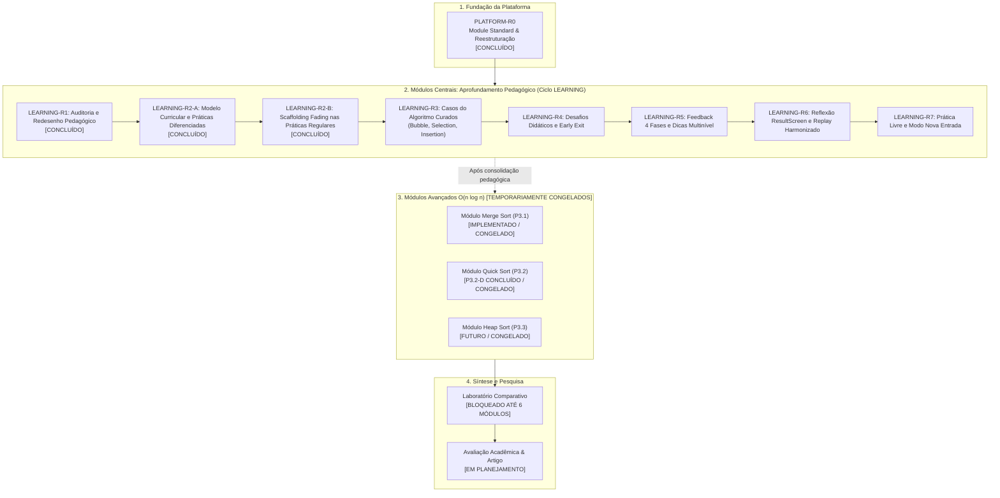

# 10 — Roadmap Estratégico da Plataforma Educacional

> **Documento canônico:** Planejamento estratégico, governança de módulos, roadmap oficial da plataforma, histórico de implementação (marcos legados) e matriz de riscos do **Sorting Station**.  
> **Status:** Ativo / Base de Verdade da Plataforma  
> **Data de Atualização:** 15/09/2026 (Marco PLATFORM-R0)  
> **Dependências:** [`AGENTS.md`](../../AGENTS.md), [`ADR 0018`](../adr/0018-game-to-educational-platform-transition.md), [`modules/README.md`](./modules/README.md), [`comparison-lab.md`](./comparison-lab.md).

---

## 1. Visão Geral e Reposicionamento do Roadmap

A partir do marco **PLATFORM-R0** ([`ADR 0018`](../adr/0018-game-to-educational-platform-transition.md)), o roadmap do Sorting Station foi oficialmente desvinculado do modelo de "fases de jogo linear" e reestruturado em torno de **Módulos Curriculares de Algoritmos** e da **Plataforma Educacional Integrada**.

Em novembro de 2026, a governança curricular estabeleceu um reposicionamento estratégico: **os três módulos elementares (Bubble Sort, Selection Sort e Insertion Sort) devem receber profundidade pedagógica plena antes de expandir novos algoritmos ou abrir o Laboratório Comparativo**. Consequentemente, o desenvolvimento de novos módulos log-lineares (Merge, Quick, Heap) e do Laboratório Comparativo permanece temporariamente congelado durante o ciclo de aprofundamento **LEARNING (LEARNING-R1 a LEARNING-R7)**.

---

## 2. Status Factual dos Módulos Curriculares

| Módulo | Arquivo de Especificação | Complexidade | Status Factual | Situação Atual e Próximo Passo |
| :--- | :--- | :---: | :---: | :--- |
| **01. Bubble Sort** | [`modules/bubble-sort.md`](./modules/bubble-sort.md) | $\Theta(n^2)$ | `PILOTO V2 IMPLEMENTADO E TECNICAMENTE VALIDADO (AGUARDANDO VALIDAÇÃO FORMATIVA COM USUÁRIOS) — R3-A` | Piloto V2 ativo e endurecido; próximo: testes com usuários no marco UX-REDESIGN-R3-B |
| **02. Selection Sort** | [`modules/selection-sort.md`](./modules/selection-sort.md) | $\Theta(n^2)$ | `IMPLEMENTADO, DIFERENCIADO, SCAFFOLDING FADING E CASO-PILOTO HOMOLOGADO` | LEARNING-R2-A/B e R3-A concluídos; próximo: LEARNING-R3-B |
| **03. Insertion Sort** | [`modules/insertion-sort.md`](./modules/insertion-sort.md) | $\Theta(n^2)$ | `IMPLEMENTADO, DIFERENCIADO, SCAFFOLDING FADING E CASO-PILOTO HOMOLOGADO` | LEARNING-R2-A/B e R3-A concluídos; próximo: LEARNING-R3-B |
| **04. Merge Sort** | [`modules/merge-sort.md`](./modules/merge-sort.md) | $\Theta(n \log n)$ | `IMPLEMENTADO E INTEGRADO (P3.1-F)` | Ativo no Hub; temporariamente congelado para expansão |
| **05. Quick Sort** | [`modules/quick-sort.md`](./modules/quick-sort.md) | $\Theta(n \log n)$ | `PARTICIONAMENTO ENTREGUE (P3.2-D)` | Temporariamente congelado (P3.2-E aguardando ciclo LEARNING) |
| **06. Heap Sort** | [`modules/heap-sort.md`](./modules/heap-sort.md) | $\Theta(n \log n)$ | `FUTURO` (P3.3) | Congelado |
| **Laboratório Comparativo**| [`comparison-lab.md`](./comparison-lab.md) | Multi-algoritmo | `BLOQUEADO` | Aguarda conclusão dos 6 módulos e ciclo pedagógico |

---

## 3. Roadmap da Plataforma Educacional

### Marco 0: PLATFORM FOUNDATION (PLATFORM-R0) — `CONCLUÍDO`
- Redefinição oficial do produto como **Plataforma Educacional Interativa e Gamificada** ([`ADR 0018`](../adr/0018-game-to-educational-platform-transition.md)).
- Estabelecimento do **Module Standard transversal** com as 20 seções obrigatórias para todos os módulos ([`modules/README.md`](./modules/README.md)).
- Congelamento dos **6 módulos curriculares oficiais** em `docs/wiki/modules/`.
- Taxonomia Transversal de Exercícios (A até H) com matriz de obrigatoriedade.
- Especificação formal do **Laboratório Comparativo** com bloqueio explícito até a entrega dos 6 módulos ([`comparison-lab.md`](./comparison-lab.md)).
- Diagnóstico do Schema v3 e especificação conceitual do Schema v4 orientado a exercícios ([`07-backend-and-persistence.md`](./07-backend-and-persistence.md)).
- Auditoria e sincronização documental completa da Wiki.

---

### Marco 1: MÓDULO INSERTION SORT (P2.2) — `CONCLUÍDO`
- **Objetivo:** Implementar o 3º módulo curricular da plataforma: *"Desvio e Encaixe de Cargas"*.
- **Sub-Marcos de Engenharia Concluídos:**
  1. **P2.2-A:** Design Pedagógico, Mecânico e Curricular do Módulo (`CONCLUÍDO` em [`modules/insertion-sort.md`](./modules/insertion-sort.md));
  2. **P2.2-B:** Engine pura de Insertion Sort por deslocamentos em `src/game/sorting/insertion/` + suíte completa de testes unitários com Vitest (`CONCLUÍDO`, ADR 0018);
  3. **P2.2-C:** Restrições procedurais (`insertionConstraints.ts`), briefing oficial, tutorial interativo (`[4, 2, 3]`) e driver puro de demonstração canônica (`[6, 3, 5, 2, 7]`) (`CONCLUÍDO`, ADR 0019);
  4. **P2.2-D:** Interface de prática interativa (`InsertionGameScreen.tsx`) com trilho suspenso para chave elevada, esteira com vaga única (`InsertionHoleSlot`), role `"ordered-scan"`, catálogo de práticas sem fases (`basic`, `intermediate`, `advanced`), resultado de exercício e tela de conclusão do conjunto (`PracticeSetCompleteScreen.tsx`) (`CONCLUÍDO`, ADR 0020);
  5. **P2.2-E:** Replay retrospectivo com derivação pura de quadros e pseudocódigo sincronizado de 11 instruções (`InsertionSortPseudocodePanel.tsx`) + conexão visual da demonstração (`CONCLUÍDO`);
  6. **P2.2-F:** Persistência Schema v4 orientada a exercícios/módulos, migração determinística v1/v2/v3->v4, estabilização de storage key e homologação pública do Insertion Sort no catálogo como `available` (`CONCLUÍDO`, ADR 0021).
- **Critério de Aceite Atingido:** 100% dos testes unitários verdes (376 testes) e zero regressão.

---

### Marco 1.5: PADRONIZAÇÃO VISUAL E ESTRUTURAL DE BUBBLE E SELECTION (PLATFORM-R1-B) — `IMPLEMENTAÇÃO CONCLUÍDA / HOMOLOGAÇÃO VISUAL EM BROWSER PENDENTE`
- **Objetivo:** Migrar Bubble Sort e Selection Sort da linguagem visual legada ("Fase / Campanha") para o modelo canônico da plataforma ("Módulo / Prática / Exercício / Conjunto de Práticas"), consolidando a convergência com o Insertion Sort ([`ADR 0022`](../adr/0022-canonical-exercise-module-standardization.md)).
- **Entregáveis Concluídos:**
  1. Catálogo curricular transversal unificado (`src/game/curriculum/practiceCatalog.ts`) com tipos puros (`PracticeDefinition`, `PracticeLevel`, `PracticeProgressState`);
  2. Componente reutilizável `PracticeSelector.tsx` data-driven para seleção direta de práticas desbloqueadas com telemetria;
  3. Desacoplamento do Early Exit no Bubble Sort como Modo Desafio / Caso Especial Curricular derivado pelo Schema v4;
  4. Padronização de cabeçalhos (`PhaseHeader.tsx`) e telas (`GameScreen.tsx`, `SelectionGameScreen.tsx`), eliminando termos de fases legadas sem alterar mecânicas singulares;
  5. Normalização de `ResultScreen.tsx` ("EXERCÍCIO CONCLUÍDO!") e ação para o Seletor de Práticas;
  6. Unificação transversal da conclusão na tela canônica `PracticeSetCompleteScreen.tsx` com diferenciação honesta entre progresso curricular acumulado (ex.: 3/3 salvo) e práticas da sessão ativa sem fabricação de métricas;
  7. Persistência canônica exclusiva via `recordExerciseCompletion` com garantia de escrita única por conclusão, integridade factual de `completedTutorial`, e eliminação de gravação redundante;
  8. Suíte de testes expandida para 29 arquivos e 413 testes automatizados 100% verdes com cobertura comportamental de cenários cross-sessão.
- **Pendência Declarada:**
  - Validação renderizada interativa em navegador real nas resoluções 1366x768, 1600x900, 1920x1080 e altura <700px (roteiro manual entregue).

---

### Marco 2: MÓDULO MERGE SORT (P3.1) — `IMPLEMENTADO E INTEGRADO (P3.1-F) — HOMOLOGAÇÃO VISUAL EM BROWSER PENDENTE`
- **Objetivo:** Primeiro módulo log-linear $\Theta(n \log n)$ da plataforma, demonstrando Divisão e Conquista, preservação estrita de estabilidade e memória auxiliar $O(n)$ com esteiras convergentes.
- **Sub-marcos:**
  - **P3.1-A: Design Pedagógico e Mecânico (`CONCLUÍDO / APROVADO`):** Especificação completa das 20 seções do Module Standard ([`modules/merge-sort.md`](./modules/merge-sort.md)) e proposta arquitetural formalizada no [`ADR 0023`](../adr/0023-merge-sort-pedagogical-mechanical-design.md) (Top-Down pós-ordem, intercalação ativa com dois ponteiros, esteira coletora auxiliar, regra de estabilidade $\le$ e distinção entre partição `ORD` e conclusão `OK`).
  - **P3.1-B: Engine Pura e FSM (`CONCLUÍDO`):** Implementação funcional de `src/game/sorting/merge/mergeSortEngine.ts`, tipos contratuais em `types.ts`, ponto de entrada em `index.ts` e suíte exaustiva de testes unitários no Vitest (`mergeSortEngine.test.ts`, 22 testes 100% verdes). Invariantes testadas: casos base (vazio e unitário com 0 comparações/escritas), recorrência exata $W(4)=16, W(5)=24, W(6)=32$, estabilidade estrita em chaves duplicadas com desempate na esquerda, drenagem de ambos os lados sem comparações, tratamento de ações impossíveis com zero penalidade e reconstrução factual sem reexecução algorítmica.
  - **P3.1-C: Camada Pedagógica, Tutorial e Demonstração (`CONCLUÍDO`):** Constraints procedurais Mulberry32 com predicado de confronto real de duplicatas (`mergeConstraints.ts`), catálogo data-driven de práticas (`practiceCatalog.ts`), camada pedagógica e dicas (`mergePedagogy.ts`), tutorial interativo curto guiado (`[4a, 1, 3, 4b]`) com retenção de passo em erro e desempate reflexivo na confluência raiz (`mergeTutorialGuide.ts`), demonstração canônica autônoma (`[7, 2, 5, 3]`) via engine pura (`mergeDemonstration.ts`), briefing oficial do protocolo (`briefingCatalog.ts`) com 7 pilares pedagógicos e derivação pura de quadros visuais (`MergeVisualStepFrame`) para Replay. 53 testes do módulo no Vitest; total do projeto em 466 testes 100% verdes em 34 arquivos.
  - **P3.1-D: Estação de Intercalação e Seletor de Práticas (`CONCLUÍDO — Homologação visual manual pendente`):** Interface `MergeGameScreen.tsx` desktop-first, pátio de triagem com ramais esquerdo e direito como janelas sobre o vetor principal sem cópias algorítmicas adicionais, sensor óptico de confronto de cabeças sem vazar a resposta, esteira coletora auxiliar (buffer) com realce do slot $k$, botoeira com `GameButton` (`DISPATCH_LEFT`, `DISPATCH_RIGHT`, `DRAIN_REMAINDER`), atalhos locais de teclado `1`, `2`, `3` ignorando campos editáveis e repetições (`event.repeat`), trava síncrona com `displayedFrame` impedindo decisões defasadas, cancelamento atômico de timers e apresentação com `presentationIdRef`, avanço discreto manual sob `prefers-reduced-motion` (sem timers contínuos e sem perda de conteúdo), Seletor de Práticas (`PracticeSelector` com tema `merge` e 3 práticas $n=4, 5, 6$), `ResultScreen` segregando escritas no buffer e no principal. 491 testes verdes no Vitest (35 arquivos).
  - **P3.1-E: Replay e Pseudocódigo Sincronizado (`CONCLUÍDO — Homologação visual manual pendente`):** Modelo funcional imutável `src/game/sorting/merge/mergeReplayModel.ts` (invariante estrita de $1+N$ quadros, histórico factual sem reexecução da engine, frentes históricas preservadas para badges de comparação, telemetria zerada no quadro inicial, acúmulo e remoção retroativa de intervalos ordenados e badges diegéticos ORD/OK), definição e mapeamento de pseudocódigo canônico de 30 linhas em `mergeReplayPseudocode.ts`, componente de pseudocódigo sincronizado `MergeSortPseudocodePanel.tsx`, tela completa de auditoria `MergeReplayScreen.tsx` desktop-first com controles temporais (INÍCIO, ANTERIOR, REPRODUZIR/PAUSAR, PRÓXIMO, FIM, velocidade 0.5x, 1x, 2x), atalhos de teclado (ArrowLeft, ArrowRight, Home, End, Space) protegidos para não colidir com controles interativos focados, suporte a `prefers-reduced-motion` (inicia pausado, navegação discreta manual) e integração com `ResultScreen.tsx`. Total de 515 testes verdes no Vitest (38 arquivos).
  - **P3.1-F: Persistência Schema v4, Tutorial Guiado e Ativação no Hub (`CONCLUÍDO — Homologação visual manual pendente`):** Gravação canônica sob `saveData.modules["merge"].exerciseSets` (`merge.practice.basic`, `merge.practice.intermediate`, `merge.practice.advanced`), migração defensiva no Schema v4 sem sobrescrever módulos prévios, tela dedicada de tutorial guiado com FSM autônoma (`MergeTutorialScreen.tsx`), tela de conclusão de conjunto `PracticeSetCompleteScreen.tsx` com telemetria agregada de escritas no buffer e no vetor principal, rota de repetição iniciando pela Prática Básica, integração completa de rotas no `App.tsx` e ativação pública com status `available` no Hub de Protocolos (`PROTOCOL_CATALOG`). Total consolidado de 528 testes verdes no Vitest em 39 arquivos. Homologação visual em navegador real pendente (assim como PLATFORM-R1-B).

---

### Marco 3: MÓDULO QUICK SORT (P3.2) — `EM ANDAMENTO (P3.2-D Concluído)`
- **Objetivo:** Segundo módulo log-linear, demonstrando ordenação in-place por particionamento de Lomuto em torno de pivô final com consolidação definitiva $p = i+1$.
- **Sub-marcos:**
  - **P3.2-A: Design Pedagógico e Mecânico (`CONCLUÍDO / APROVADO`):** Especificação completa das 20 seções do Module Standard ([`modules/quick-sort.md`](./modules/quick-sort.md)) e proposta formalizada no [`ADR 0024`](../adr/0024-quick-sort-pedagogical-mechanical-design.md) (Particionamento de Lomuto com pivô no fim $A[high]$, limites inclusivos, invariante de 4 regiões contíguas ainda não necessariamente ordenadas, selamento com selo esmeralda `OK DEFINITIVO` no índice $p = i+1$, pilha explícita LIFO com pior caso $O(n)$, agência do aluno em `Menor ou igual ao pivô`, `Maior que o pivô` e confirmação pedagógica `Colocar o pivô na posição final`, convenção métrica sem auto-trocas, $W(n) = 2 \times S(n)$ e evidência visual de não-estabilidade com o vetor `[4a, 4b, 1, 2, 3]`).
  - **P3.2-B: Engine Pura e FSM (`CONCLUÍDO`):** Implementação funcional de `src/game/sorting/quick/quickSortEngine.ts`, tipos contratuais em `types.ts`, ponto de entrada em `index.ts` e suíte exaustiva de testes unitários no Vitest (`quickSortEngine.test.ts`, 31 testes 100% verdes; 566 testes na plataforma). Invariantes testadas: casos base unitário e vazio com métricas zeradas, contagem de comparações relacionais estritas por acerto ($C(n)$), trocas físicas reais ($pos_1 \neq pos_2$) excluindo auto-trocas, não-estabilidade com inversão de duplicatas em `[4a, 4b, 1, 2, 3]`, preservação de ordem em `[4a, 1, 4b, 2, 3]` demonstrando ausência de garantia, processamento esquerdo antes do direito (*left-first*), imutabilidade de posições definitivas, avanço automático puramente funcional de partições vazias e unitárias, retenção de estado em erros sem penalização algorítmica, tratamento de ações impossíveis sem penalidade, reconstrução factual de snapshots via helper e limites de acúmulo da pilha explícita.
  - **P3.2-C: Camada Pedagógica, Tutorial e Demonstração (`CONCLUÍDO`):** Constraints procedurais (`quickConstraints.ts`) para os 3 níveis (básico $n=4$, intermediário $n=5$, avançado $n=6$ com confronto real de igualdade verificado via engine pura, determinismo de sementes e fallbacks curados), catálogo data-driven de práticas (`practiceCatalog.ts`), camada pedagógica com feedback formativo imediato, scaffolding de dicas em 3 níveis e precedência estrita de realce visual (`quickPedagogy.ts`), tutorial guiado sobre o vetor canônico `[4a, 4b, 1, 2, 3]` com retenção em erro e comprovação formal de instabilidade por inversão final (`quickTutorialGuide.ts`: 6 comparações, 3 trocas, 6 escritas), modo de demonstração autônoma sobre `[5, 2, 4, 1, 3]` (`quickDemonstration.ts`: 6 comparações, 5 trocas, 10 escritas) integrado ao despachante universal e briefing oficial ilustrado no padrão aprovado (`quickBriefing.ts` e `ProtocolModeBriefingScreen.tsx`) com 3 passos, exemplo visual de partição local vs execução completa, cards de regras, instabilidade e detalhes técnicos recolhíveis. Total consolidado da plataforma: 582 testes verdes em 45 arquivos.
  - **P3.2-D: Estação de Particionamento e Seletor de Práticas (`CONCLUÍDO`):** Interface `QuickGameScreen.tsx` desktop-first, vetor principal único com caixas diegéticas e identidades visuais de duplicatas (`[a]`, `[b]`), painel de 4 regiões de Lomuto (com limites textuais e tratamento gracioso de regiões vazias), pílula de confronto contextual, botoeira com `GameButton` (`1: ≤ Menor ou igual ao pivô`, `2: > Maior que o pivô`, `3: ⤓ Colocar o pivô na posição final`), atalhos de teclado 1/2/3 com anéis de foco e proteção contra inputs/repetições, fila sequencial de apresentação com bloqueio estrito de ações e cancelamento atômico em reinício, suporte a `prefers-reduced-motion` com avanço discreto manual, Seletor de Práticas (`PracticeSelector.tsx`) com tema Quick Sort, tela de resultados (`ResultScreen.tsx`) com telemetria factual Lomuto (`Escritas no Vetor`) e supressão de replay prematuro, roteamento de desenvolvimento em `App.tsx` isolado e protegido em produção, validação visual real em navegador em 1366x768, 1920x1080 e 1280x650 (5 capturas obrigatórias), e 16 testes comportamentais completos (`quickPracticeFlow.test.tsx`). Total do projeto: 598 testes verdes em 46 arquivos.
  - **P3.2-E: Replay e Pseudocódigo Sincronizado (`FUTURO / PRÓXIMO PASSO`):** Modelo funcional imutável `src/game/sorting/quick/quickReplayModel.ts` ($1+N$ quadros, derivação pura sem reexecução), pseudocódigo canônico sincronizado de 27 linhas e tela `QuickReplayScreen.tsx` desktop-first com controles temporais e atalhos.
  - **P3.2-F: Persistência Schema v4, Tutorial Guiado e Ativação no Hub (`FUTURO`):** Persistência sob `saveData.modules["quick"]`, tela de tutorial guiado (`QuickTutorialScreen.tsx`), tela de conclusão de conjunto `PracticeSetCompleteScreen.tsx`, rotas no `App.tsx` e ativação pública com status `available` no Hub de Protocolos.

---

### Marco 3.5: CICLO DE EXPANSÃO PEDAGÓGICA DOS MÓDULOS CENTRAIS (LEARNING-R1 A LEARNING-R7) — `EM ANDAMENTO`
- **Justificativa Estratégica:** A auditoria educacional demonstrou que apoiar a progressão de práticas unicamente no crescimento de $n$ ($n=4, 5, 6$) restringe o valor formativo da plataforma. Os três módulos centrais (**Bubble Sort**, **Selection Sort** e **Insertion Sort**) requerem profundidade pedagógica, novos tipos de exercícios, casos algorítmicos curados, desafios didáticos, sistema de feedback em 4 fases e dicas multinível antes que novos módulos ou o Laboratório Comparativo sejam ativados.
- **Sub-marcos do Ciclo LEARNING:**
  - **LEARNING-R1: Auditoria e Redesenho Pedagógico (`CONCLUÍDO`):** Auditoria profunda, taxonomia transversal em 7 categorias, catálogo de casos curados, desafios didáticos, padrão de feedback em 4 fases e matriz de aprendizagem dos 3 módulos formalizados em [`learning-experience-expansion.md`](./learning-experience-expansion.md);
  - **LEARNING-R2-A: Modelo Curricular de Práticas e Diferenciação Procedural (`CONCLUÍDO`):** Evolução de `practiceCatalog.ts` e constraints procedurais dos 3 módulos centrais para diferenciar práticas por propriedades de entrada e objetivos formativos;
  - **LEARNING-R2-B: Scaffolding Fading e Diferenciação de Suporte nas Práticas Regulares (`CONCLUÍDO`):** Implementação visual e comportamental dos perfis `full` (Básica: orientação conceitual e relação concreta sem spoiler V/F), `reduced` (Intermediária: estado interpretável, sem fórmula relacional direta) e `minimal` (Avançada: autonomia máxima sem instruções prévias redundantes), preservando feedback formativo em erros, botão de dica e acessibilidade integral sem alterar o Schema v4;
  - **LEARNING-R3-A: Infraestrutura de Casos do Algoritmo e Casos-Piloto (`CONCLUÍDO`):** Implementação transversal da infraestrutura de Casos do Algoritmo (`caseCatalog.ts`), segregação canônica de `ActivityContext = 'practice' | 'case'`, desbloqueio derivado da conclusão da prática básica, persistência em Schema v4 (`exerciseSets[caseId]`), cards dedicados em `PracticeSelector.tsx`, modo de caso em `ResultScreen.tsx` com reflexões factuais e 3 casos-piloto homologados (`bubble.case.nearly-sorted`, `selection.case.already-sorted`, `insertion.case.nearly-sorted`) sob zero PRNG (ADR 0026);
  - **LEARNING-R3-B / R3-C: Casos do Algoritmo Curados Restantes e Identidade de Duplicatas (`PRÓXIMO PASSO`):** Implementação dos 12 casos curados restantes e identidade visual de duplicatas ($30a, 30b$) preservando `comparisonValue = 30` nas engines puras;
  - **LEARNING-R4: Desafios Didáticos e Early Exit (`FUTURO`):** Formalização do Early Exit como desafio didático com reflexão comparativa local na tela de resultados, e novos desafios conceituais para Selection e Insertion;
  - **LEARNING-R5: Dicas Multinível e Feedback em 4 Fases (`FUTURO`):** Implementação do padrão `DECISÃO -> RESULTADO -> EXPLICAÇÃO -> PRÓXIMO RACIOCÍNIO` e sistema de scaffolding em 2 níveis (Nível 1 Conceitual, Nível 2 Direcionamento Focal) preservando a fórmula canônica da Pontuação do Protocolo;
  - **LEARNING-R6: Reflexão Pós-Exercício e Harmonização do Replay (`FUTURO`):** Seção qualitativa na `ResultScreen` e alinhamento dos modelos de Replay de Bubble e Selection ao padrão ouro estabelecido no Insertion Sort ($1+N$ quadros, semântica estrita);
  - **LEARNING-R7: Prática Livre e Modo Nova Entrada (`FUTURO`):** Botão "Nova Entrada" nas telas de exercício/resultado e especificação do modo sandbox.

---

### Marco 4: MÓDULO HEAP SORT (P3.3) — `TEMPORARIAMENTE CONGELADO`
- **Status:** Congelado durante a execução dos marcos LEARNING-R1 a R7.
- **Objetivo:** Terceiro módulo avançado, unindo complexidade garantida $O(n \log n)$ com espaço auxiliar $O(1)$.
- **Entregáveis:**
  1. Comutador de visão dupla (esteira horizontal e holograma em árvore binária quase completa);
  2. Fase 1 de montagem do heap (*heapify*) e Fase 2 de extração sucessiva da raiz;
  3. Mecânica interativa de afundamento (*sift-down*) promovendo o maior filho.

---

### Marco 5: LABORATÓRIO COMPARATIVO (P3.4) — `BLOQUEADO`
- **Condição Mandatória:** Bloqueado até a conclusão formal do ciclo LEARNING e dos 6 módulos curriculares homologados.
- **Entregáveis:**
  1. Modo Comparação Visual: de 2 a 6 esteiras paralelas alimentadas pela mesma semente (PRNG Mulberry32);
  2. Modo Benchmark Analítico: execução em lote sem animação sobre $n = 10, 50, 100, 500$, gerando gráficos analíticos;
  3. Matriz de métricas segregada: Comparações universais vs. Movimentações específicas (swaps, shifts, writes);
  4. Exportação de dados para pesquisa científica (JSON/CSV).

---

### Marco 6: AVALIAÇÃO ACADÊMICA E METODOLOGIA (P3.5) — `EM PLANEJAMENTO`
- **Objetivo:** Aplicação pedagógica do Sorting Station em turmas de graduação de Ciência da Computação.
- **Diretriz Ética Inegociável:** Coleta de dados controlada sem alegações prematuras de eficácia na documentação antes da conclusão formal dos experimentos empíricos.

---

## 4. Histórico de Implementação / Legacy (Marcos P0 a P2.1-G)

Esta seção preserva o registro histórico indelével de engenharia dos marcos concluídos durante a fase inicial de desenvolvimento do projeto:

### Marco P0 — MVP Pedagógico e Correção de Fundações (Concluído)
- **P0.1 a P0.4:** FSM da engine pura de Bubble Sort, bloqueio de ações fora de sequência, decisões explícitas `TROCAR` vs `MANTER`.
- **P0.5:** Fixação determinística de elementos consolidados (`sortedBoundary`).
- **P0.6 e P0.7:** Cálculo real de progresso e correção física do bug de animação de permuta.
- **P0.8:** Suíte inicial de testes unitários com Vitest (28 testes).
- **P0.9:** Tela final de encerramento da campanha (`CampaignCompleteScreen.tsx`) e eliminação do loop infinito da Fase 3 ([`ADR 0002`](../adr/0002-campaign-completion-memory-state.md)).

### Marco P1 — Refinamento Pedagógico e Infraestrutura Transversal (Concluído)
- **P1.1 a P1.4:** Replay retrospectivo com derivação pura de quadros a partir do histórico ([`ADR 0004`](../adr/0004-execution-replay-state-derivation.md)) e pseudocódigo sincronizado de 9 instruções ([`ADR 0005`](../adr/0005-replay-synchronized-pseudocode.md)).
- **P1.5 e P1.6:** Persistência local desacoplada via `StorageAdapter` com Schema v1 e v2 ([`ADR 0006`](../adr/0006-decoupled-local-storage-persistence.md)).
- **P1.7:** Pontuação do Protocolo transparente e tempo decorrido puramente descritivo ([`ADR 0007`](../adr/0007-protocol-score-and-descriptive-elapsed-time.md)).
- **P1.8:** Tutorial interativo guiado com FSM dedicada sobre `[3, 1, 2]` ([`ADR 0008`](../adr/0008-interactive-tutorial-fsm.md)).
- **P1.9:** Geração procedural determinística universal (PRNG Mulberry32) com constraints puras ([`ADR 0009`](../adr/0009-deterministic-procedural-generation.md)).
- **P1.10:** Briefing operacional com seleção bimodal canônico vs Early Exit ([`ADR 0010`](../adr/0010-data-driven-protocol-mode-briefing.md)).

### Marco P2.1 — Implementação do Selection Sort (Concluído)
- **P2.1-A:** Especificação conceitual e formal do Selection Sort ([`ADR 0011`](../adr/0011-selection-sort-engine-fsm.md)).
- **P2.1-B:** Engine pura bimodal `INSPECT`/`COMMIT` e constraints procedurais (`selectionSortEngine.ts`, `selectionConstraints.ts`).
- **P2.1-C:** Tutorial interativo com engine real sobre `[4, 1, 3]` (`SelectionTutorialScreen.tsx`).
- **P2.1-D:** Interface de gameplay do Selection Sort com scanner visual, animações de longo alcance e tela final (`SelectionGameScreen.tsx`, `SelectionCampaignCompleteScreen.tsx`, [`ADR 0013`](../adr/0013-selection-sort-gameplay-and-screen-flow.md)).
- **P2.1-E:** Replay retrospectivo do Selection Sort com pseudocódigo sincronizado de 13 instruções ([`ADR 0014`](../adr/0014-selection-sort-replay-and-synchronized-pseudocode.md)).
- **P2.1-F:** Persistência multi-protocolo Schema v3 isolando namespaces de progresso sem cross-contamination ([`ADR 0015`](../adr/0015-multi-protocol-persistence-schema-v3.md)).

### Marco P2.1-G — Harmonização Transversal e Modo Demonstração (Concluído)
- **P2.1-G-A:** Charter Educacional e congelamento da metáfora logística ([`ADR 0016`](../adr/0016-educational-charter-and-cross-protocol-standardization.md)).
- **P2.1-G-B:** Harmonização visual de layout, cabeçalhos, telemetria contínua e notas pedagógicas de resultado.
- **P2.1-G-C:** Hub Simétrico de Protocolos na Home (`HomeScreen.tsx`, `ProtocolCard.tsx`, `protocolCatalog.ts`).
- **P2.1-G-D:** Modo Demonstração Educacional Canônico consumindo engines reais sobre vetores curados (`DemonstrationScreen.tsx`, `bubbleDemonstration.ts`, `selectionDemonstration.ts`, [`ADR 0017`](../adr/0017-canonical-demonstration-mode.md)).
- **Consolidação de Testes:** Total de **303 testes unitários automatizados 100% verdes** distribuídos em 19 arquivos de teste.

---

## 5. Repactuação de Prioridades: Ciclo UX-REDESIGN (V2)

A partir de testes informais com estudantes e professores, identificou-se que a plataforma sofria de sobrecarga cognitiva acentuada, excesso de informação simultânea e risco de automação mecânica de cliques. Conforme deliberado no [ADR 0027](../adr/0027-educational-and-ui-experience-redesign-v2.md) e especificado em [`ux-redesign-v2.md`](./ux-redesign-v2.md):

> [!IMPORTANT]
> **CONGELAMENTO DE EXPANSÃO DE CONTEÚDO:**  
> A expansão de novos algoritmos (Merge Sort, Quick Sort, Heap Sort), o Laboratório Comparativo e a criação de novos Casos do Algoritmo estão **temporariamente CONGELADOS**. O Sorting Station concentra todos os esforços na experiência de aprendizagem e simplificação visual radical dos 3 módulos centrais: **Bubble Sort**, **Selection Sort** e **Insertion Sort**.

### Cronograma de Marcos UX-REDESIGN:
- **UX-REDESIGN-R1:** `CONCLUÍDO` — Auditoria de poluição visual de todas as 17 telas, inventário consolidado de remoções, especificação canônica V2 (`docs/wiki/ux-redesign-v2.md`), wireframes em 9 estados, padrão do loop *Observe $\rightarrow$ Preveja $\rightarrow$ Aja $\rightarrow$ Compreenda* e formalização no ADR 0027.
- **UX-REDESIGN-R2:** `CONCLUÍDO` — Piloto End-to-End no Bubble Sort (implementação do padrão V2 na visão geral do módulo, Tutorial V2, Prática Básica V2, Feedback causal e Resultados enxutos com micro-reflexão).
- **UX-REDESIGN-R3-A:** `CONCLUÍDO` — Hardening do Piloto Bubble V2 (dica no Nível 2 na área de decisão, gaveta retrátil restrita a Nível 3 com detalhes técnicos, atalhos discretos, instrumentação local não invasiva via `?uxTest=1` sem PII/rede e kit completo de validação formativa em [`bubble-v2-formative-evaluation.md`](./bubble-v2-formative-evaluation.md)).
- **UX-HOME-R1:** `CONCLUÍDO` — Redesign da Tela Inicial / Menu Principal (Hero educacional, 3 passos metodológicos, card de retomada condicional, catálogo com subgrid alinhado e ADR 0028).
- **UX-HOME-R2:** `CONCLUÍDO` — Launcher Educacional Visual (Redesign radical da Home: cabeçalho enxuto com subtítulo em 1 linha, cápsula de 3 passos, 3 módulos canônicos Bubble/Selection/Insertion com mini visual da mecânica, indicador de 3 pontos, CTA único COMEÇAR/CONTINUAR, ausência de Merge da Home e ADR 0029).
- **UX-REDESIGN-R3-B:** `PRÓXIMO PASSO` — Execução presencial dos testes formativos com estudantes e professores, e ajustes empíricos decorrentes das observações reais.
- **UX-REDESIGN-R4:** `FUTURO` — Extensão do Redesign ao Selection Sort (foco visual no scanner de menor elemento e seleção persistente; inicia SOMENTE após R3-B).
- **UX-REDESIGN-R5:** `FUTURO` — Extensão do Redesign ao Insertion Sort (destaque explícito da chave e separador visual da sublista ordenada).
- **UX-REDESIGN-R6:** `FUTURO` — Harmonização Global da HomeScreen, Seletor de Práticas, Modo Demonstração e Replays síncronos com pseudocódigo sob demanda.
- **UX-REDESIGN-R7:** `FUTURO` — Avaliação Ampla com Usuários Reais e descongelamento curricular planejado.

---

## 6. Próxima Ação Imediata de Desenvolvimento

$$\mathbf{MARCO\ UX-REDESIGN-R3-B\ -\ EXECUÇÃO\ DE\ TESTES\ FORMATIVOS\ DO\ BUBBLE\ SORT\ V2}$$

Seguindo estritamente o protocolo especificado em [`bubble-v2-formative-evaluation.md`](./bubble-v2-formative-evaluation.md):
1. Conduzir sessões formativas presenciais ou remotas assistidas com estudantes das Categorias A (novatos) e B (em formação) e docentes da Categoria C;
2. Coletar tempos factuais de primeira ação (`timeToFirstActionMs`), acertos de predição e invariante via telemetria local `?uxTest=1`;
3. Aplicar a entrevista qualitativa (Questões A a G) e registrar sinais de falha heurística;
4. Realizar os ajustes finos de microcopy e tempos de transição no código antes de iniciar a propagação para o Selection Sort V2 (Marco UX-REDESIGN-R4).
