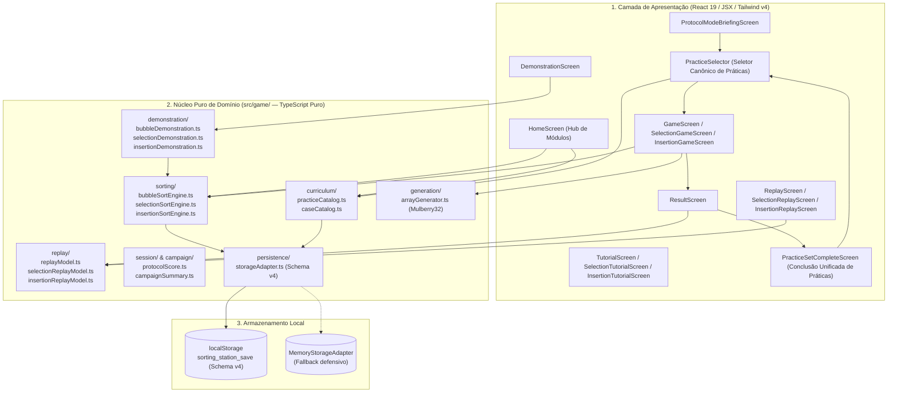

# Sorting Station – Sumário Operacional da Plataforma

> **Status da Documentação:** Ativo / Canônico  
> **Data da Última Revisão:** 16/11/2026 (Marco UX-REDESIGN-R3-A: Hardening do Bubble V2 + Kit de Validação Formativa com Usuários)  
> **Governança:** [`AGENTS.md`](../../AGENTS.md), [`ADR 0018`](../adr/0018-game-to-educational-platform-transition.md), [`ADR 0025`](../adr/0025-curriculum-practice-differentiation-and-transversal-model.md), [`ADR 0026`](../adr/0026-algorithm-case-architecture-and-activity-context.md) e [`ADR 0027`](../adr/0027-educational-and-ui-experience-redesign-v2.md).  
> 
> *Este documento é o ponto de entrada operacional e mapa de navegação canônico da Wiki. Ele não substitui a leitura das páginas temáticas detalhadas correspondentes ao escopo da tarefa.*

---

## 1. O que é o Sorting Station hoje?

O **Sorting Station** é uma **plataforma educacional interativa e gamificada para aprendizagem, prática e visualização de algoritmos de ordenação**.

A aplicação opera como uma Single Page Application (SPA) client-side desenvolvida em React 19, TypeScript e Tailwind CSS v4, executada no ecossistema Vite 8 dentro da sandbox do Figma Make.

A identidade de **Central Logística Espacial/Industrial** permanece como metáfora visual de engajamento e camada de gamificação (cargas numeradas, esteiras mecânicas, operadores de triagem, badges de invariantes, pontuação do protocolo e desafios). O produto **não é mais arquitetado nem documentado primordialmente como um jogo com fases**, mas sim como uma plataforma de ensino estruturada em **Módulos de Algoritmo** e **Exercícios**.

---

## 2. Qual é o objetivo educacional?

O objetivo pedagógico central é **ensinar e consolidar a compreensão de algoritmos de ordenação por meio de manipulação cinestésica direta governada por Máquinas de Estados Finitas (FSMs) estritas**, superando a passividade de meras animações automáticas.

A plataforma articula continuamente a tríade cognitiva:
1. **Ação do Estudante:** Tomada de decisão lógica reflexiva nas botoeiras contextuais (`SWAP`/`KEEP` ou `INSPECT`/`COMMIT`);
2. **Representação Visual Concreta:** Cargas numeradas deslizando sobre esteiras com papéis semânticos explícitos (`BoxRole`);
3. **Ancoragem Formal em Pseudocódigo:** Destaque determinístico sincronizado linha a linha em tempo real.

O sistema enfatiza o feedback formativo, imediato e não punitivo: decisões incorretas paralisam a esteira e explicam a invariante violada sem reiniciar ou punir o estudante. O tempo de execução do usuário é estritamente descritivo e tem peso zero na avaliação.

---

## 3. Quais módulos curriculares existem?

A plataforma possui um currículo oficial congelado em **6 Módulos de Algoritmos de Ordenação**:

1. **Bubble Sort:** Ordenação por comparações e trocas locais entre elementos adjacentes;
2. **Selection Sort:** Ordenação por seleção sequencial do menor elemento via varredura com scanner e permuta única por passada;
3. **Insertion Sort:** Ordenação incremental por elevação de chave e deslocamentos regressivos (*shifts*) em partição ordenada à esquerda;
4. **Merge Sort:** Ordenação por divisão binária recursiva e intercalação ordenada com dois ponteiros;
5. **Quick Sort:** Ordenação por particionamento em torno de um pivô (Lomuto/Hoare) e recursão sobre partições independentes;
6. **Heap Sort:** Ordenação in-place por construção de árvore Max-Heap e repetidos afundamentos (*sift-down*) após extração da raiz.

---

## 4. Qual o status factual de cada módulo?

| Módulo Curricular | Status Factual | Implementação no Código | Documentação Canônica |
| :--- | :---: | :--- | :--- |
| **01. Bubble Sort** | `PILOTO IMPLEMENTADO E TECNICAMENTE VALIDADO (AGUARDANDO VALIDAÇÃO FORMATIVA COM USUÁRIOS) — UX-REDESIGN-R3-A` | Experiência integral V2 ativa e endurecida: Visão Geral límpida (`BubbleModuleOverviewV2.tsx`), Tutorial em 4 passos com checkpoint de predição ativa (`BubbleTutorialScreenV2.tsx`), Prática Ativa com botões simétricos de ação, checkpoint pré-ação e micro-checagem pós-passada sem poluição no cabeçalho (`BubbleGameScreenV2.tsx`), Dica discretamente acessível na área de decisão (Nível 2), gaveta retrátil contendo estritamente detalhes técnicos e condição formal (Nível 3), Resultado V2 com descoberta e micro-reflexão conceitual (`BubbleResultScreenV2.tsx`), instrumentação local não invasiva via `?uxTest=1` e protocolo formativo em [`bubble-v2-formative-evaluation.md`](./bubble-v2-formative-evaluation.md). Engine pura (`bubbleSortEngine.ts`) e persistência Schema v4 $100\%$ preservadas. | [`modules/bubble-sort.md`](./modules/bubble-sort.md) |
| **02. Selection Sort** | `IMPLEMENTADO, DIFERENCIADO, SCAFFOLDING FADING INTEGRADO E CASO-PILOTO HOMOLOGADO (LEARNING-R3-A)` | Engine pura (`selectionSortEngine.ts`), FSM bimodal `INSPECT`/`COMMIT`, constraints procedurais enriquecidas com Scaffolding Fading ativo (`basic`: Suporte Completo; `intermediate`: Suporte Reduzido; `advanced`: Autonomia Máxima), briefing oficial, tutorial guiado (`[4, 1, 3]`), demonstração autônoma, Seletor de Práticas (`PracticeSelector`), Caso do Algoritmo piloto integrado e homologado (`selection.case.already-sorted`: `[10, 20, 30, 40, 50]` evidenciando 10 comparações e 0 trocas), reflexão factual de insensibilidade assintótica em `ResultScreen`, replay com pseudocódigo sincronizado de 13 linhas, e conclusão via `PracticeSetCompleteScreen`. Persistido em Schema v4 (`selection.practice.*` e `selection.case.*`). | [`modules/selection-sort.md`](./modules/selection-sort.md) |
| **03. Insertion Sort** | `IMPLEMENTADO, DIFERENCIADO, SCAFFOLDING FADING INTEGRADO E CASO-PILOTO HOMOLOGADO (LEARNING-R3-A)` | Engine pura (`insertionSortEngine.ts`), FSM de deslocamentos (*shifts*), constraints procedurais enriquecidas com Scaffolding Fading ativo (`basic`: Suporte Completo; `intermediate`: Suporte Reduzido; `advanced`: Autonomia Máxima), briefing oficial, tutorial guiado (`[4, 2, 3]`), demonstração autônoma (`[6, 3, 5, 2, 7]`), Seletor de Práticas (`PracticeSelector`), Caso do Algoritmo piloto integrado e homologado (`insertion.case.nearly-sorted`: `[10, 20, 40, 30, 50]` com 5 comparações, 1 shift e 4 inserções diretas), reflexão factual de adaptabilidade assintótica $\Theta(n)$ em `ResultScreen`, `PracticeSetCompleteScreen`, replay retrospectivo puro (`insertionReplayModel.ts`), pseudocódigo sincronizado de 11 linhas, persistência Schema v4 e ativado publicamente no Hub. | [`modules/insertion-sort.md`](./modules/insertion-sort.md) |
| **04. Merge Sort** | `IMPLEMENTADO, INTEGRADO E REVISADO (P3.1-F / REVISÃO PEDAGÓGICA) — Nivelamento do Hub Validado` | Estação Desktop-First com área única de decisão (`MergeGameScreen.tsx`), botoeira de ação imediata (`1: ESCOLHER DA ESQUERDA`, `2: ESCOLHER DA DIREITA`, `3: COPIAR OS RESTANTES`), briefing progressivo em 3 etapas com detalhes secundários recolhíveis, dois grupos lado a lado sem caixas redundantes de confronto, destaque nítido nos ponteiros `p1` e `p2` sem ofuscamento, buffer temporário intermediário (`Vetor Auxiliar B`), esteira principal com legenda explícita `ORD` (ordenado localmente) vs `OK` (posição final consolidada), Seletor de Práticas (`PracticeSelector` com tema merge e 3 práticas $n=4, 5, 6$), `ResultScreen` com notas pedagógicas diretas, Replay retrospectivo puro (`mergeReplayModel.ts`, invariante $1+N$ quadros, histórico factual sem reexecução algorítmica, telemetria e pseudocódigo canônico de 30 linhas sincronizados em `MergeReplayScreen.tsx` e `MergeSortPseudocodePanel.tsx`), Tutorial guiado com FSM autônoma (`MergeTutorialScreen.tsx`), Modo Demonstração observacional com engine pura, Tela de Conclusão de Conjunto (`PracticeSetCompleteScreen.tsx`), persistência canônica Schema v4 em `saveData.modules["merge"]`, migração defensiva de saves e ativação pública com status `available` no Hub de Protocolos. Cartões do Hub equalizados por CSS Grid Subgrid (0px de desalinhamento em 1920×1080 e 1366×768). 535 testes verdes no Vitest (40 arquivos). | [`modules/merge-sort.md`](./modules/merge-sort.md) |
| **05. Quick Sort** | `INTERFACE DE PARTICIONAMENTO E PRÁTICAS ENTREGUES (P3.2-D)` | Estação desktop-first com área única de partição (`QuickGameScreen.tsx`), 4 regiões de Lomuto com tratamento gracioso de vazias, botoeira `GameButton` (`≤ MENOR OU IGUAL`, `> MAIOR`, `POSICIONAR PIVÔ`), desacoplamento estrito entre frame exibido e estado da engine, stepping acessível sob reduced motion, suporte a duplicatas, `PracticeSelector` e `ResultScreen` com 27 linhas de pseudocódigo canônico e telemetria factual Lomuto (`Escritas no Vetor`), 16 testes comportamentais completos (`quickPracticeFlow.test.tsx`), validação visual real em Chrome headless em 1366×768, 1920×1080 e 1280×650. Total de 598 testes verdes em 46 arquivos. Permanece indisponível no Hub público até o marco de ativação P3.2-F. | [`modules/quick-sort.md`](./modules/quick-sort.md) |
| **06. Heap Sort** | `FUTURO` | Especificação completa no Module Standard; código algorítmico não iniciado (Marco P3.3). | [`modules/heap-sort.md`](./modules/heap-sort.md) |

---

## 5. Qual o padrão obrigatório de módulo (Module Standard)?

Todo módulo curricular deve ser documentado de forma exaustiva seguindo o **Module Standard de 20 seções obrigatórias** formalizado em [`modules/README.md`](./modules/README.md):

1. **Identificação:** `moduleId`, nome canônico, status factual e ordem curricular;
2. **Objetivos de Aprendizagem:** Competências conceituais sem alegações empíricas não comprovadas;
3. **Modelo Mental do Algoritmo:** Metáfora visual coerente e analogia física na Central Logística;
4. **Operações Fundamentais:** Comparações $C(n)$ e movimentações $M(n)$ discriminadas por tipo;
5. **Mecânica Interativa Própria:** Botoeira contextual e modelo de manipulação singular daquele algoritmo;
6. **Pseudocódigo Canônico:** Texto formal em português estruturado com numeração de linhas;
7. **Métricas Factuais Adequadas:** Telemetria inerente e fórmula de pontuação ($100 - 10\times\text{erros} - 5\times\text{dicas}$);
8. **Demonstração:** Observação autônoma da execução perfeita sobre vetor curado fixo;
9. **Tutorial Guiado:** Prática passo a passo formativa com instruções atômicas;
10. **Tipos de Exercícios:** Mapeamento na taxonomia transversal de 8 tipos (A a H);
11. **Casos Curados do Algoritmo:** Conjuntos fixos pedagógicos para evidenciar propriedades específicas;
12. **Geração Procedural e Constraints:** Predicados matemáticos aplicados sobre o gerador PRNG Mulberry32 global;
13. **Feedback Formativo:** Explicações imediatas exibidas em `InstructionPanel` para cada violação de invariante;
14. **Dicas Pedagógicas:** Scaffolding cognitivo contextual;
15. **Resultado e Reflexão:** Apresentação factual pós-exercício;
16. **Replay Retrospectivo:** Derivação funcional de quadros a partir de `history` com pseudocódigo sincronizado;
17. **Persistência e Progresso:** Schema v3 atual e mapeamento conceitual no Schema v4;
18. **Acessibilidade:** Conformidade WCAG, navegação por teclado, anéis de foco e papéis semânticos `BoxRole`;
19. **Riscos Pedagógicos:** Armadilhas cognitivas e equívocos conceituais comuns dos estudantes;
20. **Relação com o Laboratório Comparativo:** Papel do algoritmo no futuro laboratório multi-algoritmo.

### Taxonomia Transversal de 8 Tipos de Exercícios
- **A. Introdução / Conceito:** Briefing preparatório do módulo;
- **B. Demonstração:** Observação passiva da execução autônoma perfeita com pseudocódigo;
- **C. Tutorial Guiado:** Prática assistida com vetor curto curado;
- **D. Prática Básica:** Exercícios procedurais com vetores pequenos ($n=4$);
- **E. Prática Progressiva:** Exercícios procedurais crescentes ($n=5, 6$);
- **F. Casos do Algoritmo:** Entradas curadas demonstrando comportamentos críticos (já ordenado, inverso, duplicados);
- **G. Desafio:** Variações e otimizações algorítmicas (ex.: Early Exit);
- **H. Prática Livre (Sandbox):** Entrada configurável pelo usuário (futuro).

---

## 6. Qual a arquitetura de software?

A arquitetura do Sorting Station é dividida em camadas rigorosamente desacopladas:

- **Isolamento Total:** As engines algorítmicas em `src/game/` não importam React, hooks ou JSX;
- **Máquinas de Estados Imutáveis:** Cada passo gera um novo estado congelado (`Object.freeze`);
- **Catálogo Curricular Unificado (`src/game/curriculum/`):** Define imutavelmente práticas (`basic`, `intermediate`, `advanced`) em `practiceCatalog.ts` e Casos do Algoritmo curados em `caseCatalog.ts`, estruturados sob a segregação canônica de `ActivityContext = 'practice' | 'case'`, com objetivos formativos explícitos e derivação dinâmica de desbloqueio orientada ao Schema v4;
- **Geração Procedural Universal:** Um único gerador PRNG Mulberry32 determinístico (`arrayGenerator.ts`) atende a todos os algoritmos através de constraints específicas. Casos do Algoritmo operam com zero PRNG sobre vetores estáticos curados;
- **Persistência Desacoplada:** Schema v4 implementado e ativo (`sorting_station_save`), orientado a módulos e conjuntos de exercícios (`exerciseSets`), acomodando práticas e casos sob a mesma política de retenção de recordes sem necessidade de Schema v5;
- **Padronização de Telas e Rolagem Vertical (Scrollable Screen Rule — PLATFORM-UI-H1):** Diretriz canônica eliminando `overflow-hidden` podador de viewports, adotando `min-h-screen`, `overflow-y-auto`, `overflow-x-hidden`, `justify-start` e `pb-16 sm:pb-24` em todas as telas com conteúdo dinâmico, dono único do scroll vertical e acessibilidade via `prefers-reduced-motion`;
- **Suíte de Testes Automatizados:** **Vitest** com **650 testes unitários** em 50 arquivos com 100% de aprovação.

---

## 7. Qual é a próxima prioridade de desenvolvimento?

Em resposta a testes informais com estudantes e professores que revelaram sobrecarga cognitiva, poluição visual e risco de "clique mecânico", a prioridade do projeto foi repactuada pelo marco **UX-REDESIGN-R1** e formalizada no [ADR 0027](../adr/0027-educational-and-ui-experience-redesign-v2.md) e na especificação canônica [`ux-redesign-v2.md`](./ux-redesign-v2.md).

> [!IMPORTANT]
> **CONGELAMENTO DE EXPANSÕES DE CONTEÚDO:**  
> A expansão de novos Casos do Algoritmo (LEARNING-R3-B/C), novos algoritmos (Merge Sort, Quick Sort, Heap Sort) e o Laboratório Comparativo estão **temporariamente CONGELADOS**. O foco absoluto é a simplificação radical da experiência visual e pedagógica dos 3 módulos fundamentais (**Bubble Sort**, **Selection Sort**, **Insertion Sort**).

A próxima prioridade oficial e imediata é:

> **Marco UX-REDESIGN-R2 — Bubble Sort como Piloto End-to-End do Redesign V2**  
> Implementação integral e validação da nova interface no módulo Bubble Sort: tela inicial do módulo enxuta, Tutorial e Demonstração focados na mecânica elementar, gameplay com Regra de Ouro (1 foco, 1 pergunta, 2 ações, <2s para decidir onde olhar), loop *Observe $\rightarrow$ Preveja $\rightarrow$ Aja $\rightarrow$ Compreenda*, eliminação de telemetria em tempo real e tela de resultados causal/reflexiva.

---

## 8. O que é trabalho futuro?

1. **Ciclo de Redesenho da Experiência e Interface (UX-REDESIGN — Prioridade Atual):**
   - **UX-REDESIGN-R1:** `CONCLUÍDO` — Auditoria completa de poluição visual, definição da hierarquia em 3 níveis, wireframes canônicos em 9 estados, especificação do modelo de aprendizagem ativa e ADR 0027;
   - **UX-REDESIGN-R2:** `EM EXECUÇÃO` — Piloto End-to-End no Bubble Sort (Overview do módulo, Tutorial V2, Prática Básica V2, Feedback causal e Resultado reflexivo);
   - **UX-REDESIGN-R3:** Refinamento e Avaliação do Piloto Bubble Sort com testes de usuários (ajustes antes de propagar);
   - **UX-REDESIGN-R4:** Extensão do Redesign ao Selection Sort (foco visual no scanner de mínimo, destaque persistente do candidato);
   - **UX-REDESIGN-R5:** Extensão do Redesign ao Insertion Sort (destaque claro da chave, visualização limpa do subarray ordenado e deslocamentos);
   - **UX-REDESIGN-R6:** Harmonização Global da HomeScreen, Seletor Canônico, Modo Demonstração e Replays;
   - **UX-REDESIGN-R7:** Avaliação com Usuários Reais, testes de regressão transversal e descongelamento planejado.
2. **Expansões Pedagógicas Congeladas (Retomada após validação do UX-REDESIGN):**
   - Casos do Algoritmo restantes (LEARNING-R3-B/C — 12 casos estáticos curados e duplicatas visuais $30a/30b$);
   - Desafios de Early Exit e Prática Livre Sandbox (LEARNING-R4 a R7).
3. **Módulos Avançados Congelados:**
   - Merge Sort (P3.1), Quick Sort (P3.2-E/F), Heap Sort (P3.3);
   - Laboratório Comparativo (P3.4 — bloqueado até validação e conclusão dos 6 módulos).
4. **Avaliação Acadêmica e Artigo Científico:**
   - Marco P3.5: Avaliação metodológica formal em turmas reais de Ciência da Computação / Engenharia de Software.

---

## 9. Onde encontrar cada informação na Wiki?

| Preciso saber sobre... | Documento Canônico de Referência |
| :--- | :--- |
| **Regras mandatórias e restrições do agente** | [`AGENTS.md`](../../AGENTS.md) |
| **Redesenho Integral de Experiência e Interface V2** | [`ux-redesign-v2.md`](./ux-redesign-v2.md) |
| **Decisão Arquitetural do Redesign V2 (ADR 0027)** | [`docs/adr/0027-educational-and-ui-experience-redesign-v2.md`](../adr/0027-educational-and-ui-experience-redesign-v2.md) |
| **Visão oficial do produto e princípios** | [`01-product-vision.md`](./01-product-vision.md) |
| **Arquitetura de software e roteamento de telas** | [`02-system-architecture.md`](./02-system-architecture.md) |
| **Front-end, componentes visuais e props** | [`03-frontend.md`](./03-frontend.md) |
| **Engines puras de ordenação e FSMs** | [`04-sorting-engine.md`](./04-sorting-engine.md) |
| **Design System, tokens e acessibilidade** | [`05-ux-design-system.md`](./05-ux-design-system.md) |
| **Ambiente Figma Make e scripts operacionais** | [`06-development-environment.md`](./06-development-environment.md) |
| **Persistência Schema v4 e migração v3->v4** | [`07-backend-and-persistence.md`](./07-backend-and-persistence.md) |
| **Suíte de testes Vitest (657 testes) e DoD** | [`08-testing-and-quality.md`](./08-testing-and-quality.md) |
| **Build, deploy e empacotamento** | [`09-build-deploy.md`](./09-build-deploy.md) |
| **Roadmap canônico da plataforma e legado histórico** | [`10-roadmap.md`](./10-roadmap.md) |
| **Governança de ADRs e índice de decisões 0001 a 0027** | [`11-architecture-decisions.md`](./11-architecture-decisions.md) |
| **Pedagogia, rigor ético e diretrizes para o artigo** | [`12-pedagogy-and-academic-traceability.md`](./12-pedagogy-and-academic-traceability.md) |
| **Expansão pedagógica dos 3 módulos (LEARNING-R1 a R3-A)** | [`learning-experience-expansion.md`](./learning-experience-expansion.md) |
| **Padrão transversal de módulo e taxonomia de exercícios**| [`modules/README.md`](./modules/README.md) |
| **Módulo 01: Bubble Sort** | [`modules/bubble-sort.md`](./modules/bubble-sort.md) |
| **Módulo 02: Selection Sort** | [`modules/selection-sort.md`](./modules/selection-sort.md) |
| **Módulo 03: Insertion Sort** | [`modules/insertion-sort.md`](./modules/insertion-sort.md) |
| **Módulo 04: Merge Sort** | [`modules/merge-sort.md`](./modules/merge-sort.md) |
| **Módulo 05: Quick Sort** | [`modules/quick-sort.md`](./modules/quick-sort.md) |
| **Módulo 06: Heap Sort** | [`modules/heap-sort.md`](./modules/heap-sort.md) |
| **Especificação do Laboratório Comparativo** | [`comparison-lab.md`](./comparison-lab.md) |
| **Roteiro manual de testes e homologação QA** | [`qa-gameplay-checklist.md`](./qa-gameplay-checklist.md) |

---

## 10. Protocolo Obrigatório de Agentes (Preflight & Postflight)

Todo agente trabalhando no repositório Sorting Station deve cumprir integralmente o seguinte fluxo inegociável:

1. **Preflight:** Ler `AGENTS.md` $\rightarrow$ Ler `docs/wiki/SUMMARY.md` $\rightarrow$ Ler a página específica do tema $\rightarrow$ Ler ADRs relacionados $\rightarrow$ Confirmar no código o estado fático antes de qualquer alteração;
2. **Execução:** Não alterar código ou documentação sem aderência estrita às regras;
3. **Postflight:** Toda tarefa que altere comportamento, arquitetura, design system ou dependências DEVE atualizar a Wiki e o `SUMMARY.md` antes de ser considerada concluída.
