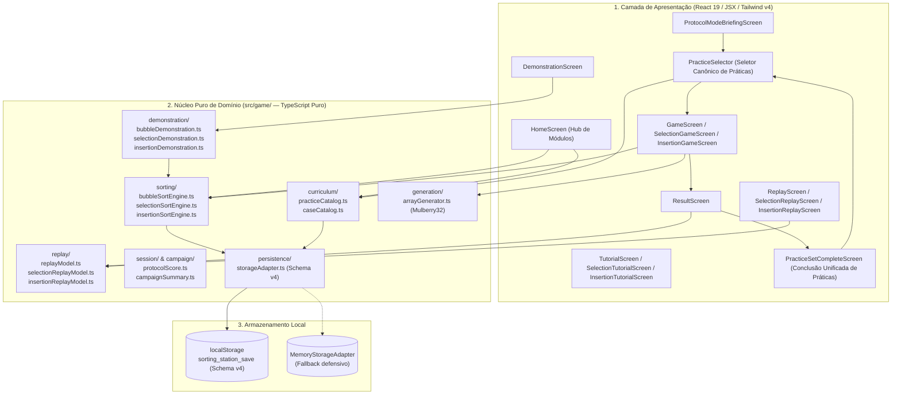

# Sorting Station – Sumário Operacional da Plataforma

> **Status da Documentação:** Ativo / Canônico  
> **Data da Última Revisão:** 24/11/2026 (Marco UX-REDESIGN-R3-B.1: Revisão Metodológica Pré-Campo do Protocolo Formativo Multi-Módulo — Status `PREPARADO`)  
> **Governança:** [`AGENTS.md`](../../AGENTS.md), [`ADR 0018`](../adr/0018-game-to-educational-platform-transition.md), [`ADR 0025`](../adr/0025-curriculum-practice-differentiation-and-transversal-model.md), [`ADR 0026`](../adr/0026-algorithm-case-architecture-and-activity-context.md), [`ADR 0027`](../adr/0027-educational-and-ui-experience-redesign-v2.md), [`ADR 0028`](../adr/0028-home-redesign-ux-home-r1.md) e [`ADR 0029`](../adr/0029-visual-educational-launcher-ux-home-r2.md).  
> 
> *Este documento é o ponto de entrada operacional e mapa de navegação canônico da Wiki. Ele não substitui a leitura das páginas temáticas detalhadas correspondentes ao escopo da tarefa.*

---

## 1. O que é o Sorting Station hoje?

O **Sorting Station** é uma **plataforma educacional interativa e gamificada para aprendizagem, prática e visualização de algoritmos de ordenação**.

A aplicação opera como uma Single Page Application (SPA) client-side desenvolvida em React 19, TypeScript e Tailwind CSS v4, executada no ecossistema Vite 8 dentro da sandbox do Figma Make.

A identidade de **Central Logística Espacial/Industrial** permanece como metáfora visual de engajamento e camada de gamificação (cargas numeradas, esteiras mecânicas, operadores de triagem, badges de invariantes, pontuação do protocolo e desafios). O produto **não é mais arquitetado nem documentado primordialmente como um jogo com fases**, mas sim como uma plataforma de ensino estruturada em **Módulos de Algoritmo** e **Exercícios**.

---

## 2. Qual é o objetivo educacional?

O objetivo pedagógico central é **ensinar e consolidar a compreensão de algoritmos de ordenação por meio de manipulação cinestésica direta governada por Máquinas de Estados Finitas (FSMs) estritas**, superando a passividade de meras animações automáticas.

A plataforma articula continuamente a tríade cognitiva:
1. **Ação do Estudante:** Tomada de decisão lógica reflexiva nas botoeiras contextuais (`SWAP`/`KEEP` ou `INSPECT`/`COMMIT`);
2. **Representação Visual Concreta:** Cargas numeradas deslizando sobre esteiras com papéis semânticos explícitos (`BoxRole`);
3. **Ancoragem Formal em Pseudocódigo:** Destaque determinístico sincronizado linha a linha em tempo real.

O sistema enfatiza o feedback formativo, imediato e não punitivo: decisões incorretas paralisam a esteira e explicam a invariante violada sem reiniciar ou punir o estudante. O tempo de execução do usuário é estritamente descritivo e tem peso zero na avaliação.

---

## 3. Quais módulos curriculares existem?

A plataforma possui um currículo oficial congelado em **6 Módulos de Algoritmos de Ordenação**:

1. **Bubble Sort:** Ordenação por comparações e trocas locais entre elementos adjacentes;
2. **Selection Sort:** Ordenação por seleção sequencial do menor elemento via varredura com scanner e permuta única por passada;
3. **Insertion Sort:** Ordenação incremental por elevação de chave e deslocamentos regressivos (*shifts*) em partição ordenada à esquerda;
4. **Merge Sort:** Ordenação por divisão binária recursiva e intercalação ordenada com dois ponteiros;
5. **Quick Sort:** Ordenação por particionamento em torno de um pivô (Lomuto/Hoare) e recursão sobre partições independentes;
6. **Heap Sort:** Ordenação in-place por construção de árvore Max-Heap e repetidos afundamentos (*sift-down*) após extração da raiz.

---

## 4. Qual o status factual de cada módulo?

| Módulo Curricular | Status Factual | Implementação no Código | Documentação Canônica |
| :--- | :---: | :--- | :--- |
| **01. Bubble Sort** | `MÓDULO CENTRAL ESTABILIZADO E CONSOLIDADO (UX-PRACTICE-R3.2); SCAFFOLDING FADING PRESERVADO` | Introdução Visual-First harmonizada via `LearningModuleOverviewLayout.tsx` (`BubbleModuleOverviewV2.tsx`) sob o tema azul, demonstrador `[8, 3]`, tríade `COMPARE / DECIDA / AVANCE`, Tutorial V2 com predição ativa e Prática Básica V2 (`BubbleGameScreenV2.tsx`) restrita estritamente ao nível `basic` regular: retorno padronizado `[ ← Práticas ]` ao `PracticeSelector`, botoeira neutra simétrica `[1] TROCAR / [2] MANTER`, dica reflexiva sem gabarito, checkpoint pós-1ª passada determinístico (`buildBubblePassCheckpointOptions`), Single Scroll Owner (`0` scrollers verticais internos), gaveta `
` `Aprofundamento técnico` com 9 linhas canônicas de `BUBBLE_SORT_PSEUDOCODE` e `BubbleResultScreenV2` exibindo `PONTUAÇÃO DO PROTOCOLO`, erros, dicas utilizadas, recorde, replay e avanço curricular. Práticas Intermediária (`SUPORTE REDUZIDO`, $n=5$), Avançada (`AUTONOMIA MÁXIMA`, $n=6$), Caso-piloto (`bubble.case.nearly-sorted`) e Desafio Early Exit operam integralmente em `GameScreen` e `ResultScreen` canônicas com *Scaffolding Fading* e Schema v4 preservados. | [`modules/bubble-sort.md`](./modules/bubble-sort.md) |
| **02. Selection Sort** | `MÓDULO CENTRAL ESTABILIZADO E CONSOLIDADO (UX-PRACTICE-R3.2); SCAFFOLDING FADING PRESERVADO` | Introdução Visual-First harmonizada (`SelectionModuleOverviewV2.tsx`) sobre `[4, 1, 3]` (`PROCURE / LEMBRE O MENOR / POSICIONE`, `PROCURAR ≠ MOVER`), Tutorial V2 e Prática Básica V2 (`SelectionGameScreenV2.tsx`) consolidados em `UX-PRACTICE-R3.2`: retorno `[ ← Práticas ]` ao `PracticeSelector`, esteira estática em busca sem métricas ao vivo no Nível 1, botoeira neutra `[1] Sim / [2] Não`, dica subordinada `100%` legível sem corte em `1366×768` e `1280×650` (`SelectionDecisionControls.tsx`), checkpoint pré-commit sem spoiler/ordenação fixa (`SelectionCommitCheckpoint.tsx`), transição única direta `Prática → ResultScreen` (sem dupla confirmação) e `
` `Aprofundamento técnico` com 13 linhas oficiais de `SELECTION_SORT_PSEUDOCODE`. Práticas Intermediária (`reduced`), Avançada (`minimal`), Caso-piloto (`selection.case.already-sorted`), Replay e Schema v4 intactos. | [`modules/selection-sort.md`](./modules/selection-sort.md) |
| **03. Insertion Sort** | `MÓDULO CENTRAL ESTABILIZADO E CONSOLIDADO (UX-PRACTICE-R3.2); SCAFFOLDING FADING PRESERVADO` | Introdução Visual-First harmonizada (`InsertionModuleOverviewV2.tsx`) sobre `[2, 5, 3]` (`PEGUE / ABRA ESPAÇO / ENCAIXE`, `DESLOCAR ≠ TROCAR`), Tutorial V2 e Prática Básica V2 (`InsertionGameScreenV2.tsx`) consolidados em `UX-PRACTICE-R3.2`: retorno padronizado `[ ← Práticas ]` ao `PracticeSelector` do Insertion (nunca enviando inesperadamente à Home), responsividade por altura de viewport (`100%` visível em `1366×768` e `1280×650`), `#1..#4` ocultos por padrão no Nível 1 e preservados em `aria-label`/`.sr-only`, invariante `ORD LOCAL ≠ OK DEFINITIVO`, reset completo de `hintsUsed`/erros, transição única direta `Prática → ResultScreen` (sem dupla confirmação) e `
` `Aprofundamento técnico` com 11 linhas oficiais de `INSERTION_SORT_PSEUDOCODE`. Práticas Intermediária (`reduced`), Avançada (`minimal`), Caso-piloto (`insertion.case.nearly-sorted`), Replay e Schema v4 intactos. | [`modules/insertion-sort.md`](./modules/insertion-sort.md) |
| **04. Merge Sort** | `IMPLEMENTADO, INTEGRADO E REVISADO (P3.1-F / REVISÃO PEDAGÓGICA) — Nivelamento do Hub Validado` | Estação Desktop-First com área única de decisão (`MergeGameScreen.tsx`), botoeira de ação imediata (`1: ESCOLHER DA ESQUERDA`, `2: ESCOLHER DA DIREITA`, `3: COPIAR OS RESTANTES`), briefing progressivo em 3 etapas com detalhes secundários recolhíveis, dois grupos lado a lado sem caixas redundantes de confronto, destaque nítido nos ponteiros `p1` e `p2` sem ofuscamento, buffer temporário intermediário (`Vetor Auxiliar B`), esteira principal com legenda explícita `ORD` (ordenado localmente) vs `OK` (posição final consolidada), Seletor de Práticas (`PracticeSelector` com tema merge e 3 práticas $n=4, 5, 6$), `ResultScreen` com notas pedagógicas diretas, Replay retrospectivo puro (`mergeReplayModel.ts`, invariante $1+N$ quadros, histórico factual sem reexecução algorítmica, telemetria e pseudocódigo canônico de 30 linhas sincronizados em `MergeReplayScreen.tsx` e `MergeSortPseudocodePanel.tsx`), Tutorial guiado com FSM autônoma (`MergeTutorialScreen.tsx`), Modo Demonstração observacional com engine pura, Tela de Conclusão de Conjunto (`PracticeSetCompleteScreen.tsx`), persistência canônica Schema v4 em `saveData.modules["merge"]`, migração defensiva de saves e ativação pública com status `available` no Hub de Protocolos. Cartões do Hub equalizados por CSS Grid Subgrid (0px de desalinhamento em 1920×1080 e 1366×768). 535 testes verdes no Vitest (40 arquivos). | [`modules/merge-sort.md`](./modules/merge-sort.md) |
| **05. Quick Sort** | `INTERFACE DE PARTICIONAMENTO E PRÁTICAS ENTREGUES (P3.2-D)` | Estação desktop-first com área única de partição (`QuickGameScreen.tsx`), 4 regiões de Lomuto com tratamento gracioso de vazias, botoeira `GameButton` (`≤ MENOR OU IGUAL`, `> MAIOR`, `POSICIONAR PIVÔ`), desacoplamento estrito entre frame exibido e estado da engine, stepping acessível sob reduced motion, suporte a duplicatas, `PracticeSelector` e `ResultScreen` com 27 linhas de pseudocódigo canônico e telemetria factual Lomuto (`Escritas no Vetor`), 16 testes comportamentais completos (`quickPracticeFlow.test.tsx`), validação visual real em Chrome headless em 1366×768, 1920×1080 e 1280×650. Total de 598 testes verdes em 46 arquivos. Permanece indisponível no Hub público até o marco de ativação P3.2-F. | [`modules/quick-sort.md`](./modules/quick-sort.md) |
| **06. Heap Sort** | `FUTURO` | Especificação completa no Module Standard; código algorítmico não iniciado (Marco P3.3). | [`modules/heap-sort.md`](./modules/heap-sort.md) |

---

## 5. Qual o padrão obrigatório de módulo (Module Standard)?

Todo módulo curricular deve ser documentado de forma exaustiva seguindo o **Module Standard de 20 seções obrigatórias** formalizado em [`modules/README.md`](./modules/README.md):

1. **Identificação:** `moduleId`, nome canônico, status factual e ordem curricular;
2. **Objetivos de Aprendizagem:** Competências conceituais sem alegações empíricas não comprovadas;
3. **Modelo Mental do Algoritmo:** Metáfora visual coerente e analogia física na Central Logística;
4. **Operações Fundamentais:** Comparações $C(n)$ e movimentações $M(n)$ discriminadas por tipo;
5. **Mecânica Interativa Própria:** Botoeira contextual e modelo de manipulação singular daquele algoritmo;
6. **Pseudocódigo Canônico:** Texto formal em português estruturado com numeração de linhas;
7. **Métricas Factuais Adequadas:** Telemetria inerente e fórmula de pontuação ($100 - 10\times\text{erros} - 5\times\text{dicas}$);
8. **Demonstração:** Observação autônoma da execução perfeita sobre vetor curado fixo;
9. **Tutorial Guiado:** Prática passo a passo formativa com instruções atômicas;
10. **Tipos de Exercícios:** Mapeamento na taxonomia transversal de 8 tipos (A a H);
11. **Casos Curados do Algoritmo:** Conjuntos fixos pedagógicos para evidenciar propriedades específicas;
12. **Geração Procedural e Constraints:** Predicados matemáticos aplicados sobre o gerador PRNG Mulberry32 global;
13. **Feedback Formativo:** Explicações imediatas exibidas em `InstructionPanel` para cada violação de invariante;
14. **Dicas Pedagógicas:** Scaffolding cognitivo contextual;
15. **Resultado e Reflexão:** Apresentação factual pós-exercício;
16. **Replay Retrospectivo:** Derivação funcional de quadros a partir de `history` com pseudocódigo sincronizado;
17. **Persistência e Progresso:** Schema v3 atual e mapeamento conceitual no Schema v4;
18. **Acessibilidade:** Conformidade WCAG, navegação por teclado, anéis de foco e papéis semânticos `BoxRole`;
19. **Riscos Pedagógicos:** Armadilhas cognitivas e equívocos conceituais comuns dos estudantes;
20. **Relação com o Laboratório Comparativo:** Papel do algoritmo no futuro laboratório multi-algoritmo.

### Taxonomia Transversal de 8 Tipos de Exercícios
- **A. Introdução / Conceito:** Briefing preparatório do módulo;
- **B. Demonstração:** Observação passiva da execução autônoma perfeita com pseudocódigo;
- **C. Tutorial Guiado:** Prática assistida com vetor curto curado;
- **D. Prática Básica:** Exercícios procedurais com vetores pequenos ($n=4$);
- **E. Prática Progressiva:** Exercícios procedurais crescentes ($n=5, 6$);
- **F. Casos do Algoritmo:** Entradas curadas demonstrando comportamentos críticos (já ordenado, inverso, duplicados);
- **G. Desafio:** Variações e otimizações algorítmicas (ex.: Early Exit);
- **H. Prática Livre (Sandbox):** Entrada configurável pelo usuário (futuro).

---

## 6. Qual a arquitetura de software?

A arquitetura do Sorting Station é dividida em camadas rigorosamente desacopladas:

- **Isolamento Total:** As engines algorítmicas em `src/game/` não importam React, hooks ou JSX;
- **Máquinas de Estados Imutáveis:** Cada passo gera um novo estado congelado (`Object.freeze`);
- **Catálogo Curricular Unificado (`src/game/curriculum/`):** Define imutavelmente práticas (`basic`, `intermediate`, `advanced`) em `practiceCatalog.ts` e Casos do Algoritmo curados em `caseCatalog.ts`, estruturados sob a segregação canônica de `ActivityContext = 'practice' | 'case'`, com objetivos formativos explícitos e derivação dinâmica de desbloqueio orientada ao Schema v4;
- **Geração Procedural Universal:** Um único gerador PRNG Mulberry32 determinístico (`arrayGenerator.ts`) atende a todos os algoritmos através de constraints específicas. Casos do Algoritmo operam com zero PRNG sobre vetores estáticos curados;
- **Persistência Desacoplada:** Schema v4 implementado e ativo (`sorting_station_save`), orientado a módulos e conjuntos de exercícios (`exerciseSets`), acomodando práticas e casos sob a mesma política de retenção de recordes sem necessidade de Schema v5;
- **Padronização de Telas e Rolagem Vertical (Scrollable Screen Rule — PLATFORM-UI-H1):** Diretriz canônica eliminando `overflow-hidden` podador de viewports, adotando `min-h-screen`, `overflow-y-auto`, `overflow-x-hidden`, `justify-start` e `pb-16 sm:pb-24` em todas as telas com conteúdo dinâmico, dono único do scroll vertical e acessibilidade via `prefers-reduced-motion`;
- **Suíte de Testes Automatizados:** **Vitest** com **745 testes automatizados** em 60 arquivos com 100% de aprovação.

---

## 7. Qual é a próxima prioridade de desenvolvimento?

Em resposta a testes informais com estudantes e professores que revelaram sobrecarga cognitiva, poluição visual e risco de "clique mecânico", a prioridade do projeto foi repactuada pelo marco **UX-REDESIGN-R1** e formalizada no [ADR 0027](../adr/0027-educational-and-ui-experience-redesign-v2.md) e na especificação canônica [`ux-redesign-v2.md`](./ux-redesign-v2.md).

> [!IMPORTANT]
> **CONGELAMENTO DE EXPANSÕES DE CONTEÚDO:**  
> A expansão de novos Casos do Algoritmo (LEARNING-R3-B/C), novos algoritmos (Merge Sort, Quick Sort, Heap Sort) e o Laboratório Comparativo estão **temporariamente CONGELADOS**. O foco absoluto é a simplificação radical da experiência visual e pedagógica dos 3 módulos fundamentais (**Bubble Sort**, **Selection Sort**, **Insertion Sort**).

A próxima prioridade oficial e imediata é:

> **Aplicação Presencial e Análise Empírica da Avaliação Formativa Multi-Módulo (`UX-REDESIGN-R3-B`: transição `PREPARADO` $\rightarrow$ `APLICADO` $\rightarrow$ `ANALISADO`)**  
> Com o protocolo unificado ([`bubble-v2-formative-evaluation.md`](./bubble-v2-formative-evaluation.md)) e o kit operacional `Itens A a K` ([`evaluation/README.md`](./evaluation/README.md)) integralmente **`PREPARADOS`**, a próxima etapa consiste na verificação ética institucional aplicável, condução presencial contrabalanceada (`O1..O6`) sobre as Práticas Básicas estabilizadas de Bubble, Selection e Insertion Sort e codificação pela rubrica `0–3`.

---

## 8. O que é trabalho futuro?

1. **Ciclo de Redesenho da Experiência e Interface (UX-REDESIGN — Prioridade Atual):**
   - **UX-REDESIGN-R1:** `CONCLUÍDO` — Auditoria completa de poluição visual, definição da hierarquia em 3 níveis, wireframes canônicos em 9 estados, especificação do modelo de aprendizagem ativa e ADR 0027;
   - **UX-REDESIGN-R2:** `CONCLUÍDO (VALIDADO TECNICAMENTE)` — Piloto End-to-End no Bubble Sort (Overview do módulo, Tutorial V2, Prática Básica V2, Feedback causal e Resultado reflexivo);
   - **UX-REDESIGN-R3-A:** `CONCLUÍDO` — Hardening do Bubble V2 + Kit de Validação Formativa com Usuários;
   - **UX-HOME-R1:** `CONCLUÍDO` — Redesign da Tela Inicial / Menu Principal da Plataforma (Hero educacional, guia de 3 passos, card de retomada condicional, catálogo de módulos com subgrid alinhado e ADR 0028);
   - **UX-HOME-R2:** `CONCLUÍDO` — Launcher Educacional Visual (Redesign radical da Home: cabeçalho enxuto com subtítulo em 1 linha, faixa minimalista de 3 passos, catálogo estrito aos 3 módulos ativos Bubble/Selection/Insertion com mini visual da mecânica, indicador de 3 pontos, CTA único COMEÇAR/CONTINUAR, ausência de Merge da Home e ADR 0029);
   - **UX-HOME-R2.1:** `CONCLUÍDO` — Hardening Final do Launcher Educacional (Eliminação de resíduos de "phase", adoção de `completedPractices`, microcopy natural de retomada sem emojis, acessibilidade via `aria-label`, enquadramento da "Regra dos 5 Segundos" estritamente como meta heurística e congelamento para testes);
   - **UX-MODULE-R1:** `CONCLUÍDO` — Insertion Sort Visual-First (Redesign radical da introdução do módulo com micro-exemplo tridimensional `[2, 5, 3]` em 3 passos, frase-resumo, CTA primário dominante e zero jargão na camada inicial);
   - **UX-MODULE-R1.1:** `CONCLUÍDO` — Hardening Conceitual e de Navegação da Introdução Visual do Insertion Sort (Fonte única da verdade em 11 linhas de pseudocódigo canônico de `insertionPseudocode.ts`, complexidade assintótica exata $\Theta(n)$/$\Theta(n^2)$/$\Theta(1)$, rota secundária única sob o CTA, demonstração livre subordinada aos detalhes técnicos, poda de badges redundantes e explicitação de `ORD`);
   - **UX-MODULE-R2:** `CONCLUÍDO` — Selection Sort Visual-First (Redesign da introdução do módulo com modelo mental de scanner e menor candidato, exemplo hero central `[4, 1, 3]` em 3 passos com stepper interativo, banner com a regra fundamental `PROCURAR ≠ MOVER: Durante a busca, nada troca de lugar.`, ausência de formalismos na camada primária, CTA primário dominante com rota secundária única sob demanda e accordion técnico com 13 linhas canônicas de `SELECTION_SORT_PSEUDOCODE` e $\Theta(n^2)$ comparações; 54 arquivos e 700 testes verdes);
   - **UX-MODULE-R2.1:** `CONCLUÍDO` — Hardening Metodológico e Conceitual do Selection Sort Visual-First (Diferenciação epistemológica estrita entre propriedades matemáticas $\Theta(n^2)$ e $\le n-1$ trocas físicas com 0 trocas se já ordenado, hipóteses de design instrucional e observações formativas com usuários; eliminação de alegações presuntivas de "comprovação"; confirmação do pseudocódigo canônico de 13 instruções `SELECTION_SORT_PSEUDOCODE` como fonte única; estabilização conceitual da introdução);
   - **UX-MODULE-R3:** `CONCLUÍDO` — Harmonização Visual e Pedagógica dos 3 Módulos Centrais (Layout unificado `LearningModuleOverviewLayout.tsx`, demonstradores conceituais interativos com stepper [8, 3], [4, 1, 3] e [2, 5, 3], regras fundamentais em destaque, CTAs padronizados, gavetas técnicas sanfonadas Nível 3, 55 arquivos e 713 testes verdes);
   - **UX-PRACTICE-R1:** `CONCLUÍDO` — Selection Sort: Redesign Visual-First do Tutorial e da Prática Básica (Prática Básica com esteira estática durante INSPECT, predição inicial sobre [4, 1, 3], pergunta central dinâmica, botões neutros [1] e [2], checkpoint de pré-commit, feedback causal com foco preservado no scanner em erros, dica Nível 2 integrada, gaveta técnica retrátil Nível 3, 57 arquivos e 720 testes verdes);
   - **UX-PRACTICE-R1.1:** `CONCLUÍDO` — Selection Sort: Hardening Semântico e Visual da Prática Básica (Eliminação de "vagas" no Selection Sort em favor de "posição-alvo" / "próxima posição", regra da esteira de uma informação visual por papel, remoção de emojis de sistema nativos da UI, demarcação entre métricas de prática escolar e instrumentação UX; 57 arquivos e 721 testes verdes);
   - **UX-PRACTICE-R2:** `CONCLUÍDO` — Insertion Sort: Redesign Visual-First do Tutorial e da Prática Básica (Trilho aéreo suspenso para chave, vaga física transitória, deslocamento unilateral `SHIFT ≠ SWAP`, predição e checkpoint no tutorial, botoeira neutra e gaveta técnica Nível 3; 59 arquivos e 731 testes verdes);
   - **UX-PRACTICE-R2.1:** `CONCLUÍDO` — Insertion Sort: Hardening Conceitual e Redução de Ruído do Insertion V2 (Invariante `ORD LOCAL ≠ OK DEFINITIVO` sem cor verde prematura durante a ordenação ativa, eliminação de métricas concorrentes na área de decisão e limpeza visual de chave/vaga/scanner; 59 arquivos e 731 testes verdes);
   - **UX-PRACTICE-R3:** `CONCLUÍDO` — Auditoria Comparativa Visual, Funcional e Pedagógica das Três Práticas Básicas V2 (Inspeção de código + renderização real em Chrome Headless em 4 viewports, matriz diagnóstica priorizada `P-01` a `P-10` e roteiro de avaliação formativa comparativa em [`ux-practice-r3-comparative-audit.md`](./ux-practice-r3-comparative-audit.md));
   - **UX-PRACTICE-R3.1:** `CONCLUÍDO` — Correção de Defeitos Críticos e Vieses Pedagógicos nas Três Práticas Básicas (`P-01` a `P-07`, `P-09` e `P-10a/b` resolvidos; 59 arquivos e 736 testes verdes);
   - **UX-PRACTICE-R3.2:** `CONCLUÍDO` — Consolidação Final de Navegação, Progressão e Fluxos das Três Práticas Básicas (`P-08` e `P-10` integralmente resolvidos: `BubbleGameScreenV2` restrito à Prática Básica regular preservando *Scaffolding Fading* `reduced`/`minimal` nas demais práticas/casos/desafios; retorno `[ ← Práticas ]` padronizado nos 3 módulos; fluxo único `Prática → ResultScreen` sem dupla confirmação; Single Scroll Owner; dica do Selection `100%` legível em `1366×768`; e gaveta `Aprofundamento técnico` com 9, 13 e 11 linhas canônicas de pseudocódigo; 60 arquivos e 745 testes verdes);
   - **UX-REDESIGN-R3-B (Preparação):** `PREPARADO` *(Não Aplicado / Não Analisado — `0` participantes avaliados)* — Protocolo único evoluído em [`bubble-v2-formative-evaluation.md`](./bubble-v2-formative-evaluation.md) e kit operacional `Itens A a K` em [`evaluation/README.md`](./evaluation/README.md) (roteiro do moderador, 6 ordens `O1..O6`, Teste de 5 Segundos, *Think-Aloud*, perguntas pós-tarefa, rubrica `0–3`, tarefa de transferência sobre `[4, 1, 3, 2]`, separação `Fonte A / Fonte B / Fonte C`, auditoria e limitações de `?uxTest=1`, consentimento/privacidade, checklist técnico e CSVs vazios);
   - **UX-REDESIGN-R3-B.1 (Revisão Metodológica Pré-Campo):** `CONCLUÍDO` — Revisão estritamente documental pré-coleta: assimetria real nos 5 segundos explicitada (Bubble com previsão inicial vs. Selection/Insertion com decisão direta), sequência fixa sem improviso (`5s → Tutorial Guiado V2 obrigatório para todos → Prática Básica real → Justificativa verbal`), separação entre conhecimento prévio e justificativa/transferência situada, matriz de comparabilidade entre módulos, registro dos vetores procedurais reais, reconciliação inter-avaliadores na rubrica `0–3`, orçamento realista de `45–60 min` com micro-pausas, adaptações de acessibilidade, reset atômico `localStorage` + reload e *dry-run* simulado sem sujar os CSVs oficiais;
   - **UX-REDESIGN-R3-B (Campo e Análise):** `PENDENTE (ORIENTAÇÃO ÉTICA → RECRUTAMENTO → APLICADO → ANALISADO)` — Execução presencial com usuários reais somente após verificação ética institucional aplicável;
   - **UX-REDESIGN-R4 / R5:** Extensão do Redesign às etapas intermediárias/avançadas e casos de Selection e Insertion Sort;
   - **UX-REDESIGN-R6:** Harmonização Global do Seletor Canônico, Resultados, Modo Demonstração e Replays;
   - **UX-REDESIGN-R7:** Avaliação com Usuários Reais, testes de regressão transversal e descongelamento planejado.
2. **Expansões Pedagógicas Congeladas (Retomada após validação do UX-REDESIGN):**
   - Casos do Algoritmo restantes (LEARNING-R3-B/C — 12 casos estáticos curados e duplicatas visuais $30a/30b$);
   - Desafios de Early Exit e Prática Livre Sandbox (LEARNING-R4 a R7).
3. **Módulos Avançados Congelados:**
   - Merge Sort (P3.1), Quick Sort (P3.2-E/F), Heap Sort (P3.3);
   - Laboratório Comparativo (P3.4 — bloqueado até validação e conclusão dos 6 módulos).
4. **Avaliação Acadêmica e Artigo Científico:**
   - Marco P3.5: Avaliação metodológica formal em turmas reais de Ciência da Computação / Engenharia de Software.

---

## 9. Onde encontrar cada informação na Wiki?

| Preciso saber sobre... | Documento Canônico de Referência |
| :--- | :--- |
| **Regras mandatórias e restrições do agente** | [`AGENTS.md`](../../AGENTS.md) |
| **Redesenho Integral de Experiência e Interface V2** | [`ux-redesign-v2.md`](./ux-redesign-v2.md) |
| **Auditoria Comparativa das Três Práticas Básicas V2 (`UX-PRACTICE-R3`)** | [`ux-practice-r3-comparative-audit.md`](./ux-practice-r3-comparative-audit.md) |
| **Protocolo Consolidado de Avaliação Formativa (`UX-REDESIGN-R3-B` — `PREPARADO`)** | [`bubble-v2-formative-evaluation.md`](./bubble-v2-formative-evaluation.md) |
| **Kit Operacional `Itens A a K` (Roteiros, Fichas, Rubrica `0–3` e CSVs Vazios)** | [`evaluation/README.md`](./evaluation/README.md) |
| **Decisão Arquitetural do Redesign V2 (ADR 0027)** | [`docs/adr/0027-educational-and-ui-experience-redesign-v2.md`](../adr/0027-educational-and-ui-experience-redesign-v2.md) |
| **Visão oficial do produto e princípios** | [`01-product-vision.md`](./01-product-vision.md) |
| **Arquitetura de software e roteamento de telas** | [`02-system-architecture.md`](./02-system-architecture.md) |
| **Front-end, componentes visuais e props** | [`03-frontend.md`](./03-frontend.md) |
| **Engines puras de ordenação e FSMs** | [`04-sorting-engine.md`](./04-sorting-engine.md) |
| **Design System, tokens e acessibilidade** | [`05-ux-design-system.md`](./05-ux-design-system.md) |
| **Ambiente Figma Make e scripts operacionais** | [`06-development-environment.md`](./06-development-environment.md) |
| **Persistência Schema v4 e migração v3->v4** | [`07-backend-and-persistence.md`](./07-backend-and-persistence.md) |
| **Suíte de testes Vitest (745 testes) e DoD** | [`08-testing-and-quality.md`](./08-testing-and-quality.md) |
| **Build, deploy e empacotamento** | [`09-build-deploy.md`](./09-build-deploy.md) |
| **Roadmap canônico da plataforma e legado histórico** | [`10-roadmap.md`](./10-roadmap.md) |
| **Governança de ADRs e índice de decisões 0001 a 0027** | [`11-architecture-decisions.md`](./11-architecture-decisions.md) |
| **Pedagogia, rigor ético e diretrizes para o artigo** | [`12-pedagogy-and-academic-traceability.md`](./12-pedagogy-and-academic-traceability.md) |
| **Expansão pedagógica dos 3 módulos (LEARNING-R1 a R3-A)** | [`learning-experience-expansion.md`](./learning-experience-expansion.md) |
| **Padrão transversal de módulo e taxonomia de exercícios**| [`modules/README.md`](./modules/README.md) |
| **Módulo 01: Bubble Sort** | [`modules/bubble-sort.md`](./modules/bubble-sort.md) |
| **Módulo 02: Selection Sort** | [`modules/selection-sort.md`](./modules/selection-sort.md) |
| **Módulo 03: Insertion Sort** | [`modules/insertion-sort.md`](./modules/insertion-sort.md) |
| **Módulo 04: Merge Sort** | [`modules/merge-sort.md`](./modules/merge-sort.md) |
| **Módulo 05: Quick Sort** | [`modules/quick-sort.md`](./modules/quick-sort.md) |
| **Módulo 06: Heap Sort** | [`modules/heap-sort.md`](./modules/heap-sort.md) |
| **Especificação do Laboratório Comparativo** | [`comparison-lab.md`](./comparison-lab.md) |
| **Roteiro manual de testes e homologação QA** | [`qa-gameplay-checklist.md`](./qa-gameplay-checklist.md) |

---

## 10. Protocolo Obrigatório de Agentes (Preflight & Postflight)

Todo agente trabalhando no repositório Sorting Station deve cumprir integralmente o seguinte fluxo inegociável:

1. **Preflight:** Ler `AGENTS.md` $\rightarrow$ Ler `docs/wiki/SUMMARY.md` $\rightarrow$ Ler a página específica do tema $\rightarrow$ Ler ADRs relacionados $\rightarrow$ Confirmar no código o estado fático antes de qualquer alteração;
2. **Execução:** Não alterar código ou documentação sem aderência estrita às regras;
3. **Postflight:** Toda tarefa que altere comportamento, arquitetura, design system ou dependências DEVE atualizar a Wiki e o `SUMMARY.md` antes de ser considerada concluída.
