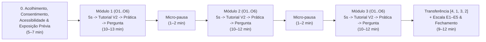

# Protocolo Consolidado de Avaliação Formativa Presencial: Bubble, Selection e Insertion Sort (`UX-REDESIGN-R3-B` / Revisão `R3-B.1`)

> **Documento Canônico:** Protocolo metodológico consolidado e revisado pré-campo para avaliação formativa presencial com usuários reais sobre os módulos centrais **Bubble Sort**, **Selection Sort** e **Insertion Sort**.  
> **Status Real da Avaliação:** **`PREPARADO (REVISADO PRÉ-CAMPO EM UX-REDESIGN-R3-B.1)`** *(**NÃO APLICADO** e **NÃO ANALISADO** — nenhum recrutamento iniciado e zero participantes reais avaliados até a presente data).*  
> **Evolução e Reuso:** Evolui e unifica diretamente o protocolo piloto produzido em `UX-REDESIGN-R3-A`, incorporando a consolidação multi-módulo de `UX-REDESIGN-R3-B` e o endurecimento metodológico pré-campo de `UX-REDESIGN-R3-B.1` sem criar protocolos concorrentes.  
> **Data da Última Revisão:** 24/11/2026 (Marco `UX-REDESIGN-R3-B.1`)  
> **Governança:** [`AGENTS.md`](../../AGENTS.md), [`ADR 0009`](../adr/0009-global-procedural-array-generation.md), [`ADR 0027`](../adr/0027-educational-and-ui-experience-redesign-v2.md), [`ux-redesign-v2.md`](./ux-redesign-v2.md), [`ux-practice-r3-comparative-audit.md`](./ux-practice-r3-comparative-audit.md) e [`12-pedagogy-and-academic-traceability.md`](./12-pedagogy-and-academic-traceability.md).

---

## 1. Enquadramento Metodológico, Pergunta Central e Demarcação Conceitual

### 1.1. Pergunta Central de Investigação
> **"Como estudantes interpretam os estados visuais e justificam suas decisões durante a utilização das Práticas Básicas de Bubble, Selection e Insertion Sort?"**

### 1.2. Objetivos Específicos da Avaliação Formativa
Esta investigação tem caráter **exploratório, qualitativo e formativo** (avaliação diagnóstica de Interação Humano-Computador e compreensão situada). Seus cinco focos operacionais são investigar:
1. **Clareza da interface:** se os elementos primários visíveis em cada tela comunicam o foco e a ação disponível sem sobrecarga visual;
2. **Facilidade de identificação dos estados:** se o participante localiza os papéis visuais próprios de cada algoritmo (`vizinho` e `ordenado` no Bubble; `PRÓXIMA POSIÇÃO`, `menor atual` e `observando` no Selection; `CHAVE`, `VAGA` e `OBSERVANDO` no Insertion);
3. **Compreensão das decisões algorítmicas:** como o participante justifica verbalmente cada escolha durante e imediatamente após a prática;
4. **Dificuldades durante a execução:** hesitações, dúvidas de interpretação de rótulos, acionamento de dicas, leitura do feedback causal após erro e eventuais necessidades de ajuda;
5. **Capacidade de diferenciar os três algoritmos:** se, após percorrer os três módulos, o participante distingue os mecanismos iniciais e o momento da primeira movimentação sobre um vetor inédito (`[4, 1, 3, 2]`).

### 1.3. Status Factual (`PREPARADO` vs. `APLICADO` vs. `ANALISADO`)
> [!IMPORTANT]
> **RIGOR CIENTÍFICO E AUSÊNCIA DE DADOS REAIS NESTE MARCO:**  
> - **`PREPARADO` (Estado Atual):** Protocolo, roteiros, fichas, rubrica `0–3`, tarefa de transferência, orientações éticas, checklist operacional e planilhas CSV em branco foram revisados metodologicamente e validados por *dry-run* operacional simulado contra o código real (`60` arquivos de teste, `745` testes verdes).  
> - **`APLICADO` (Pendente):** Depende de verificação ética institucional aplicável, recrutamento futuro e realização presencial das sessões com seres humanos.  
> - **`ANALISADO` (Pendente):** Depende da transcrição literal, codificação rastreável pela rubrica `0–3` e triangulação das fontes coletadas.

### 1.4. Distinção Obrigatória entre Conhecimento Prévio, Execução e Aprendizagem (`R3-B.1`)
Este estudo **NÃO é um experimento controlado de eficácia pedagógica** (não possui pré-teste/pós-teste formal, grupo de controle nem medida de retenção tardia). Na análise futura, é metodologicamente obrigatório distinguir cinco fenômenos independentes:

| Fenômeno Analítico | Evidência Correspondente | Regra Estrita de Interpretação (O que NÃO concluir) |
| :--- | :--- | :--- |
| **1. Reconhecimento inicial da interface** | Respostas no Teste de 5 Segundos (`Item C`) e localização inicial dos controles | **Dificuldade inicial nos primeiros segundos NÃO prova falha pedagógica do algoritmo:** pode refletir apenas o primeiro contato com convenções visuais novas antes do Tutorial Guiado. |
| **2. Familiaridade / conhecimento prévio** | Autodeclaração coletada por algoritmo antes da prática (`Nunca viu`, `Viu superficialmente`, `Já estudou/programou`) e estrato (`A/B/C`) | **Desempenho elevado de participante com domínio prévio NÃO é prova de aprendizagem gerada pela plataforma:** pode refletir repertório anterior trazido para a sessão. |
| **3. Execução operacional correta** | Conclusão da Prática Básica, `score`, `errors` e `hintsUsed` (`Fonte A`) | **Sucesso operacional na prática NÃO prova compreensão conceitual nem aprendizagem:** cliques corretos podem ocorrer por tentativa local, reação ao feedback ou heurística superficial. |
| **4. Justificativa verbal situada** | Fala no *Think-Aloud* e resposta pós-prática codificada na Rubrica `0–3` (`Fonte C`) | Evidencia se o participante articula comparação, ação e consequência imediatamente após operar o módulo, mas não mede retenção de longo prazo nem ganho pré/pós. |
| **5. Transferência para situação inédita** | Predição e justificativa processual sem computador sobre `[4, 1, 3, 2]` (`Item G`) | Evidencia capacidade situada de diferenciar os três mecanismos fora da tela interativa, devendo ainda ser interpretada à luz da familiaridade prévia declarada. |

---

## 2. Participantes, Recrutamento Futuro e Registro de Exposição Prévia

Adota-se **amostragem não probabilística por conveniência**, estratificada em três perfis complementares (nenhum recrutamento foi iniciado até o momento):

| Código de Estrato | Perfil Planejado | Meta de Recrutamento (Planejamento) | Exposição Prévia Esperada (Confirmar Individualmente) | Quantidade Real Avaliada |
| :---: | :--- | :---: | :--- | :---: |
| **Cat. A** | **Iniciantes sem domínio prévio de ordenação** (ingressantes ou alunos sem estudo formal de Bubble/Selection/Insertion Sort) | **3 a 5** participantes | Nenhuma ou apenas noção vaga (confirmar para cada um dos 3 algoritmos no acolhimento). | *A registrar pós-coleta (`0`)* |
| **Cat. B** | **Estudantes com conhecimentos de programação** (alunos de Computação/TI/Engenharia que já programam com vetores/laços) | **3 a 5** participantes | Variável por algoritmo (comum conhecer Bubble e desconhecer detalhes de Selection/Insertion; registrar por módulo). | *A registrar pós-coleta (`0`)* |
| **Cat. C** | **Docentes ou monitores** de Algoritmos e Estruturas de Dados | **2 a 3** participantes | Domínio prévio completo dos três algoritmos (foco em inspeção conceitual e didática da representação visual). | *A registrar pós-coleta (`0`)* |
| **TOTAL** | **Amostra Formativa Global Planejada** | **8 a 13** participantes | Registrada por algoritmo (`prior_familiarity_algo`) na Ficha `B` e no CSV. | *A registrar pós-coleta (`0`)* |

---

## 3. Contrabalanceamento Completo das Ordens de Exposição ($3! = 6$)

Para distribuir simetricamente efeitos de familiarização com o *shell* visual da plataforma, aprendizado de interface entre o 1º e o 3º módulo e eventual fadiga final, preservam-se integralmente as **seis permutações possíveis**:

| Código da Ordem | 1º Módulo | 2º Módulo | 3º Módulo | Alocação Sequencial Sugerida dentro de Cada Estrato |
| :---: | :--- | :--- | :--- | :--- |
| **`O1`** | **Bubble Sort** | **Selection Sort** | **Insertion Sort** | Participante #1 do estrato (`A1`, `B1`, `C1`) |
| **`O2`** | **Bubble Sort** | **Insertion Sort** | **Selection Sort** | Participante #2 do estrato (`A2`, `B2`, `C2`) |
| **`O3`** | **Selection Sort** | **Bubble Sort** | **Insertion Sort** | Participante #3 do estrato (`A3`, `B3`, `C3`) |
| **`O4`** | **Selection Sort** | **Insertion Sort** | **Bubble Sort** | Participante #4 do estrato (`A4`, `B4`, ...) |
| **`O5`** | **Insertion Sort** | **Bubble Sort** | **Selection Sort** | Participante #5 do estrato (`A5`, `B5`, ...) |
| **`O6`** | **Insertion Sort** | **Selection Sort** | **Bubble Sort** | Próximo participante (assegurando cobertura das 6 ordens no total da amostra quando $N \ge 6$) |

---

## 4. Caminho Didático Padronizado, Tempo Realista (`45–60 min`) e Procedimentos de Sessão

### 4.0. Decisão Metodológica Fechada sobre o Caminho Didático (Zero Improviso em Campo)
Em revisão metodológica pré-campo (`UX-REDESIGN-R3-B.1`), avaliou-se se o **Tutorial Guiado V2** deveria ser (a) obrigatório para todos, (b) obrigatório apenas para iniciantes ou (c) omitido. Fixa-se como regra fechada do protocolo:

> **DECISÃO CANÔNICA: O Tutorial Guiado V2 é OBRIGATÓRIO PARA TODOS OS PARTICIPANTES (`Cat. A`, `Cat. B` e `Cat. C`) nos três módulos, executado sempre APÓS o Teste de Primeira Impressão e ANTES da Prática Básica real.**

**Fundamentação metodológica e técnica da decisão:**
1. **Proteção pedagógica aos iniciantes (`Cat. A`):** Evita lançar estudantes sem domínio prévio diretamente à Prática Básica sem a mediação visual curta (`[3, 1, 2]` no Bubble, `[4, 1, 3]` no Selection e `[4, 2, 3]` no Insertion) que compõe o desenho instrucional real do produto;
2. **Eliminação de confundimento entre estrato e tratamento:** Se `Cat. A` fizesse tutorial e `Cat. B` o omitisse, diferenças observadas na Prática Básica misturariam perfil prévio com ausência de exposição ao tutorial;
3. **Eliminação total de improviso do moderador:** Nenhum pesquisador decide em sala se o participante "precisa ou não" de tutorial;
4. **Isolamento técnico limpo dos temporizadores (`src/App.tsx`):** Coletar a primeira impressão de 5 segundos na tela da Prática Básica **sem realizar cliques** e em seguida sair por `[ ← Práticas ] → [ Tutorial Guiado ]` não grava conclusão falsa e mantém `bubbleUxSession === null`; quando o participante conclui o Tutorial Guiado V2 (`onComplete`), `App.tsx` invoca `handleSelectPracticeLevel("basic", module)`, instanciando uma **nova Prática Básica limpa** com novo vetor procedural $n=4$ e relógio (`startTimeRef` e `practiceStartedAt`) iniciado exatamente na entrada efetiva da prática!

Assim, a sequência invariável dentro de cada um dos três módulos é:

$$\text{Primeira Impressão (5s na Prática Básica)} \longrightarrow \text{Tutorial Guiado V2} \longrightarrow \text{Prática Básica Real (Think-Aloud)} \longrightarrow \text{Justificativa Verbal Pós-Prática} \longrightarrow \text{Micro-pausa e Próximo Algoritmo}$$

### 4.1. Primeira Impressão — Teste de Cinco Segundos e Assimetria Real entre as Telas (`Seção 2`)

> [!WARNING]
> **ASSIMETRIA FACTUAL ENTRE AS TELAS INICIAIS (PROIBIDO FINGIR EQUIVALÊNCIA):**  
> As interfaces não foram nem devem ser alteradas artificialmente para a pesquisa. No código real estabilizado em `UX-PRACTICE-R3.2`, **a tela inicial da Prática Básica do Bubble Sort NÃO é estruturalmente equivalente às telas iniciais de Selection e Insertion Sort**:

| Módulo | O que é Efetivamente Exibido nos Primeiros 5 Segundos | Controles Visíveis na Abertura | Controles Ocultos nos Primeiros 5s (**NÃO cobrar!**) |
| :--- | :--- | :--- | :--- |
| **Bubble Sort** (`BubbleGameScreenV2`) | Cabeçalho (`← Práticas`, `Passo 1 de 6`), esteira com 4 caixas (as duas primeiras com contorno azul e rótulo `vizinho`), **card `Previsão Antes de Agir`** (*"Antes de agir: depois de comparar X e Y, qual valor ficará mais à direita?"*) e rodapé recolhido `Aprofundamento técnico`. | Dois botões numéricos de previsão **`[ X ]`** e **`[ Y ]`** (valores das duas primeiras caixas). | Os botões **`[1] TROCAR`**, **`[2] MANTER`** e **`[ ? Dica ]`** **estão ocultos** até que a previsão inicial seja confirmada. |
| **Selection Sort** (`SelectionGameScreenV2`) | Cabeçalho (`← Práticas`, `Reiniciar`), esteira com 4 caixas (`PRÓXIMA POSIÇÃO` + `menor atual` na 1ª caixa; `observando` na 2ª caixa), card `BUSCA` com pergunta *"O número X é menor que o menor atual, Y?"* e rodapé `Aprofundamento técnico`. | Botão **`[ ? Dica ]`** e botões primários **`[1] Sim, é o novo menor`** / **`[2] Não, manter o menor`**. | Checkpoint Pré-Commit e botão `Posicionar o menor agora` (aparecem apenas ao final da varredura). |
| **Insertion Sort** (`InsertionGameScreenV2`) | Cabeçalho (`← Práticas`, `Reiniciar`), `TRILHO AÉREO • CHAVE SUSPENSA` com o 2º valor portando `CHAVE`, `ESTEIRA` com 1ª caixa `OBSERVANDO` e 2ª posição como `VAGA`, pergunta *"O número X precisa deslizar para abrir espaço para a chave Y?"* e `Aprofundamento técnico`. | Botões primários **`[1] Deslizar para a Direita`** / **`[2] Encaixar a Chave`** e link **`? Precisa de ajuda? Ver Dica`**. | Nenhum botão primário oculto (a mesma dupla de decisão opera durante toda a prática). |

**Regras operacionais obrigatórias do Teste de Cinco Segundos:**
1. Sem explicar o algoritmo previamente, abrir a tela inicial da **Prática Básica** (`Home → Card → Ir para práticas › → PRÁTICA BÁSICA: INICIAR PRÁTICA →`), anotar o vetor exibido (`five_sec_displayed_array`) e o estado inicial exibido (`five_sec_screen_variant`), e pedir que o participante observe por **~5 segundos sem clicar**;
2. Formular as três perguntas neutras de primeira impressão sobre **o que esteve efetivamente visível**:
   - **C1:** *"O que você acha que precisa fazer aqui?"*
   - **C2:** *"Onde você olhou primeiro?"*
   - **C3:** *"O que acredita que os botões visíveis fazem?"* *(No Bubble, refere-se exclusivamente aos botões numéricos `[X]` e `[Y]` do card de previsão; jamais exigir que o participante adivinhe os botões `TROCAR`/`MANTER` ocultos)*;
3. Na análise futura, analisar o Teste de 5 Segundos **descritivamente dentro do contexto visual real de cada tela**, sem tratar as respostas de `C3` no Bubble (card de predição) como equivalentes diretas às respostas de `C3` em Selection/Insertion (botoeira de decisão);
4. **Adaptação de Acessibilidade Obrigatória (`Seção 9`):** Não aplicar o corte cronometrado de 5 segundos a participantes com baixa visão, cegueira/uso de leitor de tela, dislexia, desconforto com pressão temporal ou necessidade de ampliação/leitura assistida. Nesses casos, aplicar o **Modo de Primeira Exploração Sem Limite de Tempo** documentado em [`evaluation/moderator-guide-and-scripts.md`](./evaluation/moderator-guide-and-scripts.md) (`Seção C.3`), registrar `accessibility_adaptation` e **jamais interpretar diferenças decorrentes da modalidade de acesso como dificuldade cognitiva**.

### 4.2. Tutorial Guiado V2 Padronizado (`~2,5 a 3,5 min` por módulo)
Logo após registrar `C1–C3`, o moderador clica em `[ ← Práticas ]` (sem tocar nas ações da prática) e abre `[ Tutorial Guiado ]`:
- O participante percorre autonomamente os passos curtos do Tutorial V2 (`[3, 1, 2]` no Bubble; `[4, 1, 3]` no Selection; `[4, 2, 3]` no Insertion);
- O moderador registra na Ficha `B` a conclusão do tutorial (`tutorial_completed`) e se houve qualquer dúvida ou ajuda solicitada nessa etapa;
- Ao clicar no botão final do Tutorial V2 (`"Começar a Prática Básica ▶"` / conclusão do tutorial), a aplicação redireciona automaticamente para uma **nova instância limpa da Prática Básica V2**.

### 4.3. Prática Básica Real em *Think-Aloud* e Controle da Variação Procedural (`Seções 6 e 7`)
Ao entrar na Prática Básica real pós-tutorial, o moderador lê a instrução neutra:
> *"Enquanto utiliza a plataforma, diga o que está observando e por que escolheu cada ação."*

- **Focos observacionais por módulo (`Ficha B`):**
  - **Bubble Sort:** par de elementos `vizinho`, critério `TROCAR` vs. `MANTER` e consolidação `ordenado` à direita;
  - **Selection Sort:** `PRÓXIMA POSIÇÃO`, `menor atual`, `observando` com esteira estática em `BUSCA`, e troca única ao final da passada em `POSICIONAMENTO`;
  - **Insertion Sort:** `CHAVE` suspensa no trilho superior, `VAGA` física na esteira, elemento `OBSERVANDO` à esquerda, motivo de `Deslizar para a Direita` e momento de `Encaixar a Chave`.
- **Auditoria de `seed` e Registro da Entrada Procedural (`Seção 6`):**
  - *Verificação no código-fonte:* Embora a camada pura de domínio (`src/game/generation/arrayGenerator.ts`, [`ADR 0009`](../adr/0009-global-procedural-array-generation.md)) possua geração determinística via **Mulberry32** parametrizável por `seed?: SeedInput`, a camada de UI (`src/App.tsx:550, 558, 779`) invoca `generateBubblePhaseArray(1)`, `generateSelectionPhaseArray(1)` e `generateInsertionPracticeArray("basic")` **sem argumento de `seed`**, gerando sementes aleatórias em memória a cada entrada. Não existe query param `?seed=` nem exibição da `seed` na tela ou no JSON `?uxTest=1`. Em respeito à proibição de alterar `src/` ou criar gerador paralelo para a pesquisa, **não se força semente fixa artificialmente**;
  - *Procedimento rigoroso de controle documental:* Assim que a Prática Básica real abre após o tutorial, o moderador registra literalmente os **4 números iniciais (`practice_initial_array = [v0, v1, v2, v3]`)** na Ficha `B` e no CSV (lembrando que, no Insertion Sort, `v0` inicia na 1ª posição da esteira, `v1` inicia suspenso como `CHAVE` sobre a `VAGA` da 2ª posição, `v2` na 3ª e `v3` na 4ª — podendo ser conferido também no Replay);
  - *Reconhecimento analítico obrigatório:* Mesmo dentro das *constraints* pedagógicas de $n=4$, os vetores sorteados variam no número de inversões, atualizações de `menor atual` e deslocamentos necessários (ex.: no Insertion $n=4$, tanto `comparisons` quanto `shifts` variam conforme o vetor; no Bubble e Selection, o número de trocas reais varia de `1` a `5` e de `1` a `3`). Portanto, **diferenças nas entradas sorteadas podem influenciar quantidade de ações, oportunidades de erro e tempo total**, sendo proibido comparar contagens brutas entre participantes sem contextualizar o `practice_initial_array` registrado.

### 4.4. Perguntas Verbais Pós-Prática (`Seção 8`)
Imediatamente após concluir cada Prática Básica (na tela oficial de resultados), registrar palavra por palavra:
- **Bubble Sort:** *"Por que você trocou ou manteve aqueles dois números?"*
- **Selection Sort:** *"Por que o algoritmo não movimenta as caixas enquanto procura o menor?"*
- **Insertion Sort:** *"Qual é a diferença entre deslizar um número e trocar dois números de lugar?"*

### 4.5. Revisão Realista de Duração (`45–60 min`) e Prevenção de Fadiga (`Seção 8`)
A estimativa preliminar anterior (`35–45 min`) foi revisada por ser excessivamente comprimida frente à inclusão padronizada do Tutorial Guiado V2, à verbalização em *Think-Aloud*, às três perguntas de compreensão pós-módulo, à tarefa de transferência com 9 respostas processuais e às pausas de conforto. O **planejamento realista por sessão individual é de `45 a 60 minutos`**:
- Acolhimento, consentimento, checagem de acessibilidade e registro de familiaridade prévia: **`5–7 min`**;
- Cada um dos 3 módulos (`5s` `~1,5 min` + `Tutorial Guiado V2` `~2,5–3,5 min` + `Prática Básica com Think-Aloud` `~4–6 min` + `Pergunta Pós-Prática e exportação/transcrição` `~2 min`): **`10–13 min` × 3 = `30–37 min`**;
- Duas micro-pausas ativas entre módulos (`1–2 min` cada, com oferta de água e descanso visual): **`2–4 min`**;
- Tarefa de Transferência (`[4, 1, 3, 2]`) + Escala Descritiva `E1–E5` + encerramento: **`8–12 min`**.
- **Salvaguarda contra fadiga:** O contrabalanceamento nas **6 ordens (`O1..O6`)** distribui simetricamente qualquer cansaço residual do 3º módulo entre os três algoritmos; se o participante demonstrar fadiga ou se a sessão atingir `60 min`, prioriza-se pausa imediata ou encerramento voluntário sem pressão, registrando na Ficha `H`.

---

## 5. Rubrica Analítica `0–3` e Tratamento de Ambiguidades / Discordâncias (`Seção 7`)

A rubrica completa encontra-se em [`evaluation/comprehension-rubric-0-3.md`](./evaluation/comprehension-rubric-0-3.md):
- **`0` (Ausente ou incompatível):** Não explica ou contradiz a mecânica real do algoritmo;
- **`1` (Explicação superficial da ação):** Descreve o gesto de interface ou o movimento aparente (*"cliquei em trocar"*, *"apertei Sim"*, *"a caixa andou"*), **sem** justificar o mecanismo algorítmico;
- **`2` (Comparação e ação corretas, com omissão parcial):** Justifica corretamente a relação entre os valores comparados e a decisão tomada, mas omite parte importante do mecanismo estrutural (adjacência/fixação à direita no Bubble; espera até o fim da busca para troca única no Selection; suspensão da chave + vaga física para deslocamento unilateral no Insertion);
- **`3` (Justificativa completa do mecanismo e modelo mental):** Articula comparação, ação e consequência estrutural (aceitando integralmente **linguagem natural cotidiana** sem exigir jargão técnico formal).

**Procedimento formal para casos ambíguos e múltiplos avaliadores:**
1. Proibição absoluta de converter a nota `0–3` na `PONTUAÇÃO DO PROTOCOLO` (`0..100`) ou consultar `score`/`errors` antes de codificar a fala literal;
2. Quando houver dois ou mais avaliadores, cada um registra sua nota bruta independente (`rubric_coder1_raw_0_3`, `rubric_coder2_raw_0_3`) antes de qualquer reunião; divergências são resolvidas frente ao checklist de âncoras do algoritmo (ou por terceiro árbitro), preservando no CSV tanto as notas pré-consenso quanto a nota final reconciliada (`rubric_final_consensus_0_3`) e o motivo explícito em `rubric_disagreement_notes`;
3. Em caso de fala curta ou fronteiriça insolúvel (`1` vs. `2` ou `2` vs. `3`), marca-se `rubric_ambiguous_case = true` e adota-se critério conservador (não presumir raciocínio não verbalizado).

---

## 6. Tarefa de Transferência Comparativa — Vetor Inédito `[4, 1, 3, 2]`

Aplicada fora do computador após os três módulos ([`evaluation/moderator-guide-and-scripts.md`](./evaluation/moderator-guide-and-scripts.md), `Item G`), perguntando para Bubble, Selection e Insertion:
1. *"O que cada algoritmo compararia primeiro?"*
2. *"Qual seria sua primeira movimentação física?"*
3. *"Por que essa movimentação acontece naquele momento?"*

Como os três algoritmos atingem a mesma configuração intermediária `[1, 4, 3, 2]` após a primeira troca do Bubble, o primeiro posicionamento do Selection (após inspecionar `1`, `3` e `2` sem mover) e o encaixe da primeira chave (`1`) do Insertion (após suspender `1` e deslizar `4` para a vaga), **avalia-se exclusivamente a sequência processual e a justificativa temporal/causal — jamais apenas o vetor resultante ou final**.

---

## 7. Auditoria de Comparabilidade das Medidas nas Três Fontes (`A, B e C`) e Limitações do `?uxTest=1` (`Seção 5`)

### 7.1. Matriz Explícita de Existência e Comparabilidade por Módulo

| Fonte e Medida | **Bubble Sort** (`BubbleGameScreenV2` + `BubbleResultScreenV2`) | **Selection Sort** (`SelectionGameScreenV2` + `ResultScreen`) | **Insertion Sort** (`InsertionGameScreenV2` + `ResultScreen`) | Regra de Comparabilidade entre Módulos |
| :--- | :---: | :---: | :---: | :--- |
| **`A` — Conclusão da Prática (`sys_completed`)** | Sim (Tela + JSON) | Sim (Tela) | Sim (Tela) | **Comparável** descritivamente nos 3 módulos. |
| **`A` — `PONTUAÇÃO DO PROTOCOLO` (`sys_protocol_score`)** | Sim (`0..100`) | Sim (`0..100`) | Sim (`0..100`) | **Apenas descritiva intra-módulo** (número de passos interativos difere entre algoritmos e vetores). |
| **`A` — Comparações (`sys_comparisons`)** | Sim (`6` fixo em $n=4$) | Sim (`6` fixo em $n=4$) | Sim (**variável `3..6`** conforme o vetor!) | **Não comparar contagens brutas** sem considerar a propriedade matemática de cada algoritmo e o vetor sorteado. |
| **`A` — Trocas bilaterais (`sys_swaps`)** | Sim (`1..5` em $n=4$) | Sim (`1..3`, máx. $n-1$) | **Não existe** (`0` / N/A) | Exclusivo de algoritmos por permuta; depende do vetor sorteado. |
| **`A` — Deslocamentos e Inserções (`sys_shifts`, `sys_insertions`)** | **Não existe** (N/A) | **Não existe** (N/A) | Sim (`shifts` variável; `insertions = 3` em $n=4$) | **Exclusivo do Insertion** (`DESLOCAR ≠ TROCAR`; vedado somar com `swaps`). |
| **`A` — Decisões incorretas (`sys_errors`) e Dicas (`sys_hints_used`)** | Sim (Tela + JSON) | Sim (Tela) | Sim (Tela) | **Descritivo por módulo**; contextualizar pelo total de decisões exigidas pelo vetor sorteado. |
| **`A` — Tempo total da prática (`sys_elapsed_time`)** | Sim (`performance.now()`, exibido na gaveta da tela de resultado) | Sim (`Date.now()`, exibido em `MÉTRICAS DA OPERAÇÃO`) | Sim (`Date.now()`, exibido em `MÉTRICAS DA OPERAÇÃO`) | **Puramente descritivo; NÃO comparar como eficiência cognitiva** (fortemente afetado pela extensão da fala no *Think-Aloud* e pelo vetor sorteado). |
| **`A` — `timeToFirstActionMs` e `firstActionCorrect`** | **SOMENTE Bubble (`?uxTest=1`)** | **NÃO EXISTE** | **NÃO EXISTE** | **PROIBIDO comparar entre módulos:** no Bubble inclui a etapa `Previsão Antes de Agir`; **jamais cronometrar manualmente em Selection/Insertion para comparar com o milissegundo eletrônico do Bubble**. |
| **`A` — `predictionCorrect`, `passCheckpointCorrect`, `microReflectionCorrect`** | **SOMENTE Bubble (`?uxTest=1`)** | **NÃO EXISTE em `Fonte A`** *(checkpoint pré-commit anotado em `Fonte B`)* | **NÃO EXISTE na Prática Básica** *(checkpoint ocorre no Tutorial V2)* | Medidas específicas de cada mecânica; analisar apenas dentro do respectivo módulo. |
| **`A/B` — Abertura de `Aprofundamento técnico` e `Replay`** | Automático em `Fonte A` (`?uxTest=1`) + nota em `Fonte B` | **Somente manual em `Fonte B`** | **Somente manual em `Fonte B`** | Comparável apenas como indicador binário observacional (`abriu / não abriu` via `Fonte B`). |
| **`B` — Hesitações, Red Flags, Carry-over e Intervenções (`Item H`)** | Sim (`Ficha B.1` + `H`) | Sim (`Ficha B.2` + `H`) | Sim (`Ficha B.3` + `H`) | **Comparável qualitativamente** sob o mesmo protocolo observacional. |
| **`C` — Teste de 5 Segundos (`C1–C3`)** | Sim (**sobre tela de Previsão**) | Sim (**sobre tela de Decisão**) | Sim (**sobre tela de Decisão**) | **NÃO fingir equivalência direta em `C3`** entre Bubble (botões de previsão) e Selection/Insertion (botões de decisão); separar casos com adaptação de acessibilidade. |
| **`C` — *Think-Aloud*, Pós-Prática (`Rubrica 0–3`) e Transferência `[4, 1, 3, 2]`** | Sim (`Ficha B.1` / `G`) | Sim (`Ficha B.2` / `G`) | Sim (`Ficha B.3` / `G`) | **Principal eixo comparativo qualitativo/ordinal** entre os três algoritmos, contextualizado pela familiaridade prévia (`prior_familiarity_algo`). |

### 7.2. Síntese das Limitações Confirmadas do `?uxTest=1`
1. **Exclusivo da Prática Básica do Bubble Sort** (`SelectionGameScreenV2`, `InsertionGameScreenV2` e `ResultScreen` canônica não possuem `?uxTest=1`);
2. **`timeToFirstActionMs` inicia na montagem de `BubbleGameScreenV2`**, englobando a leitura e confirmação do card `Previsão Antes de Agir` (e englobaria os 5 segundos iniciais caso o moderador não saísse para o Tutorial antes de agir — fluxo já saneado na Seção 4.0);
3. **`overviewStartedAt` e `tutorialStartedAt` não são preenchidos** no código atual;
4. **Autocorreção antes de clicar `"Continuar"` nos checkpoints** registra apenas a alternativa final confirmada;
5. **Estado em memória React (`bubbleUxSession`):** apaga-se em `F5`, mas **permanece na memória caso não haja reload entre participantes** — exigindo obrigatoriamente `localStorage.removeItem("sorting_station_save"); window.location.assign("/?uxTest=1");` na troca de participante (`Item K`).

---

## 8. Acessibilidade, Ética, Privacidade e Condições Pré-Recrutamento (`Seções 9 e 10`)

1. **Acessibilidade sem Penalização Analítica:** Participantes para os quais a exposição visual cronometrada de 5 segundos seja inacessível ou inadequada realizam exploração inicial sem relógio, com ajustes de zoom, movimento reduzido (`prefers-reduced-motion`) ou leitura assistida (`Item C.3` em [`evaluation/moderator-guide-and-scripts.md`](./evaluation/moderator-guide-and-scripts.md)). Diferenças de modalidade de acesso são documentadas e jamais tratadas como déficit de compreensão.
2. **Condições Éticas Obrigatórias Antes de Recrutar (`Item I` em [`evaluation/consent-privacy-and-checklist.md`](./evaluation/consent-privacy-and-checklist.md)):**
   - **Nenhuma aprovação ética institucional é presumida neste documento;**
   - Antes de convidar qualquer participante ou iniciar coleta formal, a equipe responsável deve consultar e atender às exigências éticas e institucionais vigentes (ex.: Comitê de Ética em Pesquisa / CEP-CONEP, quando aplicável);
   - Nenhum recrutamento e nenhuma coleta de dados reais ocorrem neste marco.

---

## 9. Validação Operacional Pré-Campo por *Dry-Run* Simulado (`Seção 11`)

Executou-se em `UX-REDESIGN-R3-B.1` uma simulação operacional completa de ponta a ponta (usando exclusivamente identificadores sintéticos de treinamento `SIM_DRYRUN_01` e `SIM_DRYRUN_02` documentados no Apêndice de [`evaluation/observation-and-incident-sheets.md`](./evaluation/observation-and-incident-sheets.md) e na Seção 6 de [`evaluation/comprehension-rubric-0-3.md`](./evaluation/comprehension-rubric-0-3.md), **sem inserir nenhuma linha nos arquivos `.csv` oficiais**):
- **Navegação real verificada:** `Home → Card → Ir para práticas › → Prática Básica (5s sem clique) → ← Práticas → Tutorial Guiado V2 → conclusão abre Prática Básica limpa → ResultScreen / BubbleResultScreenV2 → Seletor → Hub Principal`;
- **Troca de participantes e limpeza local verificada:** Confirmado que apenas `localStorage.removeItem("sorting_station_save")` sem recarregar a página deixaria `saveData` e `bubbleUxSession` vivos na memória React; o checklist `Item K` passa a exigir `localStorage.removeItem("sorting_station_save"); window.location.assign("/?uxTest=1");`, zerando simultaneamente `Schema v4` e `bubbleUxSession`;
- **Exportação Bubble e transcrição Selection/Insertion verificadas:** Campos dos painéis batem 1:1 com a Ficha `B` e as colunas `sys_*` do CSV;
- **Planilhas CSV oficiais preservadas intactas e vazias:** `1` única linha de cabeçalho em cada arquivo `.csv`, com `0` registros fictícios.

---

## 10. Mapa dos Instrumentos Consolidados (`Itens A a K`)

| Código | Instrumento Operacional | Arquivo Existente Atualizado |
| :---: | :--- | :--- |
| **A, C, D, E, G** | Roteiro do Moderador (`45–60 min`), 6 Ordens, Teste de 5s Assimétrico + Adaptação Acessível, *Think-Aloud*, Pós-Tarefa e Transferência `[4, 1, 3, 2]` | [`evaluation/moderator-guide-and-scripts.md`](./evaluation/moderator-guide-and-scripts.md) |
| **B, H** | Fichas de Observação por Módulo (`Fontes A/B/C`, familiaridade prévia, vetores `5s` e `prática`, tutorial) + Ficha de Incidentes + Apêndice de Dry-Run Simulado | [`evaluation/observation-and-incident-sheets.md`](./evaluation/observation-and-incident-sheets.md) |
| **F** | Rubrica Analítica `0–3` Revisada + Protocolo de Casos Ambíguos e Discordância entre Avaliadores + Exemplo Simulado de Calibração | [`evaluation/comprehension-rubric-0-3.md`](./evaluation/comprehension-rubric-0-3.md) |
| **I, K** | Folha Informativa (`45–60 min`), Roteiro de Consentimento/Privacidade (sem presunção ética) e Checklist Técnico com Reset Atômico entre Participantes | [`evaluation/consent-privacy-and-checklist.md`](./evaluation/consent-privacy-and-checklist.md) |
| **J** | Planilhas-Modelo CSV Vazias (`0` linhas de dados; cabeçalhos alinhados à revisão `R3-B.1`) | [`evaluation/session-consolidation-template.csv`](./evaluation/session-consolidation-template.csv) e [`evaluation/transfer-and-incidents-template.csv`](./evaluation/transfer-and-incidents-template.csv) |

---

## 11. Registro de Resultados Empíricos (Em Branco — Aguardando Orientação Ética e Campo)

> [!NOTE]
> **STATUS REAL: `PREPARADO (REVISADO EM UX-REDESIGN-R3-B.1) — ZERO PARTICIPANTES REAIS AVALIADOS`**  
> Nenhum recrutamento foi iniciado e nenhum dado empírico real consta neste repositório. Esta seção permanecerá vazia até a conclusão das etapas futuras `APLICADO` e `ANALISADO`.
