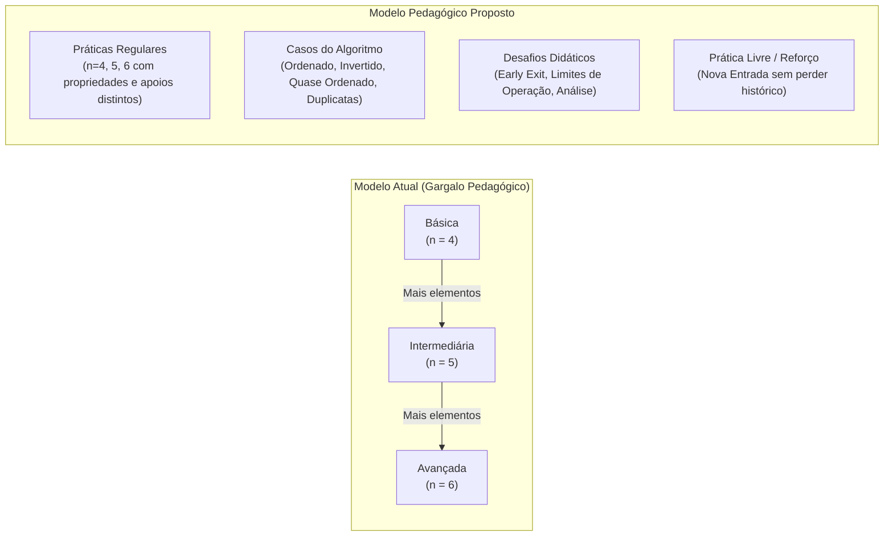
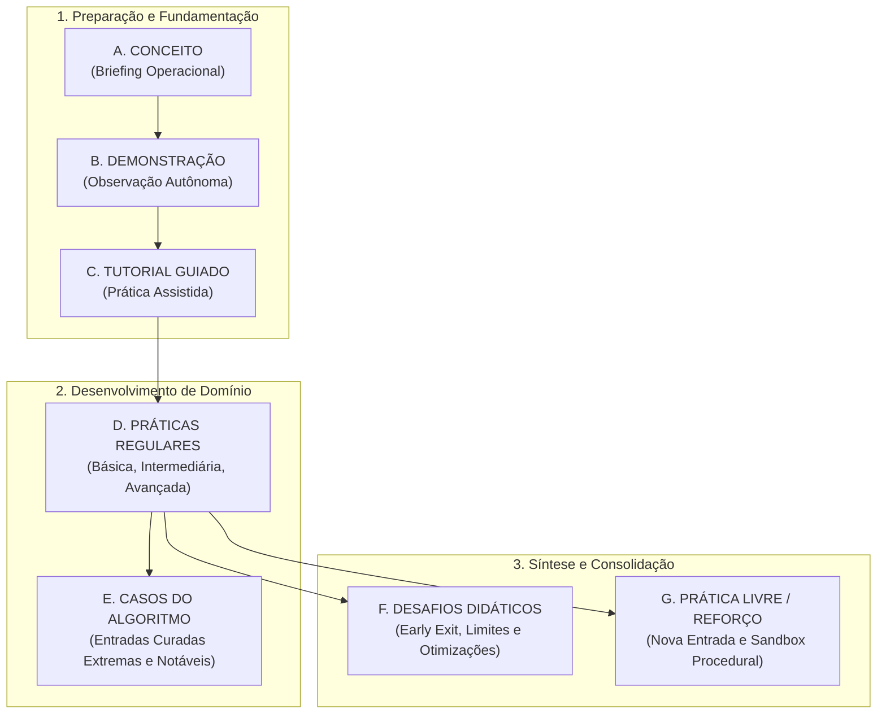
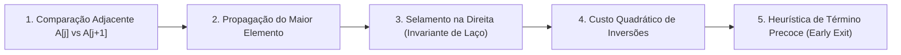
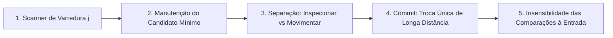
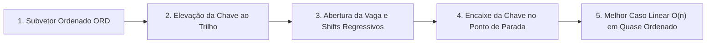
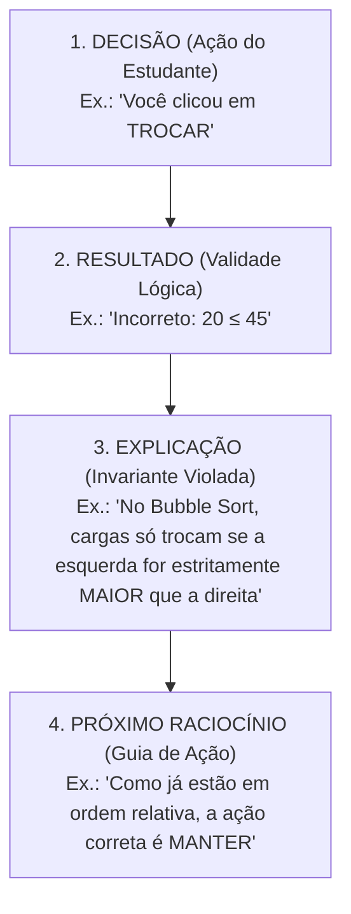
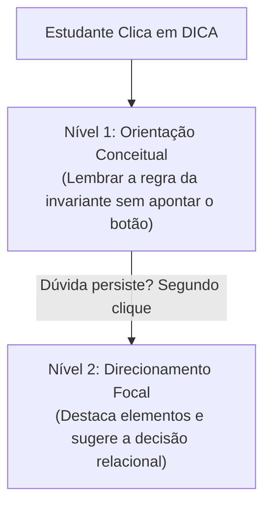
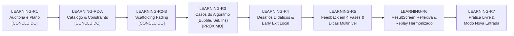

# Expansão da Experiência Pedagógica dos Módulos Centrais (LEARNING-R1)

> **Documento Canônico:** Auditoria aprofundada, matriz pedagógica e plano de expansão funcional para os módulos **Bubble Sort**, **Selection Sort** e **Insertion Sort**.  
> **Status:** Ativo / Base de Verdade da Plataforma  
> **Data:** 12/11/2026 (Marco LEARNING-R1)  
> **Governança:** [`AGENTS.md`](../../AGENTS.md), [`ADR 0018`](../adr/0018-game-to-educational-platform-transition.md), [`ADR 0021`](../adr/0021-module-exercise-persistence-schema-v4.md), [`modules/README.md`](./modules/README.md), [`12-pedagogy-and-academic-traceability.md`](./12-pedagogy-and-academic-traceability.md).

---

## 1. Problema Atual: Diagnóstico da Auditoria e Limitações

### 1.1. Contexto do Repositório
O Sorting Station consolidou com sucesso uma arquitetura client-side robusta, desacoplada em três camadas:
1. Núcleo algorítmico puro e imutável (`src/game/sorting/`);
2. Camada de apresentação reativa em React 19 e Tailwind CSS v4 (`src/screens/`, `src/components/`);
3. Persistência determinística orientada a módulos e conjuntos de exercícios sob o Schema v4 (`src/game/persistence/`).

Com 598 testes automatizados 100% verdes no Vitest em 46 arquivos, a integridade técnica é sólida. Contudo, a auditoria educacional revela que a profundidade pedagógica da experiência discente ainda não reflete a maturidade da infraestrutura.

### 1.2. O Gargalo: "Tamanho como Substituto de Dificuldade"
Atualmente, as práticas procedurais de cada módulo organizam-se quase que exclusivamente pela escala de $n$:
- **Prática Básica:** Vetor aleatório com $n = 4$;
- **Prática Intermediária:** Vetor aleatório com $n = 5$;
- **Prática Avançada:** Vetor aleatório com $n = 6$.



A auditoria direta das constraints procedurais (`arrayGenerator.ts`, `selectionConstraints.ts`, `insertionConstraints.ts`) comprova:
- **Bubble Sort:** Aplica exatamente as mesmas restrições (`isNotSorted`, `isNotStrictlyReversed`, `hasAtLeastOneSwap`, `hasAtLeastOneKeep`) para $n=4, 5, 6$. O estudante repete a mesma mecânica de comparação adjacente, enfrentando apenas mais passos sem novas exigências conceituais;
- **Selection Sort:** Para $n=4$, aplica `isGlobalMinNotInFirstPosition` e `hasAtLeastOneKeepMin`. Para $n=5$ e $n=6$, adiciona `hasMultipleMinUpdatesInAtLeastOnePass`. Embora haja um pequeno ganho de variedade, a experiência permanece restrita ao aumento dimensional;
- **Insertion Sort:** Exige `hasAtLeastOneShift`, `hasAtLeastOneDirectInsert` e em níveis maiores `hasInsertionWithMultipleShifts`. Apesar da riqueza do modelo de vaga/chave, o estudante não vivencia de forma deliberada cenários de melhor caso ($\Theta(n)$) ou pior caso ($O(n^2)$).

### 1.3. Matriz de Auditoria do Fluxo Atual por Módulo

| Componente de Experiência | Bubble Sort | Selection Sort | Insertion Sort | Classificação Factual | Diagnóstico Pedagógico |
| :--- | :---: | :---: | :---: | :---: | :--- |
| **Briefing / Conceito** | Sim | Sim | Sim | `IMPLEMENTADO` | `ProtocolModeBriefingScreen.tsx` data-driven. Clareza conceitual adequada. |
| **Demonstração Canônica** | Sim (`[5, 2, 4, 1]`) | Sim (`[4, 1, 3]`) | Sim (`[6, 3, 5, 2, 7]`) | `IMPLEMENTADO` | Visualização pura sem intervenção com pseudocódigo sincronizado. |
| **Tutorial Guiado** | Sim (`[3, 1, 2]`) | Sim (`[4, 1, 3]`) | Sim (`[4, 2, 3]`) | `IMPLEMENTADO` | FSM dedicada, scaffolding passo a passo e proteção contra erros. |
| **Prática Básica ($n=4$)** | Sim | Sim | Sim | `IMPLEMENTADO` | Procedural determinístico Mulberry32. Funcional, mas focado puramente em $n=4$. |
| **Prática Intermediária ($n=5$)** | Sim | Sim | Sim | `IMPLEMENTADO` | Procedural determinístico. Variação centrada em tamanho. |
| **Prática Avançada ($n=6$)** | Sim | Sim | Sim | `IMPLEMENTADO` | Procedural determinístico. Variação centrada em tamanho. |
| **Casos Algorítmicos Curados** | Parcial (3 no Early Exit) | Ausente na UI | Ausente na UI | `PARCIAL / AUSENTE` | Vetores curados existem apenas como desafio de Bubble; Selection e Insertion não expõem casos na interface. |
| **Desafios Específicos** | Sim (Early Exit) | Ausente | Ausente | `PARCIAL / LEGADO` | Early Exit existe como card destacado, mas não há desafios conceituais para Selection ou Insertion. |
| **Resultado Factual** | Sim | Sim | Sim | `IMPLEMENTADO` | Score, $C(n)$, $M(n)$, tempo descritivo. Falta reflexão qualitativa sobre a execução. |
| **Replay Retrospectivo** | Sim (9 linhas) | Sim (13 linhas) | Sim (11 linhas) | `IMPLEMENTADO` | Insertion Sort é a referência de qualidade (1+N quadros, sincronismo estrito). Bubble e Selection necessitam alinhamento. |
| **Feedback Imediato** | Sim | Sim | Sim | `IMPLEMENTADO` | Imediato, porém binário e focado no passo atômico ("Correto/Incorreto"). Falta encadeamento pedagógico em 4 fases. |
| **Dicas Pedagógicas** | Sim (1 nível) | Sim (1 nível) | Sim (1 nível) | `IMPLEMENTADO` | Revelam a resposta diretamente ("Como X > Y, clique em TROCAR"). Falta gradação conceitual. |
| **Prática Livre ("Nova Entrada")**| Ausente | Ausente | Ausente | `AUSENTE` | Não há opção de gerar novo lote procedural da mesma prática sem reiniciar o fluxo ou retornar ao Seletor. |
| **Persistência Schema v4** | Sim | Sim | Sim | `IMPLEMENTADO` | Chaves `exerciseSets` no padrão `<modulo>.practice.<nivel>`. Seguro e extensível. |

---

## 2. Princípios Pedagógicos e Educacionais

Para fundamentar as expansões sem ferir o rigor científico exigido em [`12-pedagogy-and-academic-traceability.md`](./12-pedagogy-and-academic-traceability.md), este redesenho consolida os seguintes axiomas:

1. **A Unidade Curricular é o MÓDULO; a Unidade de Aprendizagem é a ATIVIDADE / EXERCÍCIO:**
   Fica vedado restabelecer qualquer terminologia legada de "fases de jogo linear", "mundos" ou "campanhas". O estudante navega por um catálogo diversificado de experiências com intencionalidade explícita.
2. **Manipulação Cinestésica Governada por FSM:**
   O estudante aprende através de micro-decisões atômicas com feedback síncrono. A máquina de estados garante que nenhuma ação inválida corrompa a invariante do algoritmo.
3. **Desmistificação da Eficiência Algorítmica por Contraste Empírico:**
   O valor pedagógico surge quando o estudante observa comportamentos contrastantes sobre tipos de dados distintos (ex.: vetor ordenado vs. invertido; quase ordenado no Bubble vs. Insertion).
4. **Scaffolding Cognitivo com Redução Gradual de Suporte (Fading):**
   A dificuldade não se eleva apenas gerando mais caixas na esteira, mas retirando gradualmente andaimes (dicas relacionais explícitas, destaque do scanner, avisos prévios) e exigindo interpretação autônoma do estado do sistema.
5. **Feedback Formativo Não Punitivo:**
   Erros não zeram o exercício e não penalizam com perda de progresso acumulado. Eles pausam o sistema e oferecem uma explicação reflexiva.
6. **Linguagem Científica Não-Presuntiva para Pesquisa:**
   A documentação e a interface devem formular propostas pedagógicas com verbos de suporte e oportunidade ("busca apoiar", "fornece oportunidade para observar", "permite constatar"), jamais afirmando "comprovadamente melhora a aprendizagem" antes de avaliações empíricas formais com sujeitos humanos.

---

## 3. Taxonomia Transversal de Experiências de Aprendizagem

Propõe-se uma taxonomia transversal de 7 categorias didáticas, aplicável uniformemente aos três módulos centrais:



### Detalhamento das Categorias

| Categoria | Propósito Didático | Obrigatoriedade | Entrada de Dados | Desbloqueio | Persistência (Schema v4) | Relação com Replay |
| :--- | :--- | :---: | :--- | :--- | :--- | :--- |
| **A. Conceito** | Introduzir o modelo mental, analogia logística, invariante central e complexidade teórica. | Obrigatória | N/A (texto/gráficos) | Livre | Volátil (não persistido no Schema v4; acesso livre sob demanda) | Não se aplica |
| **B. Demonstração** | Oferecer observação passiva do algoritmo ideal operando com pseudocódigo sincronizado. | Opcional | Vetor curado canônico | Livre | Volátil (memória) | Sem histórico; visualização contínua |
| **C. Tutorial Guiado** | Prática passo a passo assistida por andaimes com retenção em caso de erro. | Obrigatória na 1ª vez | Vetor curto fixo ($n=3$) | Livre | `modules.<m>.completedTutorial` | Opcional pós-conclusão |
| **D. Práticas Regulares** | Desenvolver fluência operacional básica, intermediária e avançada sobre dados procedurais. | Obrigatória para certificação | Procedural Mulberry32 filtrado por constraints | Sequencial (Básica $\rightarrow$ Interm. $\rightarrow$ Avançada) | `modules.<m>.exerciseSets` | Replay completo disponível ao final |
| **E. Casos do Algoritmo** | Evidenciar propriedades extremas (ordenado, invertido, quase ordenado, duplicatas). | Opcional / Recomendada | Vetores curados fixos projetados para o algoritmo | Desbloqueado após Prática Básica | `modules.<m>.exerciseSets` (IDs canônicos de caso) | Replay completo focado no comportamento do caso |
| **F. Desafios Didáticos** | Estimular a reflexão crítica, identificação de elementos críticos e avaliação de heurísticas. | Opcional | Cenários curados ou sementes desafiadoras | Desbloqueado após Prática Avançada | `modules.<m>.exerciseSets` (IDs canônicos de desafio) | Replay com destaques do desafio |
| **G. Prática Livre / Reforço** | Permitir ao estudante gerar novas instâncias ("Nova Entrada") sem restrição de trilha. | Opcional | Procedural novo sob mesma constraint | Desbloqueado por prática já concluída | Atualiza melhor pontuação se superior; mantém histórico | Replay padrão da instância jogada |

---

## 4. Matriz Pedagógica de Aprendizagem: Bubble Sort



### 4.1. Objetivos de Aprendizagem Específicos
O estudante deve ser capaz de:
1. Compreender que o Bubble Sort possui visão puramente local, inspecionando exclusivamente pares contíguos ($j$ e $j+1$);
2. Visualizar que cada passada pelo trecho desordenado empurra infalivelmente o maior elemento remanescente para o final da partição;
3. Reconhecer a invariante de laço: a partição $[n-1-i \dots n-1]$ está definitivamente ordenada e não precisa ser mais inspecionada;
4. Identificar o impacto de elementos pequenos situados na cauda ("tartarugas"), que exigem uma passada inteira para avançar apenas uma posição à esquerda;
5. Compreender o mecanismo do Early Exit como flag booleana de verificação de trocas e reconhecer que ele otimiza o melhor caso ($\Omega(n)$), mas não atenua o pior caso ($O(n^2)$);
6. Observar a estabilidade: elementos com valores iguais não devem ser trocados ($A[j] \le A[j+1] \rightarrow \text{KEEP}$).

### 4.2. Operações Atômicas e Botoeira
- `[ ⇄ TROCAR ]`: Acionada se e somente se $A[j] > A[j+1]$;
- `[ = MANTER ]`: Acionada se e somente se $A[j] \le A[j+1]$.

### 4.3. Armadilhas Cognitivas Frequentes (Misconceptions)
- *Achar que o algoritmo "já vê" onde colocar o elemento:* O estudante tenta comparar elementos distantes;
- *Acreditar que a primeira passada já ordena tudo:* Não percebe a necessidade de múltiplas passadas para descolar valores menores;
- *Confundir Early Exit com algoritmo eficiente:* Supor que a otimização torna o Bubble Sort competitivo com algoritmos $O(n \log n)$ em quaisquer vetores.

---

## 5. Matriz Pedagógica de Aprendizagem: Selection Sort



### 5.1. Objetivos de Aprendizagem Específicos
O estudante deve ser capaz de:
1. Distinguir categoricamente as fases de **Inspeção** (scanner $j$ percorrendo a esteira sem mover caixas) e **Commit** (uma única movimentação ao término da varredura);
2. Acompanhar a variável de estado `minIndex`, compreendendo que ela aponta para o menor elemento encontrado até o momento na passada corrente;
3. Perceber que o Selection Sort consolida o vetor da esquerda para a direita ($0, 1, \dots$), em oposição ao Bubble Sort (que consolida da direita para a esquerda);
4. Constatar cinestesicamente que o algoritmo realiza no máximo $n-1$ trocas em toda a execução ($O(n)$ escritas em memória), tornando-o vantajoso quando a escrita é fisicamente custosa;
5. Observar que o Selection Sort executa **sempre** $\frac{n(n-1)}{2}$ comparações, mesmo que o vetor já esteja completamente ordenado (insensibilidade da busca de mínimo à ordem prévia);
6. Identificar a instabilidade algorítmica: trocas de longa distância podem alterar a ordem relativa entre chaves iguais.

### 5.2. Operações Atômicas e Botoeira Bimodal
- **Fase INSPECT:**
  - `[ ✦ NOVO MÍNIMO ]`: Acionada se e somente se $A[j] < A[minIndex]$;
  - `[ = MANTER CANDIDATO ]`: Acionada se e somente se $A[j] \ge A[minIndex]$.
- **Fase COMMIT:**
  - `[ ⇄ TRANSFERIR MENOR CARGA ]`: Acionada quando $minIndex \neq i$;
  - `[ ✓ CONSOLIDAR POSIÇÃO ]`: Acionada quando o mínimo já estava na posição alvo ($minIndex = i$).

### 5.3. Armadilhas Cognitivas Frequentes
- *Tentar trocar imediatamente ao encontrar um elemento menor:* Não aguardar o scanner inspecionar todas as caixas restantes;
- *Achar que o algoritmo para se o vetor estiver ordenado:* Tentar finalizar antes de varrer todas as passadas obrigatórias;
- *Confundir com Bubble Sort:* Pensar que se trata de uma variante com menos trocas adjacentes, ignorando a estrutura de varredura global por seleção.

---

## 6. Matriz Pedagógica de Aprendizagem: Insertion Sort



### 6.1. Objetivos de Aprendizagem Específicos
O estudante deve ser capaz de:
1. Compreender o conceito de sub-esteira ordenada à esquerda (`ORD`), que cresce monotonicamente de $1$ até $n$ elementos;
2. Dominar a mecânica de três tempos: elevação da carga chave para o trilho suspenso $\rightarrow$ deslocamentos regressivos (*shifts*) de cargas maiores abrindo a vaga $\rightarrow$ pouso definitivo da chave na vaga;
3. Diferenciar rigorosamente **Deslocamento (*Shift*)** de **Troca (*Swap*)**: o deslocamento copia um elemento para a vaga adjacente sem colocar nada no lugar, enquanto a chave aguarda suspensa;
4. Vivenciar a eficiência máxima em vetores quase ordenados: se a chave já for maior que o último item de `ORD`, zero shifts são executados e a chave pousa de imediato (comportamento $O(n)$ adaptativo);
5. Reconhecer o pior caso em vetores estritamente invertidos: cada chave precisa deslocar todos os elementos precedentes até a cabeceira ($j < 0$);
6. Observar a estabilidade: elementos iguais na sub-esteira ordenada interrompem os deslocamentos ($A[j] \le \text{chave} \rightarrow \text{PARAR}$), preservando a ordem original.

### 6.2. Operações Atômicas e Botoeira
- `[ ➔ DESLOCAR CARGA ]`: Acionada quando $j \ge 0$ e $A[j] > \text{chave}$;
- `[ ⇣ ENCAIXAR CHAVE ]`: Acionada quando a vaga correta é aberta (ou $j < 0$, ou $A[j] \le \text{chave}$).

### 6.3. Armadilhas Cognitivas Frequentes
- *Contar shifts como trocas:* Confundir a métrica de translação de vaga com permuta de duas cargas;
- *Deslocar quando a chave é maior ou igual:* Forçar a chave para a esquerda sem necessidade, destruindo a ordem de `ORD`;
- *Não perceber o caráter online/incremental:* Ignorar que o Insertion Sort é ideal para fluxos de dados contínuos.

---

## 7. Catálogo de Casos Algorítmicos Propostos

A área **"Casos do Algoritmo"** introduz baterias curadas com propriedades notáveis que expõem características essenciais de cada algoritmo:

### 7.1. Casos para Bubble Sort

| ID Canônico | Nome do Caso | Vetor Curado | Propriedade Pedagógica Revelada | Comportamento Esperado | Reflexão Pós-Exercício |
| :--- | :--- | :---: | :--- | :--- | :--- |
| `bubble.case.already-sorted` | **Vetor Já Ordenado** | `[10, 20, 30, 40, 50]` | Invariante de não-troca. | $C=10, M=0$ (canônico) ou $C=4, M=0$ (early exit). | *"No Bubble canônico, o algoritmo ainda precisa comparar todos os pares para certificar a ordem, mesmo sem nenhuma troca."* |
| `bubble.case.reverse` | **Ordem Reversa** | `[50, 40, 30, 20, 10]` | Pior caso analítico absoluto. | Máximo de trocas: $C=10, M=10$. | *"Cada par adjacente precisou ser invertido. Este é o esforço máximo do Bubble Sort ($O(n^2)$ trocas)."* |
| `bubble.case.nearly-sorted` | **Quase Ordenado** | `[10, 30, 20, 40, 50]` | Apenas uma inversão local. | $C=10, M=1$ (canônico) ou $C=7, M=1$ (early exit). | *"Uma única troca resolve o vetor, mas o algoritmo canônico gasta todas as passadas para garantir a invariante."* |
| `bubble.case.turtle-element`| **Elemento Tartaruga** | `[20, 30, 40, 50, 10]` | Menor elemento no final da esteira. | O 10 avança apenas 1 posição por passada. Exige 4 passadas. | *"Observe como elementos baixos no final demoram para voltar ao início: cada passada empurra o 10 apenas um passo à esquerda."* |
| `bubble.case.duplicates` | **Duplicatas e Estabilidade** | `[30a, 10, 30b, 20]` | Conservação da ordem de chaves iguais. | Decisão `KEEP` mandatória em $30a \le 30b$. | *"Ao comparar elementos iguais ($30a \le 30b$), MANTER a ordem preserva a estabilidade original do vetor."* |

### 7.2. Casos para Selection Sort

| ID Canônico | Nome do Caso | Vetor Curado | Propriedade Pedagógica Revelada | Comportamento Esperado | Reflexão Pós-Exercício |
| :--- | :--- | :---: | :--- | :--- | :--- |
| `selection.case.already-sorted`| **Vetor Já Ordenado** | `[10, 20, 30, 40, 50]` | Inércia de comparações no melhor caso. | $C=10$, $M=0$ trocas (apenas 4 consolidações $i=minIndex$). | *"Mesmo com o vetor perfeitamente ordenado, o Selection Sort inspecionou todas as 10 combinações. O custo de comparações é sempre $\Theta(n^2)$."* |
| `selection.case.reverse` | **Ordem Reversa** | `[50, 40, 30, 20, 10]` | Mínimo de movimentações no pior caso. | $C=10$, exatamente 2 trocas ($50 \leftrightarrow 10$, $40 \leftrightarrow 20$). | *"Enquanto o Bubble realizou 10 trocas na ordem reversa, o Selection precisou de apenas 2 trocas físicas!"* |
| `selection.case.long-transfer` | **Transferência de Longa Distância** | `[90, 20, 30, 40, 10]` | O menor elemento está no extremo oposto. | Varredura completa até o fim, seguida por translação de amplitude 4. | *"O scanner encontrou o 10 na última doca e o transferiu diretamente para o início em um único salto."* |
| `selection.case.multiple-min` | **Candidato Mínimo Fluido** | `[80, 60, 40, 20, 10]` | Atualizações sucessivas de `minIndex`. | Scanner atualiza o mínimo em cada passo da Passada 1. | *"Em cada caixa inspecionada, um valor ainda menor foi encontrado, forçando a substituição contínua do candidato."* |
| `selection.case.instability` | **Instabilidade Visual** | `[40a, 20, 40b, 10]` | Quebra da ordem relativa original. | O 10 troca com $40a$. Resultado final: `[10, 20, 40b, 40a]`. | *"Observe a ordem das caixas 40: o 40b terminou antes do 40a! Isso demonstra que o Selection Sort NÃO é estável."* |

### 7.3. Casos para Insertion Sort

| ID Canônico | Nome do Caso | Vetor Curado | Propriedade Pedagógica Revelada | Comportamento Esperado | Reflexão Pós-Exercício |
| :--- | :--- | :---: | :--- | :--- | :--- |
| `insertion.case.already-sorted`| **Vetor Já Ordenado** | `[10, 20, 30, 40, 50]` | Melhor caso analítico absoluto $\Theta(n)$. | $C=4, \text{shifts}=0, \text{insertions}=4$. | *"Cada chave pousou imediatamente na doca de onde saiu! Zero deslocamentos e complexidade linear $\Theta(n)$."* |
| `insertion.case.reverse` | **Ordem Reversa** | `[50, 40, 30, 20, 10]` | Pior caso analítico quadrático. | Cada chave viaja até a cabeceira ($j<0$). Máximo de shifts: $10$. | *"Cada chave teve que abrir vaga deslocando todos os itens anteriores. No pior caso, o Insertion exige tantas escritas quanto o Bubble."* |
| `insertion.case.nearly-sorted` | **Quase Ordenado** | `[10, 20, 40, 30, 50]` | Eficiência adaptativa extraordinária. | Apenas a chave 30 exige 1 shift; as demais pousam direto. | *"Apenas 1 deslocamento foi necessário em todo o vetor! O Insertion Sort é a escolha ideal para dados quase ordenados."* |
| `insertion.case.head-landing` | **Chave até a Cabeceira** | `[30, 40, 50, 10]` | Scanner esgota o limite esquerdo ($j < 0$). | Chave 10 desloca 50, 40, 30 e pousa na doca 0. | *"O scanner atingiu o início da esteira sem encontrar valor menor. A chave 10 encaixou-se na cabeceira."* |
| `insertion.case.duplicates` | **Duplicatas e Estabilidade** | `[20, 30a, 30b, 10]` | Preservação estrita da ordem das chaves. | Ao testar $30b$, o scanner para em $30a$ ($30a \le 30b$). | *"A chave 30b parou assim que encontrou o 30a, pousando à sua direita. Isso comprova que o Insertion Sort é estável."* |

> [!NOTE]
> **Status de Implementação dos Casos do Algoritmo (LEARNING-R3-A — ADR 0026):**  
> A infraestrutura transversal para Casos do Algoritmo foi implementada e validada em produção no marco **LEARNING-R3-A** com **3 Casos-Piloto homologados**:
> - **Bubble Sort:** `bubble.case.nearly-sorted` (`[10, 30, 20, 40, 50]` — 10 comparações e 1 troca);
> - **Selection Sort:** `selection.case.already-sorted` (`[10, 20, 30, 40, 50]` — 10 comparações e 0 trocas);
> - **Insertion Sort:** `insertion.case.nearly-sorted` (`[10, 20, 40, 30, 50]` — 5 comparações, 1 shift, 4 inserções diretas).
>
> A infraestrutura garante: segregação `ActivityContext = 'practice' | 'case'`, zero PRNG (vetores estáticos curados imutáveis), desbloqueio dinâmico atrelado à conclusão da prática básica (`<moduleId>.practice.basic`), persistência canônica em Schema v4 (`exerciseSets[caseId]`), cards dedicados com visualização do vetor de entrada em `PracticeSelector.tsx`, síntese reflexiva pós-exercício baseada nas métricas reais da sessão em `ResultScreen.tsx` e Replay determinístico sem perda de contexto. Os 12 casos restantes e as duplicatas visuais ($30a, 30b$) estão programados para os marcos subsequentes (**LEARNING-R3-B** e **R3-C**).

> [!NOTE]
> **Rigor sobre Duplicatas e Identidade (Planejado para LEARNING-R3):**  
> As notações visuais $30a$ e $30b$ são identificadores pedagógicos para distinguir visualmente elementos de mesmo valor no frontend. Os motores algorítmicos continuarão comparando o valor numérico puro (`comparisonValue = 30`), associado a uma identidade de elemento `{ id, value }`. A infraestrutura de duplicatas visuais será introduzida formalmente no marco **LEARNING-R3**.

---

## 8. Catálogo de Desafios Didáticos Propostos

Os **Desafios Didáticos** diferenciam-se das práticas regulares por introduzirem metas conceituais de otimização, restrições e reflexão:

### 8.1. Bubble Sort: Desafio Early Exit Formalizado
- **Posicionamento:** Desacoplado das práticas regulares, posicionado na aba "Desafios" (desbloqueado após concluir as 3 práticas regulares).
- **ID Canônico de Produção:** `bubble.challenge.early-exit` (implementado no Schema v4).
- **Mecânica:** Monitoramento ativo da esteira com flag de trocas.
- **Modo de Comparação Reflexiva Local:** Na tela de resultados do Desafio Early Exit, exibir um painel comparativo local:
  - *Sua execução com Early Exit:* $C_{\text{real}}$ comparações;
  - *Execução correspondente no Canônico:* $\frac{n(n-1)}{2}$ comparações;
  - *Economia alcançada:* $(1 - C_{\text{real}}/C_{\text{canônico}}) \times 100\%$ de inspeções evitadas.
  - *Nota:* Isso oferece o contraste cognitivo sem antecipar a arquitetura pesada do futuro Laboratório Comparativo.

### 8.2. Selection Sort: Desafio da Varredura Imperturbável (CANDIDATO)
- **ID Candidato:** `selection.challenge.unperturbed-scan` *(CANDIDATO - Aguardando homologação em LEARNING-R4; não ativado na produção do Schema v4)*.
- **Objetivo Pedagógico:** Vivenciar a insensibilidade das comparações. O estudante recebe uma sequência de vetores quase ordenados e é desafiado a prever o número de comparações antes de iniciar.
- **Regra:** O sistema confirma que, independentemente da ordem inicial, o número de inspeções permanece imutável em $\frac{n(n-1)}{2}$.

### 8.3. Insertion Sort: Desafio "Zero Shifts" (CANDIDATO)
- **ID Candidato:** `insertion.challenge.zero-shifts` *(CANDIDATO - Aguardando homologação em LEARNING-R4; não ativado na produção do Schema v4)*.
- **Objetivo Pedagógico:** Reconhecer e executar o melhor caso linear $\Theta(n)$. O estudante opera sobre um vetor quase ordenado e deve alcançar a meta de pousar as chaves com o menor número possível de deslocamentos.

---

## 9. Especificação de Prática Livre e Botão "Nova Entrada"

### 9.1. O Botão "Nova Entrada"
Atualmente, após concluir uma prática ou acessar um exercício, o estudante precisa retornar ao Seletor de Práticas para tentar novamente.

Propõe-se a introdução da ação **`[ ↻ NOVA ENTRADA ]`**:
1. **Localização:** Presente na barra superior do `GameScreen` (ação secundária discreta) e como CTA opcional na tela de `ResultScreen`;
2. **Comportamento Funcional:**
   - Gera um novo lote procedural com uma nova semente PRNG Mulberry32 respeitando exatamente o nível atual (`basic`, `intermediate`, `advanced`) e suas constraints;
   - Reinicia a engine e a telemetria da sessão (`comparisons = 0`, `errors = 0`, `hintsUsed = 0`, `swaps/shifts = 0`);
   - Não perde o status de conclusão já conquistado no Schema v4;
   - Se a nova execução obtiver pontuação superior ao recorde anterior, atualiza o score no storage.

### 9.2. Modo Sandbox (Prática Livre)
Especificado para implementação futura (LEARNING-R7):
- Permite ao estudante definir seu próprio vetor de entrada ($3 \le n \le 7$) ou escolher valores numéricos específicos;
- Permite experimentar cenários criados por professores em sala de aula;
- Opera com score desativado (puramente exploratório).

---

## 10. Padrão de Feedback Pedagógico em 4 Fases

Para superar mensagens simplórias de "Certo" ou "Errado", institui-se o padrão transversal em 4 fases no `InstructionPanel`:

$$\text{1. DECISÃO} \longrightarrow \text{2. RESULTADO} \longrightarrow \text{3. EXPLICAÇÃO} \longrightarrow \text{4. PRÓXIMO RACIOCÍNIO}$$



### Exemplos Concretos por Algoritmo

#### 1. Bubble Sort (Erro de Troca Desnecessária)
- **Decisão:** Tentativa de `TROCAR` sobre par $[25, 40]$;
- **Resultado:** *Incorreto: $25 \le 40$.*
- **Explicação:** *No protocolo Bubble, cargas adjacentes só devem ser permutadas quando a carga da esquerda for maior que a da direita ($A[j] > A[j+1]$).*
- **Próximo Raciocínio:** *Como o par já está ordenado localmente, clique em `[ = MANTER ]` para avançar a varredura.*

#### 2. Selection Sort (Erro de Manutenção Espúria)
- **Decisão:** Tentativa de `MANTER CANDIDATO` quando $A[j]=15$ e $A[minIndex]=40$;
- **Resultado:** *Incorreto: $15 < 40$.*
- **Explicação:** *A carga inspecionada (15) tem valor menor do que o candidato a mínimo atual (40). O Selection Sort exige atualizar o apontador sempre que um elemento menor for detectado.*
- **Próximo Raciocínio:** *Clique em `[ ✦ NOVO MÍNIMO ]` para eleger a carga 15 como novo candidato da passada.*

#### 3. Insertion Sort (Erro de Deslocamento Prematuro)
- **Decisão:** Tentativa de `DESLOCAR CARGA` quando $A[j]=20$ e chave $=35$;
- **Resultado:** *Incorreto: $20 \le 35$.*
- **Explicação:** *A carga da esteira (20) não é maior que a chave suspensa (35). Ela já pertence à sua posição relativa correta na sub-esteira ordenada.*
- **Próximo Raciocínio:** *A vaga correta para a chave foi encontrada! Clique em `[ ⇣ ENCAIXAR CHAVE ]` para descer a carga.*

---

## 11. Sistema de Dicas Multinível (Scaffolding Gradual)

Atualmente, o botão de dica revela diretamente a resposta final, reduzindo a oportunidade de reflexão do estudante. Propõe-se um sistema com **dois níveis de scaffolding**:



### Regras do Sistema Multinível
1. **Nível 1 (Orientação Conceitual):**
   - Apresenta a regra abstrata do momento sem referenciar valores específicos.
   - *Exemplo (Bubble):* "Avalie se a carga da esquerda é estritamente maior que a da direita. Se for, deve flutuar para a direita."
   - *Exemplo (Selection):* "Compare o valor sob o scanner com o candidato atual. O objetivo é manter sempre o menor valor registrado."
   - *Exemplo (Insertion):* "Verifique se a carga na doca é maior que a chave suspensa. Só desloque itens maiores."
2. **Nível 2 (Direcionamento Focal):**
   - Ilumina visualmente os elementos envolvidos e expressa a desigualdade concreta.
   - *Exemplo (Bubble):* "Comparando $45 > 20$: como $45$ é maior, clique em `[ ⇄ TROCAR ]`."
3. **Preservação Estrita da Pontuação do Protocolo:**
   - A fórmula canônica $\text{score} = \max(0, 100 - 10 \times \text{erros} - 5 \times \text{dicas})$ permanece **inalterada**;
   - Acionar o Nível 1 deduz $5$ pontos (incrementando `hintsUsed += 1`);
   - Acionar o Nível 2 na mesma decisão não gera dedução extra (evitando punição cumulativa no mesmo micro-passo).

---

## 12. Melhorias em ResultScreen e Replay Retrospectivo

### 12.1. Reflexão Factual Qualitativa na ResultScreen
A tela de resultados exibe a Pontuação do Protocolo e as métricas brutas ($C(n), M(n)$, tempo descritivo), mas carece de uma síntese qualitativa do que ocorreu.

Adicionar a seção **"Reflexão do Protocolo"**:
- **Para Bubble:** Destacar a proporção de trocas sobre comparações ($M/C$) e o efeito do selamento dos maiores itens à direita;
- **Para Selection:** Destacar o número fixo de trocas ($M \le n-1$) em contraste com o total de inspeções ($C = n(n-1)/2$);
- **Para Insertion:** Destacar o total de deslocamentos realizados e quantas chaves pousaram sem exigir nenhum shift.

### 12.2. Harmonização Transversal dos Replays
O módulo Insertion Sort estabeleceu o padrão ouro de Replay na plataforma ([`ADR 0020`](../adr/0020-insertion-sort-gameplay-and-screen-flow.md)):
- Derivação pura de $1+N$ quadros a partir de `history`;
- Quadro 0 inicial neutro (`INITIAL`);
- Pseudocódigo sincronizado linha a linha;
- Papéis semânticos estritos (`BoxRole`) preservados no playback.

**Plano de Alinhamento para Bubble e Selection:**
- **Bubble Sort:** Garantir que o Replay sincronize com o pseudocódigo canônico de 9/14 linhas com destaque explícito da condição `se A[j] > A[j+1]` e da ação `trocar`;
- **Selection Sort:** Harmonizar o painel de Replay com o pseudocódigo de 13 linhas, diferenciando o avanço do scanner `j` da atualização de `minIndex` e da transferência em `COMMIT`.

---

## 13. Mapeamento de Persistência e IDs no Schema v4

Para expandir os módulos sem quebrar retrocompatibilidade e sem introduzir prematuramente um Schema v5, todas as novas atividades são mapeadas sob a estrutura existente de `exerciseSets` no **Schema v4** ([`ADR 0021`](../adr/0021-module-exercise-persistence-schema-v4.md)):

```typescript
// Estrutura Canônica no Schema v4: saveData.modules[moduleId].exerciseSets
{
  "bubble": {
    "completedTutorial": true,
    "exerciseSets": {
      // Práticas Regulares
      "bubble.practice.basic": { "completed": true, "bestScore": 100, "attempts": 1, "lastCompletedAt": "..." },
      "bubble.practice.intermediate": { "completed": true, "bestScore": 90, "attempts": 2, "lastCompletedAt": "..." },
      "bubble.practice.advanced": { "completed": false, "bestScore": 0, "attempts": 1, "lastCompletedAt": null },

      // Casos do Algoritmo (Novos)
      "bubble.case.already-sorted": { "completed": true, "bestScore": 100, "attempts": 1, "lastCompletedAt": "..." },
      "bubble.case.reverse": { "completed": false, "bestScore": 0, "attempts": 0, "lastCompletedAt": null },
      "bubble.case.nearly-sorted": { "completed": false, "bestScore": 0, "attempts": 0, "lastCompletedAt": null },
      "bubble.case.turtle-element": { "completed": false, "bestScore": 0, "attempts": 0, "lastCompletedAt": null },
      "bubble.case.duplicates": { "completed": false, "bestScore": 0, "attempts": 0, "lastCompletedAt": null },

      // Desafios Didáticos
      "bubble.challenge.early-exit": { "completed": true, "bestScore": 95, "attempts": 1, "lastCompletedAt": "..." }
    }
  },
  "selection": {
    "completedTutorial": true,
    "exerciseSets": {
      "selection.practice.basic": { "completed": true, "bestScore": 100, "attempts": 1, "lastCompletedAt": "..." },
      "selection.practice.intermediate": { "completed": true, "bestScore": 85, "attempts": 1, "lastCompletedAt": "..." },
      "selection.practice.advanced": { "completed": false, "bestScore": 0, "attempts": 0, "lastCompletedAt": null },

      // Casos do Algoritmo (Novos)
      "selection.case.already-sorted": { "completed": false, "bestScore": 0, "attempts": 0, "lastCompletedAt": null },
      "selection.case.reverse": { "completed": false, "bestScore": 0, "attempts": 0, "lastCompletedAt": null },
      "selection.case.long-transfer": { "completed": false, "bestScore": 0, "attempts": 0, "lastCompletedAt": null },
      "selection.case.multiple-min": { "completed": false, "bestScore": 0, "attempts": 0, "lastCompletedAt": null },
      "selection.case.instability": { "completed": false, "bestScore": 0, "attempts": 0, "lastCompletedAt": null }
    }
  },
  "insertion": {
    "completedTutorial": true,
    "exerciseSets": {
      "insertion.practice.basic": { "completed": true, "bestScore": 100, "attempts": 1, "lastCompletedAt": "..." },
      "insertion.practice.intermediate": { "completed": false, "bestScore": 0, "attempts": 0, "lastCompletedAt": null },
      "insertion.practice.advanced": { "completed": false, "bestScore": 0, "attempts": 0, "lastCompletedAt": null },

      // Casos do Algoritmo (Novos)
      "insertion.case.already-sorted": { "completed": false, "bestScore": 0, "attempts": 0, "lastCompletedAt": null },
      "insertion.case.reverse": { "completed": false, "bestScore": 0, "attempts": 0, "lastCompletedAt": null },
      "insertion.case.nearly-sorted": { "completed": false, "bestScore": 0, "attempts": 0, "lastCompletedAt": null },
      "insertion.case.head-landing": { "completed": false, "bestScore": 0, "attempts": 0, "lastCompletedAt": null },
      "insertion.case.duplicates": { "completed": false, "bestScore": 0, "attempts": 0, "lastCompletedAt": null }
    }
  }
}
```

---

## 14. Matriz de Prioridades e Roadmap Sequencial (LEARNING-R1 a R7)



### Matriz de Impacto Pedagógico vs. Esforço Técnico

| Item / Melhoria | Impacto Pedagógico | Esforço Técnico | Prioridade | Marco Associado | Status |
| :--- | :---: | :---: | :---: | :---: | :---: |
| **Auditoria e Redesenho Pedagógico** | `MUITO ALTO` | `MÉDIO` | P1 | **LEARNING-R1** | `CONCLUÍDO` |
| **Diferenciação Procedural além de $n$** | `ALTO` | `MÉDIO` | P1 | **LEARNING-R2-A** | `CONCLUÍDO` |
| **Scaffolding Fading nas Práticas Regulares** | `ALTO` | `MÉDIO` | P1 | **LEARNING-R2-B** | `CONCLUÍDO` |
| **Casos Algorítmicos Curados (5 por algoritmo)** | `MUITO ALTO` | `MÉDIO` | P1 | **LEARNING-R3** | `PRÓXIMO` |
| **Desafios Didáticos e Early Exit Local** | `MÉDIO` | `BAIXO` | P2 | **LEARNING-R4** | `PLANEJADO` |
| **Feedback Formativo em 4 Fases** | `ALTO` | `MÉDIO` | P2 | **LEARNING-R5** | `PLANEJADO` |
| **Dicas Multinível (Nível 1 Conceito, Nível 2 Foco)**| `MÉDIO` | `MÉDIO` | P2 | **LEARNING-R5** | `PLANEJADO` |
| **Reflexão Qualitativa na ResultScreen** | `ALTO` | `BAIXO` | P2 | **LEARNING-R6** | `PLANEJADO` |
| **Harmonização Fina de Replay (Bubble/Selection)** | `MÉDIO` | `MÉDIO` | P3 | **LEARNING-R6** | `PLANEJADO` |
| **Botão "Nova Entrada" (Regeneração)** | `MÉDIO` | `BAIXO` | P3 | **LEARNING-R7** | `PLANEJADO` |
| **Modo Sandbox / Entrada Livre** | `MÉDIO` | `ALTO` | P4 | **LEARNING-R7** | `PLANEJADO` |

### Sequência Canônica dos Marcos LEARNING
1. **LEARNING-R1 (Concluído):** Auditoria profunda e redesenho pedagógico dos 3 módulos centrais;
2. **LEARNING-R2-A (Concluído):** Refatoração do modelo de práticas e catálogo curricular (`practiceCatalog.ts`), diversificando restrições procedurais e objetivos pedagógicos para além de $n=4, 5, 6$;
3. **LEARNING-R2-B (Concluído):** Implementação de Scaffolding Fading transversal (`supportConfig.ts`) com três níveis de suporte cognitivo (`full`, `reduced`, `minimal`) nos 3 módulos centrais;
4. **LEARNING-R3 (Próxima Prioridade):** Implementação da área e execução dos Casos do Algoritmo para Bubble, Selection e Insertion;
5. **LEARNING-R4:** Desafios didáticos específicos (formalização do Early Exit, limites de operações, reflexão contrastante local);
6. **LEARNING-R5:** Sistema de dicas multinível e padrão de feedback pedagógico em 4 fases;
7. **LEARNING-R6:** Seção de reflexão factual pós-exercício em `ResultScreen` e harmonização dos modelos de Replay com o padrão do Insertion Sort;
8. **LEARNING-R7:** Botão "Nova Entrada" e especificação da Prática Livre (Sandbox).

> **Observação de Governança Curricular:**  
> O desenvolvimento dos módulos avançados (Merge Sort, Quick Sort e Heap Sort) e do Laboratório Comparativo permanece temporariamente congelado até a consolidação formal da profundidade pedagógica desses 3 módulos elementares fundamentais para o produto e para o artigo acadêmico.
