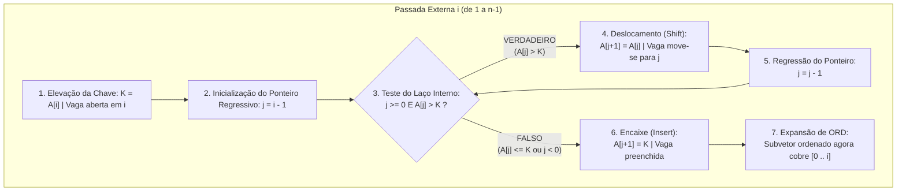

# Módulo 03 — Insertion Sort

> **Documento canônico do módulo curricular:** Especificação integral de design pedagógico, mecânico e computacional do Módulo de Insertion Sort da plataforma **Sorting Station**.  
> **Status de Implementação:** `IMPLEMENTADO E ATIVADO (P2.2 CONCLUÍDO) — INTRODUÇÃO VISUAL-FIRST ATIVA (UX-MODULE-R1)` (P2.2-A a P2.2-F concluídos; Introdução redesenhada no padrão Visual-First com `InsertionModuleOverviewV2.tsx`, exemplo hero `[2, 5, 3]`, 3 passos intuitivos `PEGUE / ABRA ESPAÇO / ENCAIXE`, ausência de ORD na camada principal e detalhes técnicos sob demanda).  
> **Data de Atualização:** 17/11/2026 (Marco UX-MODULE-R1 / ADR 0027)  
> **Dependências:** [`AGENTS.md`](../../../AGENTS.md), [`ADR 0018`](../../adr/0018-game-to-educational-platform-transition.md), [`ADR 0019`](../../adr/0019-insertion-sort-pedagogical-layer-and-interactive-tutorial.md), [`ADR 0020`](../../adr/0020-insertion-interactive-practice-system.md), [`ADR 0021`](../../adr/0021-module-exercise-persistence-schema-v4.md), [`modules/README.md`](./README.md), [`04-sorting-engine.md`](../04-sorting-engine.md), [`05-ux-design-system.md`](../05-ux-design-system.md), [`07-backend-and-persistence.md`](../07-backend-and-persistence.md), [`10-roadmap.md`](../10-roadmap.md), [`12-pedagogy-and-academic-traceability.md`](../12-pedagogy-and-academic-traceability.md).

---

## 1. Identificação do Módulo

- **Nome Canônico:** Insertion Sort (Ordenação por Inserção Incremental)
- **Identificador de Sistema (`moduleId`):** `insertion`
- **Rótulo Diegético na Interface:** `PROTOCOLO: INSERTION SORT // DESVIO E ENCAIXE DE CARGAS`
- **Subtítulo Diegético:** *Desvio e Encaixe de Cargas*
- **Status Factual:** `IMPLEMENTADO E ATIVADO (P2.2 CONCLUÍDO)` (Engine pura, constraints, briefing, tutorial guiado, práticas proceduralmente calibradas, tela de conclusão do conjunto, ResultScreen com telemetria de shifts/inserts, modelo de replay puro, pseudocódigo sincronizado de 11 linhas, tela unificada de replay/demonstração e persistência Schema v4 ativa; status no catálogo: `available`)
- **Classificação Curricular:** Algoritmo Elementar de Inserção com Subvetor Ordenado Crescente
- **Complexidade Temporal:**
  - **Melhor Caso (Vetor Já Ordenado):** $\Theta(n)$ comparações, $0$ deslocamentos físicos
  - **Caso Médio:** $\Theta(n^2)$ comparações, $\Theta(n^2)$ deslocamentos de elementos
  - **Pior Caso (Vetor Invertido):** $\Theta(n^2)$ comparações ($\frac{n(n-1)}{2}$), $\frac{n(n-1)}{2}$ deslocamentos
- **Complexidade Espacial (Memória Auxiliar):** $O(1)$ (in-place; 1 registrador auxiliar para a chave suspensa)
- **Estabilidade Formal:** Estável (preserva a ordem relativa de elementos com chaves idênticas se a inserção parar estritamente ao encontrar elemento $\le \text{chave}$)
- **Tema Visual e Acentos:** Âmbar Industrial / Ouro Solar (`#f59e0b`), iluminação de trilho aéreo suspenso

---

## 2. Objetivos de Aprendizagem

Ao concluir o Módulo de Insertion Sort, o estudante deverá demonstrar competência nos seguintes conceitos algorítmicos, computacionais e matemáticos pertinentes ao módulo:

1. **Lembrar (Conhecimento):** Identificar a operação de extração do elemento-chave ($K = A[i]$), a existência de uma partição ordenada à esquerda ($[0 \dots i-1]$) e o laço de varredura regressiva ($j = i - 1$ descendo até $-1$).
2. **Entender (Compreensão):** Explicar a distinção fundamental entre uma **permuta física bilateral** (*swap*, típica de Bubble e Selection Sort) e um **deslocamento unilateral** (*shift*, característico de Insertion Sort), bem como a razão pela qual a partição `ORD` não representa posições definitivamente fixas (`OK`).
3. **Aplicar (Execução):** Conduzir a varredura regressiva na esteira, avaliando a cada passo a condição relacional $A[j] > \text{chave}$, comandando deslocamentos de cargas maiores para a direita e inserindo a chave no momento exato em que a invariante for restaurada.
4. **Analisar (Diferenciação):** Diferenciar o comportamento do algoritmo sob dados aleatórios versus dados quase ordenados, reconhecendo o caráter adaptativo do Insertion Sort ($O(n + d)$, onde $d$ é o número de inversões).
5. **Avaliar (Julgamento):** Comparar criticamente o custo computacional de deslocamento contíguo em arranjos físicos versus a facilidade de inserção de nós em listas encadeadas ou buffers circulares.

---

## 3. Modelo Mental e Metáfora Visual

### 3.1. A Metáfora Canônica: Desvio e Encaixe de Cargas
A metáfora do módulo é formalmente congelada no domínio da Central Logística:

- **O Trilho Aéreo de Desvio (*Bypass Suspenso*):** Paralelo e acima da esteira principal de roletes, existe um trilho pneumático/magnético energizado. No início de cada passada $i$, o guindaste mecânico eleva a carga $A[i]$ para esse trilho aéreo.
- **A Chave Suspensa (`CHAVE`):** A carga elevada permanece flutuando sobre a esteira, visível e destacada em âmbar, servindo como padrão de comparação móvel.
- **A Vaga na Esteira (`VAGA`):** A retirada da chave deixa uma lacuna vazia na esteira (slot tracejado com iluminação industrial pulsante). A vaga não é preenchida por um "fantasma", mas sim pelo elemento vizinho quando este for deslocado.
- **O Deslocamento Regressivo (*Shift*):** Cargas já arranjadas na partição ordenada à esquerda que forem mais pesadas que a chave suspensa deslizam uma posição para a direita, ocupando a vaga e transferindo o espaço vazio um passo para a esquerda.
- **O Encaixe na Doca (*Drop / Insertion*):** Ao encontrar uma carga mais leve ou igual à chave (ou ao atingir a cabeceira $j=-1$), o guindaste desce a chave suspensa, encaixando-a com firmeza na vaga correspondente.

---

## 4. Operações Fundamentais e Invariantes



### 4.1. Invariante de Laço do Laço Externo
No início de cada iteração $i$ ($1 \le i \le n - 1$):
- O subvetor $A[0 \dots i-1]$ contém os mesmos elementos originais que ocupavam essas posições, porém em **ordem não decrescente**.
- **Aviso Pedagógico Fundamental:** $A[0 \dots i-1]$ é um subvetor ordenado **localmente** (`ORD`). Ele **NÃO** contém necessariamente os menores elementos globais do vetor (diferente do Selection Sort). Futuras cargas desordenadas podem ser menores e forçar o deslocamento de elementos já ordenados.

### 4.2. Invariante do Laço Interno
Durante a varredura regressiva com a chave $K$ suspensa e a vaga em $\text{holeIndex} = j + 1$:
- Todos os elementos originalmente em $A[j+1 \dots i]$ foram deslocados uma posição para a direita e satisfazem $A[k] > K$ para todo $k \in [j+1 \dots i]$.
- A condição de parada ocorre exatamente quando:
  1. $j < 0$ (a chave é menor que todos os elementos da sub-esteira, devendo ser encaixada no índice 0); OU
  2. $A[j] \le K$ (encontrou-se um elemento menor ou igual, devendo a chave ser encaixada na posição imediatamente seguinte, $j+1$).

### 4.3. Regra de Estabilidade
Quando $A[j] = K$, a condição $A[j] > K$ avalia como **FALSA**. O laço é interrompido imediatamente e a chave é encaixada em $j+1$, garantindo que a chave duplicada permaneça **após** o elemento idêntico já presente na esteira, preservando estritamente a estabilidade.

---

## 5. Mecânica Interativa Própria

### 5.1. Comparação Crítica das Propostas Mecânicas

| Critério de Avaliação | Proposta A: Decisão Passo a Passo (`SHIFT` vs `INSERT`) | Proposta B: Seleção Direta da Vaga Alvo | Proposta C: Híbrido (Scanner Passivo + Confirmação) |
| :--- | :--- | :--- | :--- |
| **Fidelidade ao Algoritmo** | **Máxima:** Espelha 1:1 o laço `while (j >= 0 && A[j] > key)`. | **Baixa:** O aluno usa percepção visual humana global, ignorando a busca sequencial. | **Média:** O scanner avança sozinho e o aluno apenas confirma a parada final. |
| **Clareza para Iniciantes** | **Alta:** O estudante avalia a inequação booleana exata $A[j] > K$ a cada passo. | **Média:** O estudante tenta "adivinhar" o índice mentalmente contando posições. | **Média:** Falta agência ativa nas comparações intermediárias. |
| **Carga Cognitiva** | **Focal:** Foco restrito a 2 elementos ($A[j]$ e $K$). | **Elevada:** Requer varredura visual de todo o subvetor ordenado de uma só vez. | **Baixa:** Risco de passividade cognitiva do operador. |
| **Risco de Confusão com Bubble** | **Nulo:** A chave está suspensa; o movimento é de translação de 1 caixa para a vaga. | **Nulo:** Mas perde o conceito computacional de deslocamento. | **Baixo:** Porém perde a sensação física de empurrar caixas. |
| **Micro-Ações Excessivas** | **Controladas:** Para $n=4, 5, 6$, cada passada possui entre 1 e 5 decisões. | **Mínimas:** Apenas 1 clique por passada (superficial pedagogicamente). | **Mínimas:** Mas reduz a interatividade. |

### 5.2. Mecânica Canônica Recomendada: Proposta A Refinada (Decisão Guiada)
Fica aprovada a **Proposta A Refinada**, com as seguintes diretrizes ergonômicas:

1. **Início Automático da Passada (*Auto-Lift*):** No início da passada $i$, o sistema eleva a carga $A[i]$ para o trilho suspenso com uma animação fluida (400ms) e abre a vaga em $i$. **Veta-se exigir um clique manual burocrático apenas para "selecionar a chave"**, pois não há escolha alternativa (a chave é estritamente $A[i]$ pelo laço externo).
2. **Botoeira Contextual Bimodal:**
   - `[ ➔ DESLOCAR CARGA ]` (Tecla `Espaço`): Comanda o deslocamento de $A[j]$ para a vaga à direita ($A[j+1] \leftarrow A[j]$). Válido se $A[j] > \text{chave}$.
   - `[ ⇣ ENCAIXAR CHAVE ]` (Tecla `Enter`): Comanda o pouso da chave suspensa na vaga atual. Válido se $A[j] \le \text{chave}$ ou se $j < 0$.
3. **Tratamento da Cabeceira ($j < 0$):** Quando todos os elementos forem deslocados e o ponteiro atingir $j < 0$, o botão `DESLOCAR CARGA` é desabilitado visualmente e o botão `ENCAIXAR CHAVE` passa a ser a única ação permitida, acompanhado da mensagem explicativa no `InstructionPanel`.

---

## 6. Pseudocódigo Canônico (11 Instruções — `INSERTION_SORT_PSEUDOCODE`)

```text
1.  procedimento insertionSort(A)
2.    para i de 1 até n - 1 faça
3.      chave ← A[i]
4.      j ← i - 1
5.      enquanto j ≥ 0 e A[j] > chave faça
6.        A[j + 1] ← A[j]
7.        j ← j - 1
8.      fim enquanto
9.      A[j + 1] ← chave
10.   fim para
11. fim procedimento
```

### Mapeamento de IDs Semânticos para Replay e Demonstração:
- Linha 1: `PROCEDURE_START`
- Linha 2: `OUTER_LOOP_START`
- Linha 3: `LIFT_KEY` (Extração de $A[i]$ para a chave suspensa)
- Linha 4: `INIT_J` (Apontamento para o vizinho imediato à esquerda $i-1$)
- Linha 5: `WHILE_CONDITION` (Avaliação booleana $j \ge 0 \land A[j] > \text{chave}$)
- Linha 6: `SHIFT_RIGHT` (Deslocamento de $A[j]$ para a vaga $j+1$)
- Linha 7: `DECREMENT_J` (Avanço da inspeção para a esquerda $j \leftarrow j - 1$)
- Linha 8: `END_WHILE`
- Linha 9: `INSERT_KEY` (Descida da chave suspensa para a vaga $j+1$)
- Linha 10: `END_FOR`
- Linha 11: `PROCEDURE_END`

---

## 7. Métricas Factuais Adequadas ao Algoritmo

- **Comparações de Chaves ($C(n)$):** Contabiliza todas as avaliações relacionais entre $A[j]$ e a chave suspensa, inclusive a comparação de parada quando $A[j] \le \text{chave}$.
- **Deslocamentos de Carga (*Shifts*):** Contabiliza o número de movimentações de caixas sobre a esteira ($A[j+1] \leftarrow A[j]$). **Não são permutas (*swaps*)!**
- **Inserções de Chave (*Insertions*):** Exatamente $n - 1$ operações de pouso da chave na vaga final.
- **Decisões Incorretas (`errors`):**
  - Tentar `DESLOCAR` quando $A[j] \le \text{chave}$ (violação da condição do enquanto);
  - Tentar `ENCAIXAR` quando $A[j] > \text{chave}$ (inserção prematura antes de abrir a vaga correta).
- **Dicas Utilizadas (`hintsUsed`):** Solicitações de andaime cognitivo contextual.
- **Tempo de Operação (`elapsedTimeMs`):** Informativo descritivo com peso **estritamente zero**.
- **Pontuação do Protocolo:**
  $$\text{score} = \max(0, 100 - (\text{errors} \times 10) - (\text{hintsUsed} \times 5))$$

---

## 7.1. Introdução Visual-First do Módulo (UX-MODULE-R1)

O ponto de entrada do módulo foi radicalmente redesenhado no marco `UX-MODULE-R1` sob o princípio fundamental:
$$\text{VISUAL FIRST} \longrightarrow \text{NATURAL LANGUAGE} \longrightarrow \text{FORMAL TERMINOLOGY}$$

### Arquitetura da Tela (`InsertionModuleOverviewV2.tsx`)
A antiga arquitetura baseada em múltiplos cards de documentação técnica foi substituída por uma apresentação visual progressiva (revisada e consolidada no marco `UX-MODULE-R1.1`):
1. **Título Dominante:** `INSERTION SORT` em destaque principal (sem competição com rótulos diegéticos pesados).
2. **Frase Conceitual Única:** *"Pegue um número e encaixe no lugar certo."* (projetada para leitura imediata sem termos técnicos prévios).
3. **Hero Visual Central (`InsertionConceptVisual.tsx`):** O elemento de maior destaque na tela, operando sobre o vetor elementar `[2, 5, 3]`:
   - **1. PEGUE:** Elemento `3` suspenso com badge `CHAVE`, abrindo a vaga inicial (`VAGA`). Mensagem: *"Vamos encaixar o 3. O número que estamos encaixando é chamado de chave."*.
   - **2. ABRA ESPAÇO:** Como $5 > 3$, o elemento `5` desliza para a direita para a vaga aberta. A vaga desloca-se para a esquerda. Mensagem: *"5 é maior que 3, então ele desliza para a direita. O 5 apenas desliza. Ele não troca de lugar com o 3."*. Badges concorrentes de ação foram eliminados em favor da evidência cinestésica direta do movimento e do destaque em ciano.
   - **3. ENCAIXE:** A chave `3` desce e pousa na vaga entre `2` e `5` (`[ 2 ] [ 3 ] [ 5 ]`). Mensagem: *"Agora o 3 cabe aqui. O vetor fica organizado: [2, 3, 5].*". O vetor final recebe realce suave em esmeralda, sem introduzir badges textuais prematuros como `OK`.
4. **Os 3 Passos Essenciais (`InsertionConceptSteps.tsx`):**
   - `1. PEGUE`: *"Escolha o próximo número."*
   - `2. ABRA ESPAÇO`: *"Mova para a direita quem for maior."*
   - `3. ENCAIXE`: *"Coloque a chave na vaga."*
5. **Ação Principal Dominante (CTA) com Caminho Secundário Único:** Botão `[ COMEÇAR TUTORIAL ▶ ]` com legenda *"Você vai praticar isso passo a passo."* e atalho secundário único discretamente posicionado: *"Já conhece o algoritmo? [ Ir para práticas › ]"*. O acesso à Demonstração Livre foi subordinado aos detalhes sob demanda, evitando sobrecarga com 3 caminhos de peso semelhante.
6. **Detalhes Técnicos Sob Demanda (`InsertionDetails.tsx`):** Único accordion retrátil fechado por padrão (`▼ Ver mais detalhes técnicos`) contendo:
   - Definição formal do algoritmo;
   - Relação entre Chave e Vaga Aberta;
   - Distinção conceitual entre *Shift* (deslocamento unilateral) e *Swap* (troca bilateral);
   - Região Ordenada Local (`ORD`) vs Posição Definitiva (`OK`), explicitando que o conceito foi adiado para esta seção de aprofundamento para reduzir a carga conceitual inicial;
   - Pseudocódigo canônico formal de 11 instruções importado diretamente de `src/game/sorting/insertion/insertionPseudocode.ts`;
   - Complexidades assintóticas completas: Melhor Caso $\Theta(n)$, Caso Médio $\Theta(n^2)$, Pior Caso $\Theta(n^2)$ e Espaço Auxiliar $\Theta(1)$ / $O(1)$;
   - Link subordinado para abertura da Demonstração Livre (`[ Ver Demonstração Livre › ]`).
7. **Regras de Despoluição e Factualidade:** Zero badges `ORD` na camada principal; zero badges textuais `OK` no hero conceitual; zero emojis de sistema; menos de 80 palavras antes do CTA principal; visível no primeiro viewport de 1366×768 sem rolagem obrigatória. Decisões registradas como escolhas arquiteturais de redução de carga cognitiva, sem asserção de efeitos cognitivos definitivos antes de nova validação formativa com usuários.

---

## 8. Modo Demonstração (Showcase Autônomo)

- **Propósito:** Proporcionar aprendizado observacional puro da mecânica de chave suspensa, deslocamentos em cadeia e encaixes.
- **Vetor Curado Fixo:** `[6, 3, 5, 2]` ($n=4$).
- **Passo a Passo Visual da Demonstração:**
  1. **Estado Inicial:** Vetor `[6, 3, 5, 2]`. Doca `[6]` marcada como `ORD`.
  2. **Passada 1 ($i=1$):**
     - Chave $3$ eleva-se ao trilho aéreo; vaga abre em $1$.
     - Scanner compara $A[0]=6$ com chave $3$: $6 > 3 \rightarrow$ VERDADEIRO.
     - Carga $6$ desliza para vaga $1$; vaga move-se para índice $0$.
     - Scanner atinge cabeceira ($j < 0$).
     - Chave $3$ desce para vaga $0$. Vetor: `[3, 6, 5, 2]`. Subvetor `ORD`: `[3, 6]`.
  3. **Passada 2 ($i=2$):**
     - Chave $5$ eleva-se; vaga abre em $2$.
     - Scanner compara $A[1]=6$ com chave $5$: $6 > 5 \rightarrow$ VERDADEIRO.
     - Carga $6$ desliza para vaga $2$; vaga move-se para índice $1$.
     - Scanner compara $A[0]=3$ com chave $5$: $3 \le 5 \rightarrow$ FALSO (parada do laço).
     - Chave $5$ desce para vaga $1$. Vetor: `[3, 5, 6, 2]`. Subvetor `ORD`: `[3, 5, 6]`.
  4. **Passada 3 ($i=3$):**
     - Chave $2$ eleva-se; vaga abre em $3$.
     - Deslocamentos sucessivos de $6 \rightarrow 3$, $5 \rightarrow 2$, $3 \rightarrow 1$.
     - Cabeceira atingida ($j < 0$).
     - Chave $2$ desce para vaga $0$. Vetor final: `[2, 3, 5, 6]`. Todas as caixas recebem selo `ORD`/`OK`.

---

## 9. Tutorial Guiado (Prática Assistida)

- **Vetor Curto de Treinamento:** `[4, 2, 3]` ($n=3$).
- **Roteiro Pedagógico em 7 Passos:**
  1. *Apresentação da Doca:* "A carga [4] já forma uma sub-esteira ordenada de 1 elemento. Observe a chave [2] elevando-se ao trilho aéreo."
  2. *Primeira Comparação:* "Comparando A[0] (4) com a chave (2). Como 4 > 2, a carga deve deslizar para a direita. Clique em [ ➔ DESLOCAR CARGA ]."
  3. *Encaixe na Cabeceira:* "Não há mais cargas à esquerda (início da esteira). A vaga 0 é perfeita para a chave. Clique em [ ⇣ ENCAIXAR CHAVE ]."
  4. *Expansão de ORD:* "Excelente! A esteira agora tem [2, 4] ordenados. Veja a chave [3] subindo ao trilho aéreo."
  5. *Comparação com Deslocamento:* "Comparando A[1] (4) com a chave (3). Como 4 > 3, clique em [ ➔ DESLOCAR CARGA ]."
  6. *Comparação com Parada:* "Atenção: A[0] (2) é menor ou igual à chave (3). O elemento 2 NÃO deve ser deslocado! Clique em [ ⇣ ENCAIXAR CHAVE ]."
  7. *Conclusão:* "Treinamento concluído! O vetor está ordenado: [2, 3, 4]."

---

## 10. Tipos de Exercícios Suportados (Taxonomia do Módulo / LEARNING-R1)

> **Expansão Pedagógica Canônica:** Ver especificação completa em [`learning-experience-expansion.md`](../learning-experience-expansion.md).

| Tipo de Exercício | Suporte | ID Canônico | Artefato Implementado / Status | Mapeamento no Schema v4 |
| :--- | :---: | :---: | :--- | :--- |
| **A. Introdução / Conceito** | `OBRIGATÓRIO` | `insertion-canonical` | `InsertionModuleOverviewV2.tsx` (`IMPLEMENTADO`, UX-MODULE-R1 / UX-MODULE-R1.1) | Volátil (não persistido no Schema v4; acesso livre sob demanda) |
| **B. Demonstração** | `OBRIGATÓRIO` | `insertion-demo` | `insertionDemonstration.ts` puro (`IMPLEMENTADO`, P2.2-C; visual em P2.2-E) | Volátil (memória) |
| **C. Tutorial Guiado** | `OBRIGATÓRIO` | `insertion-tutorial` | `InsertionTutorialScreen.tsx` sobre vetor `[4, 2, 3]` (`IMPLEMENTADO`, P2.2-C) | `modules.insertion.completedTutorial` |
| **D. Prática Básica** | `OBRIGATÓRIO` | `insertion.practice.basic` | `InsertionGameScreen.tsx` ($n=4$ com vaga única assistida) | `insertion.practice.basic` |
| **E. Prática Intermediária** | `OBRIGATÓRIO` | `insertion.practice.intermediate` | `InsertionGameScreen.tsx` ($n=5$ com deslocamentos múltiplos) | `insertion.practice.intermediate` |
| **E. Prática Avançada** | `OBRIGATÓRIO` | `insertion.practice.advanced` | `InsertionGameScreen.tsx` ($n=6$ com autonomia de inserção) | `insertion.practice.advanced` |
| **Encerramento do Conjunto** | `OBRIGATÓRIO` | `insertion.practice.set-complete` | `PracticeSetCompleteScreen.tsx` (`IMPLEMENTADO`, P2.2-D) | N/A |
| **F. Casos do Algoritmo** | `OBRIGATÓRIO` | `insertion.case.*` | Bateria de 5 casos curados principais (ordenado, reverso, quase ordenado, cabeceira, duplicatas) | `insertion.case.*` |
| **G. Desafio Didático** | `OPCIONAL` | `insertion.challenge.zero-shifts` | Desafio "Zero Shifts" em vetores quase ordenados | `insertion.challenge.zero-shifts` (CANDIDATO - Aguardando Homologação) |
| **H. Prática Livre (Sandbox)**| `OPCIONAL` | `insertion.sandbox` | Modo "Nova Entrada" e montagem livre (Marco LEARNING-R7) | `insertion.sandbox` |

---

## 11. Casos Pedagógicos Curados Específicos (Plano LEARNING-R1)

1. **Melhor Caso Linear — Já Ordenado (`[10, 20, 30, 40, 50]`) — ID: `insertion.case.already-sorted`**  
   - *Propriedade:* Demonstrar que $C(n) = n - 1 = 4$ e $\text{shifts} = 0$. Todas as chaves encontram parada imediata em $j = i - 1$, confirmando empiricamente o melhor caso $\Theta(n)$.
2. **Pior Caso Quadrático — Ordem Reversa (`[50, 40, 30, 20, 10]`) — ID: `insertion.case.reverse`**  
   - *Propriedade:* Demonstrar o custo máximo assintótico. $C(n) = \frac{n(n-1)}{2} = 10$, $\text{shifts} = 10$. Todas as chaves viajam até a cabeceira $j < 0$.
3. **Quase Ordenado (Adaptabilidade) (`[10, 20, 40, 30, 50]`) — ID: `insertion.case.nearly-sorted` [HOMOLOGADO EM PRODUÇÃO - LEARNING-R3-A / ADR 0026]**  
   - *Propriedade:* Apenas a chave 30 exige 1 shift; as demais pousam diretamente (5 comparações, 1 shift, 4 inserções diretas, 0 swaps). O Insertion realiza pouquíssimas operações, confirmando a complexidade próxima de $\Theta(n)$. Integrado ao Seletor de Práticas e com reflexão factual pós-execução.
4. **Chave até a Cabeceira (`[30, 40, 50, 10]`) — ID: `insertion.case.head-landing`**  
   - *Propriedade:* A chave 10 viaja até $j < 0$, demonstrando cinestesicamente a condição de limite esquerdo da esteira.
5. **Duplicatas e Estabilidade Formal (`[20, 30a, 30b, 10]`) — ID: `insertion.case.duplicates`**  
   - *Propriedade:* Ao comparar a chave $30b$ com $30a$, a condição $30a \le 30b$ interrompe o laço, garantindo que $30b$ pouse à direita de $30a$.

---

## 12. Geração Procedural e Constraints do Módulo

- **Gerador:** `generateSortingArray` e predicates puros em `src/game/sorting/insertion/insertionConstraints.ts` (PRNG Mulberry32) configurados com restrições procedurais diferenciadas por nível (Marco LEARNING-R2-A / ADR 0025).
- **Tamanhos e Perfis Curriculares:**
  - Prática Básica (`insertion.practice.basic`): $n = 4$ elementos, perfil `foundation`, suporte `full`;
  - Prática Intermediária (`insertion.practice.intermediate`): $n = 5$ elementos, perfil `mixed-decisions`, suporte `reduced`;
  - Prática Avançada (`insertion.practice.advanced`): $n = 6$ elementos, perfil `autonomous-complex`, suporte `minimal`.
- **Constraints Matemáticas Obrigatórias por Nível:**
  - **Prática Básica (`INSERTION_BASIC_CONSTRAINTS`):**
    - `isNotSorted`: impede vetores já ordenados;
    - `isNotReverseSorted`: impede pior caso trivial;
    - `hasAtLeastOneShift`: garante que ao menos uma chave exige deslocamento;
    - `hasAtLeastOneDirectInsert`: garante que ao menos uma chave pousa imediatamente sem deslocamento ($A[i-1] \le A[i]$);
    - `insertion-condition-false-stop` (`hasConditionFalseStopWithShift`): exige que em ao menos uma passada ocorra parada relacional ($A[j] \le \text{chave}$) após pelo menos 1 deslocamento prévio;
    - `insertion-moderate-shifts` (`hasModerateShiftsInBasic`): controla o volume total de shifts ($1 \le \text{totalShifts} \le 4$), evitando carga mecânica excessiva na introdução.
  - **Prática Intermediária (`INSERTION_INTERMEDIATE_CONSTRAINTS`):**
    - `isNotSorted`, `isNotReverseSorted`, `hasAtLeastOneShift`, `hasAtLeastOneDirectInsert`, `insertion-condition-false-stop`;
    - `insertion-multiple-shifts` (`hasInsertionWithMultipleShifts`): exige ao menos uma passada com múltiplos deslocamentos;
    - `insertion-heterogeneous-costs` (`hasHeterogeneousPassCosts`): assegura custos de deslocamento variados entre as passadas (sem exigir obrigatoriamente chegada à cabeceira, reservada para o caso curado `insertion.case.head-landing`).
  - **Prática Avançada (`INSERTION_ADVANCED_CONSTRAINTS`):**
    - `isNotSorted`, `isNotReverseSorted` (restaurado: exclui o vetor estritamente reverso, reservado para `insertion.case.reverse`), `hasAtLeastOneShift`, `insertion-multiple-shifts`;
    - `insertion-head-landing` (`hasHeadLandingInAtLeastOnePass`): garante que em ao menos uma passada a chave viaja até a cabeceira da esteira ($j < 0$);
    - `insertion-diverse-shift-trajectories` (`hasDiverseShiftTrajectories`): exige presença simultânea de passadas com 0 deslocamento (inserção direta), 1 deslocamento único e $\ge 2$ deslocamentos múltiplos.
- **Fallbacks Curados Determinísticos:**
  - Padrões canônicos fixos para $n=4$ (`[40, 20, 50, 30]`), $n=5$ (`[50, 20, 60, 10, 40]`) e $n=6$ (`[60, 15, 45, 90, 30, 20]`), satisfazendo integralmente todas as restrições pedagógicas de seus respectivos níveis.

### 12.1. Scaffolding Fading na Interface de Gameplay (Marco LEARNING-R2-B)
A interface dedicada do Insertion Sort (`InsertionGameScreen.tsx`) aplica a progressão de andaimes cognitivos (`PracticeSupportProfile`):
- **`full` (Prática Básica):**
  - Badge temático no painel de status: `SUPORTE COMPLETO` (esmeralda);
  - Condição relacional explícita: Container de condição destacando a fórmula exata $A[j] > \text{CHAVE} ?$;
  - Prompt: *"Compare a carga sob o scanner com a chave suspensa."*.
- **`reduced` (Prática Intermediária):**
  - Badge temático: `SUPORTE REDUZIDO` (âmbar);
  - Omissão da condição relacional: O container de condição oculta a fórmula comparativa e apresenta mensagem interpretativa;
  - Prompt: *"Avalie se a carga sob o scanner deve ser deslocada ou se a vaga é ideal."*.
- **`minimal` (Prática Avançada):**
  - Badge temático: `AUTONOMIA MÁXIMA` (púrpura);
  - Autonomia plena de decisão: Nenhuma fórmula ou dica de decisão prévia na interface;
  - Prompt: *"Determine autonomamente a posição correta da chave suspensa."*.
- **Invariantes Invioláveis:**
  - **Identificação da Cabeceira ($j = -1$):** A condição de término da esteira ($j = -1 \text{ • CABECEIRA DA ESTEIRA ALCANÇADA}$) permanece sempre explícita em todos os perfis quando $j < 0$, pois constitui um fato algorítmico do laço `while (j >= 0)`;
  - **Papéis Semânticos e Física da Esteira:** A chave suspensa no trilho aéreo, a vaga única aberta (`hole`), as caixas ordenadas (`ORD`) e a caixa sob scanner (`SCAN`) permanecem 100% visíveis com seus halos em todos os perfis;
  - O botão `[ ? DICA ]` permanece disponível em todos os perfis;
  - O feedback formativo detalhado em erros de deslocamento ou encaixe é integral em todos os perfis.

---

## 13. Feedback Formativo e Tratamento de Erros

- **Deslocamento Indevido (quando $A[j] \le \text{chave}$):**  
  - Mensagem: *"A carga sob análise A[j] (valor X) é menor ou igual à chave (valor K). Ela não deve ser deslocada! A vaga ideal para a chave foi encontrada."* (`errors += 1`, esteira paralisa sem alterar valores).
- **Encaixe Prematuro (quando $A[j] > \text{chave}$):**  
  - Mensagem: *"A carga A[j] (valor X) ainda é maior que a chave suspensa (valor K). Desloque-a para a direita antes de pousar a chave."* (`errors += 1`, estado preservado).
- **Tentativa de Deslocamento na Cabeceira ($j < 0$):**  
  - Mensagem: *"Início da esteira alcançado. Todas as cargas maiores já foram deslocadas. Encaixe a chave na vaga 0."*

---

## 14. Sistema de Dicas (Scaffolding Cognitivo)

- **Se $A[j] > \text{chave}$:**  
  *"A carga em inspeção A[j] (${A[j]}) é mais pesada que a chave (${key}). Clique em DESLOCAR CARGA para empurrá-la para a direita e abrir espaço."*
- **Se $A[j] \le \text{chave}$:**  
  *"A carga em inspeção A[j] (${A[j]}) é menor ou igual à chave (${key}). O laço de busca terminou! Clique em ENCAIXAR CHAVE."*
- **Se $j < 0$:**  
  *"Você alcançou o início da esteira. Não há elementos menores que a chave. Clique em ENCAIXAR CHAVE para colocá-la na posição 0."*
- *Rastreamento:* Cada dica solicitada incrementa `hintsUsed` na camada de sessão desacoplada, deduzindo 5 pontos na Pontuação do Protocolo.

---

## 15. Tela de Resultado e Reflexão

- **Métricas Exibidas:** Comparações $C(n)$, Deslocamentos de Carga (*shifts*), Inserções de Chave, Decisões Incorretas, Dicas, Tempo de Operação e Pontuação do Protocolo.
- **Reflexão Formativa:**  
  *"O Insertion Sort opera de maneira incremental e adaptativa. Ao contrário do Selection Sort, que sempre faz o mesmo número fixo de comparações independentemente da entrada, o Insertion Sort reduz drasticamente suas operações quando as cargas já estão próximas de sua ordem natural."*

---

## 16. Replay Retrospectivo e Demonstração Visual (P2.2-E)

- **Módulo Dedicado:** `insertionReplayModel.ts` consumindo `(initialArray, history: readonly InsertionStepRecord[])`.
- **Invariante Estrutural Estrita:** `frames.length === 1 + history.length` (exatamente 1 quadro `INITIAL` e 1 quadro para cada `StepRecord`). Sem geração de microframes artificiais (`INIT_J`, `DECREMENT_J`, `END_WHILE` ou `COMPARISON` isolado sem passo correspondente).
- **Tipos de Quadros Imutáveis (`InsertionReplayFrame`):**
  - `INITIAL`: Exibição do vetor inicial com a primeira carga estabelecendo `ORD` provisório de tamanho 1. Nenhuma vaga aberta e nenhum elemento suspenso.
  - `KEY_LIFT`: A chave eleva-se ao trilho aéreo (`key = A[i]`) e a vaga física é aberta na esteira (`holeIndex = i`).
  - `SHIFT`: A carga $A[j]$ desliza para a direita ocupando $j+1$, e a vaga física desloca-se para $j$. A comparação concreta ($A[j] > \text{chave} \rightarrow \text{VERDADEIRO}$) fica registrada no próprio quadro que justificou o movimento.
  - `INSERT`: Encaixe definitivo da chave na vaga, fechando a lacuna e expandindo `ORD` para cobrir $0 \dots i$. Discriminado pedagogicamente por:
    - `CONDITION_FALSE`: Parada por $A[j] \le \text{chave}$ (condição booleana falsa);
    - `HEAD_REACHED`: Parada por $j = -1$ (cabeceira da esteira alcançada).
- **Tratamento Rigoroso da Cabeceira:** Invariante inegociável de nunca exibir $A[-1]$ ou tentar comparar com posições fora do arranjo; o quadro exibe textualmente `j < 0 • CABECEIRA ALCANÇADA`.
- **Semântica Visual e Papéis de Caixas (`BoxRole`):**
  - A vaga aberta (`InsertionHoleSlot`) nunca recebe badge `ORD` nem o papel `ordered`;
  - Cargas preenchidas dentro da região $0 \dots \text{orderedBoundary}$ recebem o papel `ordered` (`ORD`) ou `ordered-scan` (`ORD • SCAN`) se coincidentes com $j$;
  - Durante passos intermediários, o selo esmeralda definitivo `OK` jamais é emitido;
  - Somente após o quadro final consolidado (`isCompleted === true`), todas as caixas assumem o papel `sorted` (`OK`).
- **Pseudocódigo Sincronizado de 11 Linhas:** O componente `InsertionSortPseudocodePanel.tsx` consome `getInsertionPseudocodeHighlight(frame)` e mapeia determinística e imutavelmente a linha primária em foco, as linhas de escopo ativas, o resultado booleano da condição e o bloco factual de contexto concreto.
- **Tela de Visualização Unificada:** `InsertionReplayScreen.tsx` opera como casca compartilhada para ambos os modos:
  - `mode: "replay"`: Auditoria técnica pós-exercício iniciada pausada com botão `← VOLTAR AO RESULTADO`;
  - `mode: "demonstration"`: Demonstração canônica pré-treinamento iniciada com autoplay ativo, botão `← VOLTAR` e CTA `INICIAR TREINAMENTO`.
- **Demonstração Canônica:** Alimentada autonomamente por `runInsertionDemonstration(CURATED_INSERTION_DEMO_ARRAY)` sobre o vetor curado `[6, 3, 5, 2, 7]`.

---

## 17. Persistência e Progresso (Schema v4 - ADR 0021)

- **Persistência Canônica Implementada (Schema v4):** Mapeado diretamente em `saveData.modules.insertion` na chave `sorting_station_save`:
  - `completedTutorial: boolean` — Persiste conclusão do tutorial interativo `[4, 2, 3]`;
  - `exerciseSets`: Mapeamento de cada conjunto de exercícios concluído:
    - `"insertion.practice.basic"` ($n=4$)
    - `"insertion.practice.intermediate"` ($n=5$)
    - `"insertion.practice.advanced"` ($n=6$)
  - `bestRecord`: Registra factual de melhor pontuação (`bestScore`, `bestScoreErrors`, `bestScoreHintsUsed`, `bestScoreElapsedTimeMs`).
- **Política Estrita de Recordes:**
  - Maior pontuação substitui recorde anterior;
  - Empate de pontuação: menor número de erros substitui recorde (recompensa por precisão);
  - Tempo de execução **NUNCA** desempata recordes nem incentiva pressa mecânica;
  - Deslocamentos e inserções não alteram critério de recorde.
- **Desbloqueios Derivados:**
  - Prática básica sempre desbloqueada;
  - Prática intermediária desbloqueada ao concluir básica;
  - Prática avançada desbloqueada ao concluir intermediária;
  - Zero flags redundantes persistidas no storage.
- **Volatilidade de Sessão:** Demonstrações e quadros de Replay permanecem estritamente voláteis em memória RAM.

---

## 18. Acessibilidade e Inclusão

- **Independência de Cor:**
  - `ORD`: Identificado visualmente por tarja verde-esmeralda pontilhada, ícone `[ORD]` e `aria-label="Carga em região ordenada provisória"`.
  - `CHAVE`: Identificada por posição elevada no eixo Y, borda âmbar sólida com brilho, ícone `[CHAVE]` e `aria-label="Carga chave suspensa no trilho aéreo"`.
  - `SCAN`: Identificada por retículo ciano inferior e `aria-label="Carga em comparação regressiva"`.
  - `VAGA`: Identificada por padrão de hachuras industriais, borda tracejada, texto `[ VAGA DISPONÍVEL ]` e `aria-label="Vaga livre na esteira para encaixe"`.
- **Controles por Teclado:** Teclas `Espaço` (Deslocar) e `Enter` (Encaixar). Navegação completa por `Tab` com anéis `focus-visible`.

---

## 19. Riscos Pedagógicos e Armadilhas Conceituais

1. **Confundir Deslocamento (*Shift*) com Permuta (*Swap*):** Estudantes habituados a Bubble Sort supõem que a chave troca de lugar com cada elemento inspecionado.  
   *Mitigação:* A chave permanece fisicamente suspensa no trilho aéreo; apenas a carga da esteira desliza para o lado, evidenciando que é uma cópia/deslocamento unidirecional.
2. **Confundir Posição da Chave com a Posição da Vaga:** Achar que a vaga fica "presa" onde a chave foi retirada.  
   *Mitigação:* A vaga desloca-se dinamicamente para a esquerda a cada shift, tornando óbvia a posição onde a chave pousará.
3. **Interpretar `ORD` como Posição Definitiva (`OK`):** Supor que elementos da esquerda nunca mais se moverão.  
   *Mitigação:* O selo visual é explicitamente `ORD` (ordenado relativo); o selo esmeralda definitivo `OK` só aparece ao final da ordenação completa do vetor.
4. **Perder Visualmente a Chave Suspensa:** Foco excessivo na esteira fazendo esquecer o valor da chave.  
   *Mitigação:* A chave fica centralizada no campo de visão, alinhada com o banner da expressão matemática ($A[j] > \text{CHAVE}$).
5. **Incompreensão da Varredura Regressiva:** Dificuldade em entender por que $j$ diminui ($i-1 \rightarrow 0$) em vez de crescer.  
   *Mitigação:* O painel de telemetria exibe explicitamente $j \leftarrow j - 1$ e o scanner move-se visivelmente da direita para a esquerda.
6. **Excesso de Micro-Ações Cansativas:** Desgaste ao realizar muitos shifts repetitivos em vetores grandes.  
   *Mitigação:* Vetores procedurais estritamente calibrados em $n=4, 5, 6$, mantendo o foco na aprendizagem sem fadiga motora.
7. **Confundir Inserção Física com Adição de Elemento:** Imaginar que a esteira ganha uma nova caixa, aumentando $n$.  
   *Mitigação:* O total de caixas $n$ permanece estritamente constante; a chave retirada é a mesma que retorna à esteira.

---

## 20. Relação com o Laboratório Comparativo (Marco P3.4)

- **Status:** O laboratório permanece `BLOQUEADO` até que todos os 6 módulos estejam implementados.
- **Comportamento no Benchmark:** O Insertion Sort demonstrará empiricamente sua superioridade assintótica em conjuntos de dados quase ordenados, alcançando desempenho $O(n)$ e superando Bubble e Selection Sort em comparações e movimentações.
- **Isolamento de Métricas:** A métrica de *Shifts* será reportada em coluna própria, nunca somada ou equiparada a *Swaps* bilaterais.

---

## 21. Introdução Visual-First e Harmonização Estrutural (`UX-MODULE-R1` e `UX-MODULE-R3`)

Nos marcos **UX-MODULE-R1**, **UX-MODULE-R1.1** e **UX-MODULE-R3**, a visão geral do Insertion Sort foi estabelecida como a pioneira do padrão **Visual-First** e subsequentemente integrada ao shell estrutural unificado:

1. **Adoção do Shell Unificado (`LearningModuleOverviewLayout.tsx`):**
   - O `InsertionModuleOverviewV2.tsx` utiliza o layout unificado com o tema `themeColor="amber"`;
   - Barra superior com navegação simplificada e badge `INSERTION SORT`;
   - Título hero e subtítulo claro: *"Pegue uma carta, abra espaço e encaixe no lugar certo."*;
   - Ponto de foco cristalino, sem ruídos decorativos nem cartões aninhados.

2. **Hero Visual Protagonista (`InsertionConceptVisual.tsx`):**
   - Demonstração visual interativa de 3 passos com vetor elementar `[2, 5, 3]`:
     - **Passo 1 (PEGUE):** A chave `3` é elevada verticalmente ao trilho aéreo em realce âmbar, abrindo a vaga na esteira;
     - **Passo 2 (ABRA ESPAÇO):** O elemento maior `5` desliza lateralmente para a direita, deslocando a vaga física para a esquerda;
     - **Passo 3 (ENCAIXE):** A chave `3` desce na vaga desocupada, consolidando o vetor em `[2, 3, 5]` com realce esmeralda;
   - Stepper acessível com navegação por botões, `role="img"` e rótulo `aria-label` completo.

3. **Passos Conceituais e Regra Fundamental (`InsertionConceptSteps.tsx`):**
   - Tríade de passos em 3 colunas limpas sobre fundo neutro: `1. PEGUE` (separe o elemento da vez), `2. ABRA ESPAÇO` (deslize os maiores para o lado), `3. ENCAIXE` (solte o elemento na vaga aberta);
   - **Regra Pedagógica em Destaque:**
     > **DESLOCAR ≠ TROCAR:** *"Elementos maiores apenas abrem espaço; a chave desce na vaga."*

4. **CTA Dominante e Rota Secundária:**
   - Botão de ação primária de alto contraste: `[ COMEÇAR TUTORIAL ▶ ]` com subtítulo *"Aprenda a mecânica passo a passo."*;
   - Rota secundária subordinada: *"Já conhece o algoritmo? [ Ir para práticas › ]"*.

5. **Aprofundamento Técnico Sob Demanda (`InsertionDetails.tsx`):**
   - Gaveta retrátil `<details>` fechada por padrão (`▼ Ver mais detalhes técnicos (para quem quer se aprofundar)`);
   - Pseudocódigo formal canônico de 11 instruções (`INSERTION_SORT_PSEUDOCODE` de `src/game/sorting/insertion/insertionPseudocode.ts`);
   - Análise assintótica formal: Melhor Caso $\Theta(n)$ com $0$ deslocamentos, Casos Médio e Pior $\Theta(n^2)$ com até $\frac{n(n-1)}{2}$ deslocamentos unilaterais, estabilidade algorítmica garantida e memória auxiliar $\Theta(1)$ / $O(1)$;
   - Botão para execução da Demonstração Livre.

---

## 22. Redesign Visual-First do Tutorial e da Prática Básica (`UX-PRACTICE-R2`)

No marco **UX-PRACTICE-R2**, o Tutorial Guiado e a Prática Básica do Insertion Sort foram integralmente redesenhados segundo o padrão **Visual-First**, eliminando o formato de dashboard industrial ruidoso e centrando a experiência no ciclo cognitivo consciente:

$$\text{OBSERVE A CHAVE} \longrightarrow \text{COMPARE PARA TRÁS} \longrightarrow \text{ABRA ESPAÇO} \longrightarrow \text{ENCAIXE}$$

### 22.1. Arquitetura de Componentes V2
- **`InsertionConveyorTrack.tsx`:** Rende o Trilho Aéreo de Suspensão com a `CHAVE` flutuando verticalmente (`key !== null`) e a Esteira de Triagem com a `VAGA` física aberta (`InsertionHoleSlot` em slot tracejado âmbar). Elemento observado marcado com `OBSERVANDO` (outline cyan límpido). Ausência total de badge `ORD` na camada primária de decisão;
- **`InsertionDecisionControls.tsx`:** Botoeira contextual cujas opções e pergunta derivam estritamente do estado da engine pura (`COMPARE_AND_SHIFT` exibe `Deslizar para a direita [1]` e `Encaixar a chave na vaga [2]` com fundo slate neutro, sem indução de cores verde/vermelho; `INSERT_READY` exibe apenas o encaixe na cabeceira);
- **`InsertionPredictionCard.tsx`:** Checkpoint apresentacional exibido antes da primeira decisão do Tutorial no vetor canônico `[4, 2, 3]` (*"A chave 2 deve ficar antes ou depois do 4?"*), estimulando intuição prévia sem alterar engine, score ou Schema v4;
- **`InsertionConceptualCheckpoint.tsx`:** Reflexão conceitual única exibida imediatamente após o primeiro deslocamento no Tutorial (*"O que aconteceu com a carga 4?"* $\rightarrow$ *"Deslizou para abrir espaço"*), consolidando a distinção $\text{SHIFT} \neq \text{SWAP}$;
- **`InsertionTechnicalDetails.tsx`:** Gaveta `<details>` fechada por padrão (Nível 3), contendo variáveis de telemetria formal ($i, j, \text{key}, \text{holeIndex}, \text{orderedBoundary}$) e o pseudocódigo canônico de 11 linhas com linha ativa sincronizada;
- **`InsertionTutorialScreenV2.tsx`:** Orquestrador do tutorial interativo guiado no vetor `[4, 2, 3]`;
- **`InsertionGameScreenV2.tsx`:** Orquestrador da Prática Básica ($n=4$, SupportProfile `full`), cálculo estrito de pontuação por fórmula canônica $\max(0, 100 - 10 \times \text{erros} - 5 \times \text{dicas})$, transições animadas e feedback causal com ícones semânticos SVG (zero emojis de sistema).

### 22.2. Distinção Canônica entre Módulos

| Algoritmo | Mecânica de Espaço / Posição | Comportamento das Cargas durante a Busca | Tipo de Movimento |
| :--- | :--- | :--- | :--- |
| **Selection Sort** | **`POSIÇÃO-ALVO`** ($i$ fixo, sem vaga física) | **Estáticas:** Nenhuma caixa se move durante as comparações ($j = i+1 \dots n-1$). | **Swap Bilateral Único** no commit ($A[i] \leftrightarrow A[\text{minIndex}]$). |
| **Insertion Sort** | **`VAGA FÍSICA`** ($[ \_ ]$, móvel via shifts) | **Deslocamentos Unilaterais:** Cargas maiores deslizam para a direita para abrir espaço. | **Shift Unilateral** ($A[j] \rightarrow A[j+1]$) e **Drop Vertical** da Chave. |
| **Bubble Sort** | **Pares Adjacentes** ($j, j+1$) | **Trocas Imediatas:** Elementos trocam continuamente de posição quando invertidos. | **Swaps Bilaterais Consecutivos** a cada inversão local. |

---

## 23. Hardening Conceitual e Redução de Ruído do Insertion Sort V2 (`UX-PRACTICE-R2.1`)

O marco **UX-PRACTICE-R2.1** realizou o hardening conceitual e a redução de densidade visual do Insertion Sort V2, eliminando ambiguidades metodológicas e separando rigorosamente a tomada de decisão em 3 níveis hierárquicos:

### 23.1. Invariante Epistemológica: `ORD LOCAL ≠ OK DEFINITIVO`
- **Diagnóstico da Falha Cognitiva:** No Insertion Sort, o prefixo $[0 \dots \text{orderedBoundary}]$ encontra-se ordenado apenas relativamente a si mesmo. Ele **NÃO** representa posições consolidadas definitivas (`OK`), pois chaves subsequentes menores ainda podem forçar novos deslocamentos (*shifts*) para a direita de qualquer um desses elementos;
- **Regra Visual Canônica:** Durante a ordenação (`completed === false`), nenhum elemento do vetor recebe acabamento esmeralda/verde (`border-emerald-500`, `bg-emerald-950`), nem badge `OK` ou `ORD` na visualização primária. O acabamento esmeralda consolidado (`role="sorted"`, "OK") é reservado **exclusivamente** para o encerramento factual da prática (`completed === true`), quando todos os elementos atingem a invariante global de ordenação;
- **A Vaga Física:** A vaga (`InsertionHoleSlot.tsx`) é visualmente neutra/âmbar com borda tracejada. Ela **NUNCA** recebe coloração esmeralda, nem badge `ORD`, nem `OK`.

### 23.2. Redução de Ruído Métrico durante a Decisão (Nível 1 Limpo)
- **Despoluição do Cabeçalho Operacional:** Contadores concorrentes de execução (`Comparações`, `Deslocamentos`, `Inserções` e `Tentativas incorretas / Erros`) foram removidos do subcabeçalho de decisão da tela ativa de gameplay;
- **Hierarquia de 3 Níveis de Informação:**
  - **Nível 1 (Decisão Operacional Imediata):** Módulo ativo (`Insertion Sort • Prática Básica`), indicador sutil de progresso (`Passada X de Y` e barra percentual), trilho suspenso com chave ativa, esteira com vaga física, elemento inspecionado, pergunta central e botões balanceados;
  - **Nível 2 (Suporte & Mediação Reflexiva):** Feedback causal imediato pós-ação e botão de auxílio opcional `[ ? Dica ]`;
  - **Nível 3 (Auditoria Formal & Métricas):** Gaveta técnica retrátil `<details>` com pseudocódigo de 11 linhas e variáveis de FSM em tempo real ($i, j, \text{key}, \text{holeIndex}, \text{orderedBoundary}$, contadores acumulados), e Tela de Conclusão pós-prática com métricas completas e pontuação.

### 23.3. Simplificação Semântica da Chave, Vaga e Scanner
- **Chave Suspensa (`CHAVE`):** A chave no trilho aéreo superior porta um único rótulo limpo `CHAVE` em `NumberedBox` sob o cabeçalho funcional `TRILHO AÉREO • CHAVE SUSPENSA`, eliminando rótulos duplicados empilhados sob a caixa;
- **Vaga Física (`VAGA`):** O slot tracejado apresenta um único indicador semântico `VAGA` e posição `#idx+1`, alinhado com a altura e espaçamento das demais cargas, sem badges secundários repetitivos (`ABERTA`, `⇣`) ou pulsações excessivas;
- **Elemento Observado (`OBSERVANDO`):** Reduzido de 5 pistas visuais simultâneas e conflitantes (bouncing arrow `▼`, pulso, glow, borda e badge `SCAN`) para 2 sinais límpidos e acessíveis: contorno com foco ciano e chip textual único inferior `OBSERVANDO`, mantendo equivalência para leitores de tela via `aria-label`.

