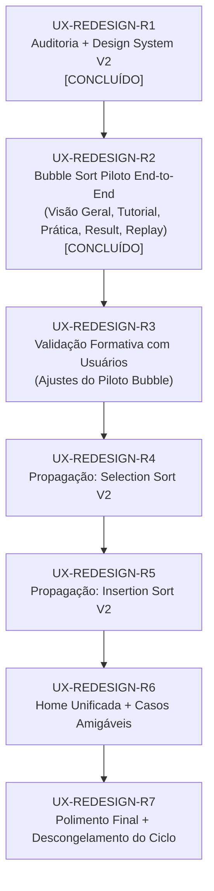

# UX Redesign V2: Redesenho Integral da Experiência Educacional e da Interface

> **Documento Canônico:** Especificação completa de auditoria, simplificação, arquitetura de informação, novo modelo de aprendizagem ativa, Design System V2, wireframes canônicos e plano de implementação do **Sorting Station**.  
> **Status:** Ativo / Base de Verdade da Plataforma  
> **Data:** 16/11/2026 (Marco UX-REDESIGN-R1)  
> **Governança:** [`AGENTS.md`](../../AGENTS.md), [`ADR 0018`](../adr/0018-game-to-educational-platform-transition.md), [`ADR 0025`](../adr/0025-curriculum-practice-differentiation-and-transversal-model.md), [`ADR 0026`](../adr/0026-algorithm-case-architecture-and-activity-context.md) e [`ADR 0027`](../adr/0027-educational-and-ui-experience-redesign-v2.md).

---

## 1. Problema Observado e Diagnóstico Formativo de Testes

### 1.1. Contexto e Motivação
Durante a consolidação da arquitetura do Sorting Station (marcos `PLATFORM-R0` a `LEARNING-R3-A`), a plataforma alcançou alto rigor técnico: engines puras isoladas, geração determinística Mulberry32, persistência canônica Schema v4 e 650 testes automatizados aprovados no Vitest.

Contudo, sessões informais de observação e testes formativos com estudantes e professores do ensino superior e técnico revelaram gargalos críticos de usabilidade e compreensão:
- **Sobrecarga de Informação Simultânea:** As telas apresentam dezenas de elementos competindo por atenção (várias métricas numéricas, múltiplos badges, carrosséis de texto operacional, painéis de pseudocódigo e decorações de ficção científica).
- **Desorientação Visual e Dificuldade Focal:** O usuário não consegue responder imediatamente: *"Onde estou?"*, *"Onde devo olhar agora?"* e *"Qual decisão preciso tomar?"*.
- **Risco de Automatismo Operacional:** Os botões e instruções tornaram-se tão mecânicos que o estudante é induzido a aprender apenas a *"clicar no botão certo"* para avançar, sem construir o modelo mental do algoritmo.
- **Curva de Aprendizagem Duplicada:** A interface exige que o estudante primeiro aprenda a decifrar a própria plataforma (índices $i, j, \text{minIndex}$, rótulos de invariantes, badges de telemetria) antes de começar a aprender ordenação.

### 1.2. Mudança Estratégica de Prioridade
Antes de expandir o currículo para novos algoritmos ou novos casos de estudo, a **experiência do usuário (UX) e a interface visual (UI) precisam ser radicalmente despoluídas e redesenhadas**.
- **Módulos Temporariamente Congelados:** Merge Sort, Quick Sort, Heap Sort e Laboratório Comparativo.
- **Módulos Centrais de Foco:** **Bubble Sort**, **Selection Sort** e **Insertion Sort**.
- **Módulo Piloto do Redesign:** **Bubble Sort** (mecânica mais elementar, ideal para validação inicial de clareza).

---

## 2. Princípios Fundamentais do Redesign

```
              ┌─────────────────────────────────────────┐
              │      CLAREZA INFANTIL SEM INFANTILIZAÇÃO │
              └────────────────────┬────────────────────┘
                                   │
         ┌─────────────────────────┼─────────────────────────┐
         ▼                         ▼                         ▼
  DESAPARECIMENTO          REGRA DE OURO DA          MODELO DE APRENDIZAGEM
    COGNITIVO DA           ATENÇÃO FOCAL              OBSERVAR ➔ PREVER ➔
     INTERFACE             (< 2 Segundos)              AGIR ➔ ENTENDER
```

### 2.1. "Clareza Infantil sem Infantilização"
Uma pessoa alfabetizada e sem qualquer conhecimento prévio de computação deve ser capaz de compreender visualmente:
1. Onde está;
2. O que está acontecendo;
3. Onde olhar;
4. Qual decisão precisa tomar;
5. Por que aquela decisão importa;
6. O que mudou depois da ação tomada.

Isso **NÃO** significa recorrer a desenhos caricatos, mascotes ou vocabulário simplista. Significa adotar **hierarquia estrita, alto contraste, tipografia legível, elementos de tamanho generoso, redução drástica de ruído visual e previsibilidade de navegação**.

### 2.2. A Interface que "Desaparece Cognitivamente"
A interface não deve ser um obstáculo entre o estudante e o algoritmo. O aluno não está ali para operar um terminal de controle simulado; está ali para compreender como os dados se comportam e convergem para a ordenação.

### 2.3. Linguagem Acadêmica Não-Presuntiva
Em estrito cumprimento a [`12-pedagogy-and-academic-traceability.md`](./12-pedagogy-and-academic-traceability.md), este redesenho **não garante nem promete aprendizagem**. O sistema é especificado para:
- Apoiar a compreensão conceitual;
- Exigir demonstrações observáveis de entendimento;
- Reduzir cliques mecânicos e impensados;
- Fornecer feedback causal imediato;
- Prover oportunidades estruturadas de reflexão.

A eficácia real continua condicionada a experimentos formais controlados com participantes humanos.

---

## 3. Auditoria Tela por Tela e Inventário de Poluição Visual

Esta auditoria detalha o estado factual de cada uma das 17 telas da plataforma atual, avaliando a carga cognitiva atual e classificando seus componentes.

### 3.1. HomeScreen (`src/screens/HomeScreen.tsx` e `ProtocolCard.tsx`)
- **Blocos Visuais Simultâneos:** 18 a 24 blocos (3 esteiras animadas de fundo, vinheta, 2 blobs de iluminação, cápsula de versão, título gigante com gradiente e drop-shadow, subtítulo, divisores com traços, 4 cards de protocolo, rodapé com telemetria).
- **Volume de Texto:** Alto (~450 palavras distribuídas entre cards, títulos e badges).
- **Badges:** 12 a 16 badges simultâneos (Status, Total de práticas, Sistema, etc.).
- **Cores Concorrentes:** 6 cores luminosas simultâneas (Ciano, Roxo, Âmbar, Azul, Esmeralda, Branco).
- **Métricas Simultâneas:** 12 métricas (3 por card: práticas concluídas, status tutorial, melhor pontuação).
- **CTAs:** 12 a 16 botões na mesma tela (cada card possui 3 a 4 botões: Iniciar Treinamento, Tutorial, Demonstração, Desafio).
- **Informação Principal:** Escolher um dos 3 algoritmos elementares para aprender.
- **Informação Secundária:** Progresso geral do estudante no módulo.
- **Informação Sob Demanda:** Metadados avançados, pontuação máxima anterior.
- **Informação Removível / Poluição:** Esteiras animadas de fundo, rodapé diegético, cards de protocolos futuros bloqueados ocupando metade da tela, múltiplos botões por card.
- **Carga Cognitiva Atual:** **ALTA**. O usuário depara-se com um catálogo denso e confuso ao invés de um ponto de partida límpido.

### 3.2. PracticeSelector (`src/screens/PracticeSelector.tsx`)
- **Blocos Visuais Simultâneos:** 14 a 18 blocos (Barra de atalhos, cabeçalho de título, 3 cards de práticas com 5 subseções cada, seção de casos com mais 3 cards, card de desafio).
- **Volume de Texto:** Muito Alto (~600 palavras com descrições, perfis de andaime e objetivos formativos).
- **Badges:** 10 a 14 badges (status, tamanho de entrada, perfil de andaime, tags de casos).
- **Cores Concorrentes:** Ciano, Roxo, Âmbar, Esmeralda, Slate.
- **Métricas Simultâneas:** Melhor score, erros, dicas, tempo para cada prática.
- **CTAs:** 6 a 8 botões concorrentes.
- **Informação Principal:** Escolher a próxima atividade do caminho de aprendizagem.
- **Informação Secundária:** Nível de apoio da prática (básico/intermediário/avançado).
- **Informação Sob Demanda:** Estatísticas históricas detalhadas de tentativas anteriores.
- **Informação Removível:** Exibição simultânea de 3 categorias distintas (Práticas, Casos, Desafios) sem separação progressiva.
- **Carga Cognitiva Atual:** **ALTA**. Parece um painel de telemetria empresarial.

### 3.3. Briefing de Modo (`src/screens/ProtocolModeBriefingScreen.tsx`)
- **Blocos Visuais Simultâneos:** 10 a 14 blocos (Cápsula, cabeçalho, carrossel de 3-4 slides, cartões de regras, ilustrações SVG, caixas de exceção, rodapé com navegação).
- **Volume de Texto:** Brutal (~800 a 1200 palavras dependendo do módulo).
- **Badges:** 4 a 6 badges.
- **Cores Concorrentes:** 4 cores.
- **Métricas Simultâneas:** Nenhuma.
- **CTAs:** 3 botões (Voltar, Próximo/Anterior, Iniciar Prática).
- **Informação Principal:** Conceito fundamental do algoritmo antes de praticar.
- **Informação Secundária:** Regra operacional de movimento.
- **Informação Sob Demanda:** Detalhes de complexidade assintótica e invariantes formais.
- **Informação Removível / Antecipada:** Parágrafos teóricos densos e explicações exaustivas de casos extremos antes da prática inicial.
- **Carga Cognitiva Atual:** **ALTA**. Leitura passiva excessiva antes do contato prático.

### 3.4. DemonstrationScreen (`src/screens/DemonstrationScreen.tsx`)
- **Blocos Visuais Simultâneos:** 12 blocos (delega integralmente para a tela de Replay com painel completo de pseudocódigo, telemetria, controles de velocidade e esteira).
- **Volume de Texto:** Médio (~200 palavras).
- **Badges:** 5 badges.
- **Cores Concorrentes:** Ciano, Roxo, Esmeralda, Slate.
- **Métricas Simultâneas:** 4 métricas (Passo, Comparações, Trocas, Erros).
- **CTAs:** 6 botões (Início, Anterior, Play/Pause, Próximo, Velocidades 0.5x/1x/2x, Voltar).
- **Informação Principal:** Movimento autônomo dos elementos ordenando-se.
- **Informação Secundária:** Explicação curta do que acabou de acontecer.
- **Informação Sob Demanda:** Pseudocódigo sincronizado linha a linha.
- **Informação Removível:** Controles de áudio/velocidade excessivos, cabeçalhos de auditoria técnica.
- **Carga Cognitiva Atual:** **MÉDIA**. Funcional, mas demasiadamente técnica para observadores iniciantes.

### 3.5. Tutorial Bubble Sort (`src/screens/TutorialScreen.tsx`)
- **Blocos Visuais Simultâneos:** 11 blocos (Barra superior, badge do protocolo, barra de passada/comparação, card de contexto, esteira com 4 cantoneiras decorativas, callout ativo pulsante, legenda de 3 papéis, botoeira com 2 botões, painel de instrução, card de regras com 3 tópicos).
- **Volume de Texto:** Médio/Alto (~280 palavras).
- **Badges:** 6 badges simultâneos.
- **Cores Concorrentes:** Ciano, Roxo, Esmeralda, Âmbar.
- **Métricas Simultâneas:** Passada atual, Comparação x/3.
- **CTAs:** 4 botões (Voltar, Reiniciar, Trocar, Manter).
- **Informação Principal:** As duas caixas sob comparação e a pergunta direta.
- **Informação Secundária:** Confirmação se trocou ou manteve.
- **Informação Sob Demanda:** Explicação expandida da regra.
- **Informação Removível:** Trilhos energizados com gradientes, cantoneiras decorativas, capacidade do vetor em jargão de carga (`3 PKG`), cards teóricos redundantes no rodapé.
- **Carga Cognitiva Atual:** **MÉDIA**. Poderia ser a experiência mais limpa da plataforma se despida de artefatos visuais.

### 3.6. Tutorial Selection Sort (`src/screens/SelectionTutorialScreen.tsx`)
- **Blocos Visuais Simultâneos:** 13 blocos (Semelhante ao Bubble, mas adiciona scanner, candidato a mínimo e fases bimodal `INSPECT`/`COMMIT`).
- **Volume de Texto:** Alto (~350 palavras).
- **Badges:** 7 badges.
- **Cores Concorrentes:** Ciano, Roxo, Âmbar, Esmeralda.
- **Métricas Simultâneas:** Passada, Comparações, Índice do Scanner.
- **CTAs:** 4 a 5 botões.
- **Informação Principal:** O elemento inspecionado é menor que o candidato atual?
- **Informação Secundária:** Posição alvo do início da passada.
- **Informação Sob Demanda:** Regra formal de seleção.
- **Informação Removível:** Múltiplas caixas com rótulos `ALVO (i)`, `MÍN (j)`, `SCAN` disputando espaço.
- **Carga Cognitiva Atual:** **ALTA**. Confusão frequente entre "alvo", "menor provisório" e "scanner".

### 3.7. Tutorial Insertion Sort (`src/screens/InsertionTutorialScreen.tsx`)
- **Blocos Visuais Simultâneos:** 14 blocos (Trilho aéreo, chave suspensa, vaga aberta na esteira, partição ordenada, scanner regressivo, botões modais).
- **Volume de Texto:** Alto (~380 palavras).
- **Badges:** 8 badges.
- **Cores Concorrentes:** Âmbar, Ciano, Esmeralda, Slate.
- **Métricas Simultâneas:** Fronteira ordenada, deslocamentos, comparações.
- **CTAs:** 3 a 5 botões dependendo da sub-fase (Elevar, Deslocar, Encaixar).
- **Informação Principal:** Para onde a chave deve ir?
- **Informação Secundária:** Os elementos maiores devem abrir espaço para a direita.
- **Informação Sob Demanda:** Relações formais $A[j] > \text{chave}$.
- **Informação Removível:** Rótulos duplicados de suspensão aérea e telemetria prematura.
- **Carga Cognitiva Atual:** **ALTA**. O modelo espacial chave/vaga é intuitivo, mas soterrado por instruções textuais longas.

### 3.8. GameScreen Bubble Sort (`src/screens/GameScreen.tsx`)
- **Blocos Visuais Simultâneos:** 12 a 15 blocos (PhaseHeader com badges de sistema, H2 de módulo redundante, subcabeçalho com 3 badges e 4 contadores, banner relacional concreto com fórmula $A[0] > A[1]$, esteira com rótulos e cantoneiras, caixas com números e badges `PKG`, legenda de 3 cores, barra de progresso, InstructionPanel, botoeira com 2 botões grandes, StatsPanel com 2 cards de métricas, botões DICA e REINICIAR).
- **Volume de Texto:** Médio/Alto (~200 palavras na tela ativa).
- **Badges:** 8 a 10 badges visíveis simultaneamente.
- **Cores Concorrentes:** 5 cores (Ciano neon, Roxo, Âmbar, Esmeralda, Vermelho alerta).
- **Métricas Simultâneas:** 6 métricas ativas durante o raciocínio ($C(n)$, $M(n)$, Erros, Dicas, Passada, Progresso %).
- **CTAs:** 5 botões (Voltar/Seletor, Trocar, Manter, Dica, Reiniciar).
- **Informação Principal:** Duas caixas destacadas e a pergunta: "Quem vem primeiro?".
- **Informação Secundária:** Indicador de progresso da passada.
- **Informação Sob Demanda:** Dica e regra do algoritmo.
- **Informação Redundante / Removível:** StatsPanel na base repetindo as métricas do topo; H2 repetindo PhaseHeader; cantoneiras de canto na esteira; contadores em tempo real de comparações/trocas que desviam a atenção da lógica; fórmula matemática $A[j] > A[j+1]$ que duplica visualmente os números das caixas.
- **Carga Cognitiva Atual:** **ALTA**. Desvia o foco do estudante para o monitoramento de painéis.

### 3.9. SelectionGameScreen (`src/screens/SelectionGameScreen.tsx`)
- **Blocos Visuais Simultâneos:** 14 a 16 blocos (PhaseHeader, subcabeçalho, banner relacional com Alvo, Mínimo e Scanner, caixas com 4 papéis semânticos simultâneos, barra de progresso, InstructionPanel, botoeira de inspeção ou commit, StatsPanel, botões de apoio).
- **Volume de Texto:** Alto (~240 palavras).
- **Badges:** 10 badges.
- **Cores Concorrentes:** 5 cores ativas.
- **Métricas Simultâneas:** 6 métricas ativas.
- **CTAs:** 4 a 5 botões.
- **Informação Principal:** Elemento sob scanner comparado com o menor encontrado até agora.
- **Informação Secundária:** Posição onde o menor será encaixado ao fim da passada.
- **Informação Removível:** Jargão técnico de índices (`Alvo (i)`, `Scanner (j)`); fórmula relacional explícita; StatsPanel redundante.
- **Carga Cognitiva Atual:** **MUITO ALTA**. A alternância entre inspecionar e comutar sobrecarrega o aprendiz.

### 3.10. InsertionGameScreen (`src/screens/InsertionGameScreen.tsx`)
- **Blocos Visuais Simultâneos:** 14 a 17 blocos (PhaseHeader, trilho aéreo suspenso, vetor principal com lacuna física `InsertionHoleSlot`, avaliação textual do passo com fórmula, legenda com 5 papéis de cores diferentes, InstructionPanel, botoeira com 3 ações, StatsPanel, botões de apoio).
- **Volume de Texto:** Alto (~260 palavras).
- **Badges:** 11 badges.
- **Cores Concorrentes:** 5 cores ativas.
- **Métricas Simultâneas:** 6 métricas ativas.
- **CTAs:** 5 botões.
- **Informação Principal:** Chave em destaque e elementos sendo comparados para abrir vaga.
- **Informação Secundária:** Fronteira ordenada consolidada à esquerda.
- **Informação Removível:** Exibição simultânea de trilho aéreo vazio, textos formais $j = -1$, StatsPanel na base.
- **Carga Cognitiva Atual:** **ALTA**. A mecânica cinestésica é rica, mas a tela compete com múltiplos painéis.

### 3.11. ResultScreen (`src/screens/ResultScreen.tsx`)
- **Blocos Visuais Simultâneos:** 10 a 12 blocos (Selo de conclusão pulsante, títulos com gradientes, vetor consolidado, card de reflexão pedagógica do caso, card de Pontuação do Protocolo com regras de dedução, lista de 5 a 6 métricas da operação, painel completo de pseudocódigo de 9 a 30 linhas estáticas, barra com 4 a 5 CTAs concorrentes).
- **Volume de Texto:** Muito Alto (~400 a 600 palavras).
- **Badges:** 6 a 8 badges.
- **Cores Concorrentes:** 5 cores.
- **Métricas Simultâneas:** 7 métricas (Score, Comparações, Trocas/Shifts, Erros, Dicas, Tempo, Comparações evitadas).
- **CTAs:** 4 a 5 botões (Próxima Prática, Repetir Prática, Rever Replay, Voltar ao Seletor, Hub Principal).
- **Informação Principal:** "Você concluiu!" + Conclusão qualitativa em 1-2 frases.
- **Informação Secundária:** 3 métricas fundamentais (Comparações, Movimentações, Erros).
- **Informação Sob Demanda:** Pontuação do protocolo, tempo decorrido, pseudocódigo completo e reflexão assintótica.
- **Informação Removível / Concorrente:** Pseudocódigo estático inteiro ocupando metade da tela; excesso de botões de navegação duplicados.
- **Carga Cognitiva Atual:** **ALTA**. O estudante não sabe se lê o código, se estuda as métricas ou se clica em avançar.

### 3.12. ReplayScreen (Bubble, Selection, Insertion)
- **Blocos Visuais Simultâneos:** 10 a 12 blocos (Cabeçalho de "Auditoria Técnica", badge de passada/passo, esteira com caixas, banner de ação do passo, caixa de explicação, controles de reprodução com 6 botões, painel sincronizado de pseudocódigo com linhas destacadas).
- **Volume de Texto:** Médio (~220 palavras).
- **Badges:** 5 badges.
- **Cores Concorrentes:** 4 cores.
- **Métricas Simultâneas:** Passo atual, Total de passos, Comparações, Trocas.
- **CTAs:** 7 botões (Início, Anterior, Play/Pause, Próximo, Velocidades, Voltar).
- **Informação Principal:** Ação causal daquele passo específico sobre a esteira.
- **Informação Secundária:** O que mudou e por quê.
- **Informação Sob Demanda:** Pseudocódigo sincronizado.
- **Informação Removível:** Jargão pesado de "Auditoria Técnica", múltiplos botões de velocidade.
- **Carga Cognitiva Atual:** **MÉDIA/ALTA**. Excelente precisão, mas parece ferramenta de depuração de engenharia.

### 3.13. PracticeSetCompleteScreen (`src/screens/PracticeSetCompleteScreen.tsx`)
- **Blocos Visuais Simultâneos:** 12 a 16 blocos (Cabeçalho comemorativo, subtítulo longo, síntese pedagógica com parágrafo denso, 3 cards com caixas consolidadas, tabela com 6 métricas agregadas, card especial de desafio desbloqueado, 3 botões de ação).
- **Volume de Texto:** Muito Alto (~500 palavras).
- **Badges:** 8 badges.
- **Cores Concorrentes:** 4 cores.
- **Métricas Simultâneas:** 6 métricas agregadas.
- **CTAs:** 3 botões.
- **Informação Principal:** Reconhecimento da conclusão do conjunto + Próximo passo recomendado.
- **Informação Secundária:** Síntese conceitual resumida.
- **Informação Sob Demanda:** Tabela analítica agregada.
- **Carga Cognitiva Atual:** **MÉDIA/ALTA**. Textos acadêmicos longos após um exercício prático cansam o estudante.

### 3.14. Seção de Casos do Algoritmo (no Seletor e no Resultado)
- **Blocos Visuais Simultâneos:** 6 a 8 blocos (Cards com vetores estáticos, objetivos formais, comparações teóricas vs. observadas).
- **Volume de Texto:** Alto.
- **Badges:** 4 por card.
- **Informação Principal:** Uma situação curiosa ou extrema para observar (ex.: quase ordenado).
- **Informação Removível:** Fórmulas de complexidade $\Theta(n)$, $\Theta(n^2)$ apresentadas antes do aluno ver o comportamento na prática.
- **Carga Cognitiva Atual:** **ALTA**.

---

### 3.15. Matriz Consolidada de Classificação de Elementos

| Elemento Atual | Classificação | Destino no Redesign V2 |
| :--- | :---: | :--- |
| **Vetor com caixas numeradas na esteira** | **ESSENCIAL** | **Preservado e ampliado**. Ocupa a posição central e dominante. |
| **Destaque do par/elemento ativo sob decisão** | **ESSENCIAL** | **Preservado**. Realce imediato e unívoco. |
| **Pergunta focal direta (ex.: "Qual vem primeiro?")** | **ESSENCIAL** | **Criado/Padronizado**. Substitui parágrafos operacionais. |
| **Botões de decisão atômica (TROCAR / MANTER)** | **ESSENCIAL** | **Preservados e aumentados**. Botoeira grande e intuitiva. |
| **Progresso simples (Passo X de Y)** | **ESSENCIAL** | **Preservado**. Barra ou texto minimalista. |
| **Feedback causal imediato (1 frase)** | **ESSENCIAL** | **Padronizado**. Explica a causa do acerto/erro. |
| **Dica contextual sob demanda** | **SECUNDÁRIO** | **Preservado sob botão `[ ? ]` ou `[ DICA ]`**. |
| **Explicação da regra em linguagem natural** | **SECUNDÁRIO** | **Movido para painel recolhível ou Nível 2**. |
| **Papel dos índices ($i, j, \text{minIndex}$)** | **SOB DEMANDA** | **Oculto no contato inicial; exibido apenas em níveis avançados**. |
| **Métricas em tempo real ($C(n)$, $M(n)$, tempo)** | **SOB DEMANDA** | **Removido da área ativa de gameplay; movido para Resultado/Replay**. |
| **Pontuação do Protocolo durante o jogo** | **SOB DEMANDA** | **Removido do gameplay; exibido exclusivamente na tela de Resultado**. |
| **Pseudocódigo sincronizado** | **SOB DEMANDA** | **Central na Demonstração e Replay; togglável/oculto na Prática ativa**. |
| **Notação assintótica ($O(n^2), \Omega(n)$)** | **SOB DEMANDA** | **Oculto inicialmente; apresentado após o estudante constatar o fenômeno**. |
| **Cards de módulos futuros bloqueados no Hub** | **REMOVÍVEL** | **Ocultos/recolhidos**. Apenas os 3 módulos centrais ficam visíveis. |
| **Esteiras decorativas com caixas rolando no fundo da Home**| **REMOVÍVEL** | **Eliminado**. Distração visual pura sem função. |
| **Cantoneiras e detalhes decorativos nas bordas da esteira** | **REMOVÍVEL** | **Eliminado**. Linhas limpas sem ornamentação supérflua. |
| **StatsPanel na base repetindo dados do cabeçalho** | **REMOVÍVEL** | **Eliminado**. Redundância zero de contadores. |
| **Fórmulas relacionais $A[j] > A[j+1]$ redundantes com caixas**| **REMOVÍVEL** | **Eliminado**. O aluno olha para os números reais das caixas. |
| **Textos operacionais longos antes da ação** | **REMOVÍVEL** | **Substituído por microcopy atômica**. |

---

## 4. Nova Hierarquia de Informação e Regra de Ouro

```
┌────────────────────────────────────────────────────────────────────────┐
│ NÍVEL 1 — ESSENCIAL (Sempre Visível)                                   │
│ • Vetor principal com caixas grandes                                   │
│ • Elementos ativos sob decisão                                         │
│ • Uma pergunta clara e direta                                          │
│ • Poucos botões de ação imediata                                       │
│ • Progresso simples da atividade                                       │
├────────────────────────────────────────────────────────────────────────┤
│ NÍVEL 2 — APOIO (Contextual / Ao Alcance de 1 Clique)                  │
│ • Dica reflexiva                                                       │
│ • Explicação do papel da peça (ex.: "Esta caixa é a chave")            │
│ • Regra do algoritmo em linguagem humana                               │
├────────────────────────────────────────────────────────────────────────┤
│ NÍVEL 3 — DETALHES (Sob Demanda / Pós-Sessão)                          │
│ • Métricas analíticas completas: C(n), M(n), tempo descritivo          │
│ • Pseudocódigo canônico formal sincronizado                            │
│ • Pontuação do Protocolo detalhada com deduções                        │
│ • Análise assintótica formal e invariantes matemáticos                 │
└────────────────────────────────────────────────────────────────────────┘
```

### 4.1. Regra de Ouro da Interface
> **"Toda tela possui UMA ação principal perceptível. No gameplay: UM foco visual, UMA pergunta e DUAS (ou poucas) decisões."**

O estudante nunca deve precisar decodificar mais de um ponto focal por vez. Ao olhar para a tela, a resposta visual à pergunta *"O que eu faço agora?"* deve ser óbvia em menos de 2 segundos.

### 4.2. Política de Métricas: Foco no Algoritmo, Não no Painel
Durante a prática ativa, o estudante não está operando uma usina nuclear; está compreendendo uma ordenação.
- **Durante o Exercício:** Exibir apenas o progresso essencial (ex.: *"Passo 2 de 6"* ou *"Passada 1 de 3"*).
- **Métricas Analíticas ($C(n)$, $M(n)$, Erros, Tempo, Pontuação):** Exibidas **exclusivamente na tela de Resultado e no Replay**, ou em gaveta recolhível sob demanda.
- **Pontuação do Protocolo:** Calculada no backend, mas revelada apenas ao final para evitar ansiedade de desempenho durante o raciocínio.

### 4.3. Política de Pseudocódigo
- **Modo Demonstração:** Pseudocódigo sincronizado pode ser exibido de forma visual e integrada, pois o objetivo é observar a correspondência entre código e movimento.
- **Modo Replay:** Pseudocódigo sincronizado linha a linha é mantido para permitir auditoria retrospectiva.
- **Prática Ativa:** Pseudocódigo fica **oculto por padrão**, acessível opcionalmente através do botão `[ VER CÓDIGO ]`.
- **Tutorial:** Exibido apenas se pedagogicamente necessário para fixar uma instrução pontual.

### 4.4. Redução Brutal de Texto Operacional
- Substituir parágrafos de instrução por:
  $$\text{TÍTULO CURTO} + \text{UMA PERGUNTA DIRETA}$$
- Exemplo a ser banido:
  *❌ "Observe atentamente as cargas destacadas e determine se a carga da esquerda apresenta valor superior à carga da direita para decidir se uma troca deverá ser executada pelo sistema..."*
- Exemplo canônico adotado:
  *✔️ "30 é maior que 20. O que deve acontecer?"* $\rightarrow$ `[ MANTER ]` / `[ TROCAR ]`
  *✔️ "Qual vem primeiro?"* $\rightarrow$ `[ 20 ]` / `[ 30 ]`

### 4.5. Linguagem e Desmistificação de Jargão
- Não despejar termos de ponteiros ($i, j, \text{minIndex}, \text{orderedBoundary}, \text{FSM}, \text{commit}$) no primeiro contato.
- Apresentar primeiro o **termo concreto/visual**, introduzindo gradualmente o termo técnico:
  - *Passo 1:* "Esta caixa será nossa **chave**."
  - *Passo 2:* "No Insertion Sort, chamamos esse elemento suspenso de **chave**."
  - *Passo 3:* "Ele é comparado com os elementos da parte ordenada."

### 4.6. Metáfora Diegética Simplificada
A metáfora da Central Logística Espacial é preservada, mas atua como aliada da clareza, nunca como barreira de vocabulário.
- "Caixa" complementa "Elemento";
- "Esteira" complementa "Vetor";
- "Scanner" representa visualmente a inspeção;
- Eliminam-se códigos diegéticos crípticos como `PKG`, `SYS_ACT`, `COMM_LINK`.

---

## 5. Novo Modelo de Aprendizagem: Observe ➔ Preveja ➔ Aja ➔ Entenda

```
       ┌───────────┐         ┌───────────┐         ┌───────────┐         ┌────────────┐
       │ OBSERVAR  │ ──────> │  PREVER   │ ──────> │   AGIR    │ ──────> │  ENTENDER  │
       └───────────┘         └───────────┘         └───────────┘         └────────────┘
        Notar estado         O que vai             Executar               Feedback
        e elementos          acontecer?            a decisão              causal
```

Para evitar que o exercício degenere em cliques automáticos ("ver ciano $\rightarrow$ clicar trocar $\rightarrow$ próximo"), introduzem-se **checkpoints pedagógicos leves**:

### 5.1. Previsão Pontual (Antes de Operações Críticas)
Em momentos selecionados da passada (e não em todos os passos, para não quebrar a fluidez), o sistema solicita uma previsão intuitiva:
- **Bubble Sort:** *"Após esta passada, qual caixa estará no final da esteira?"* $\rightarrow$ Clique na caixa prevista.
- **Selection Sort:** *"Qual é o menor valor encontrado até este momento?"* $\rightarrow$ Opção direta com 3 alternativas.
- **Insertion Sort:** *"Onde você acha que a chave vai se encaixar?"* $\rightarrow$ Clique no espaço previsto da esteira.

### 5.2. Micro-Checks de Compreensão (Após Momentos-Chave)
Após a ocorrência de um evento estrutural (ex.: conclusão da primeira passada do Bubble Sort):
- *"Por que 50 não precisou ser comparado novamente?"*
  - `A.` Porque já está na sua posição definitiva no final do vetor. *(Correta)*
  - `B.` Porque o algoritmo parou de funcionar.
  - `C.` Porque números pares não se movem.

### 5.3. Feedback Causal em Erros e Acertos
- **Em caso de Erro:** Explicar a causa factual sem punir, sem resetar a esteira e sem bloquear o estudante:
  > *"Quase! 30 é maior que 20. Por isso, eles precisam trocar de lugar para ficarem em ordem crescente. [ Tentar de Novo ]"*
- **Em caso de Acerto:** Confirmar o motivo da mudança em uma frase curta:
  > *"Correto! 30 foi para a direita porque é maior que 20."*

---

## 6. Jornada Visual e Redesenho das Telas Principais

### 6.1. Nova Home (Launcher Educacional Visual — UX-HOME-R2)
- **Foco Estrito nos 3 Módulos:** Bubble Sort, Selection Sort e Insertion Sort (Merge, Quick, Heap estão congelados e completamente ausentes da Home, sem "Em Breve").
- **Header Compacto:** Logo 25–35% menor com subtítulo direto em 1 linha: *"Aprenda algoritmos de ordenação visualmente."* (sem parágrafos longos, sem caixas de callout, sem CTAs redundantes).
- **Faixa de Processo (< 45px):** 3 passos com SVGs puros: `ESCOLHA um algoritmo` → `APRENDA como funciona` → `PRATIQUE passo a passo`.
- **Cards com Mini Visual da Mecânica:** Demonstração visual compacta (~70–90px) da operação antes do clique:
  - **Bubble Sort:** `[ 8 ] [ 3 ] ➔ [ 3 ] [ 8 ]` + *"Compare vizinhos."* (badge discreto `Recomendado`);
  - **Selection Sort:** `[ 4 ] [ 1 (min) ] [ 7 ] ➔ [ 1 ] [ 4 ] [ 7 ]` + *"Encontre o menor."*;
  - **Insertion Sort:** `[ 2 ] [ 5 ] [ 3 (key) ] ➔ [ 2 ] [ 3 ] [ 5 ]` + *"Encaixe cada elemento."*.
- **Progresso Minimalista:** Indicador de 3 pontos (`● ● ○`) e texto `X de 3 práticas`.
- **CTA Único por Card:** Exatamente 1 botão: `[ COMEÇAR ]` ou `[ CONTINUAR ]` (abre a visão do módulo).
- **Retomada Sutil:** Faixa não invasiva de 1 linha quando há progresso factual salvo (`Continue de onde parou: [Módulo] • [Prática] • Continuar →`).

### 6.2. Página do Módulo (Module Overview)
Substitui o `PracticeSelector` sobrecarregado por um caminho linear e claro:

```
BUBBLE SORT
"Compare vizinhos e organize a esteira."

[ CONTINUAR DE ONDE PAROU ]

SEU CAMINHO:
┌────────────────────────────────────────────────────────┐
│ 1. APRENDER                                            │
│    ○ Conceito em 1 Minuto                              │
│    ○ Demonstração Animada                              │
│    ● Tutorial Passo a Passo                            │
├────────────────────────────────────────────────────────┤
│ 2. PRATICAR                                            │
│    ● Prática Básica (4 caixas)                         │
│    ○ Prática Intermediária (5 caixas)                  │
│    ○ Prática Avançada (6 caixas)                       │
├────────────────────────────────────────────────────────┤
│ 3. EXPLORAR CASOS                                      │
│    ○ Quase Ordenado (O que acontece com poucas trocas?)│
│    ○ Já Ordenado (O algoritmo percebe?)                │
└────────────────────────────────────────────────────────┘
```

### 6.3. Gameplay Canônico
- **Topo Mínimo:** Nome do Módulo e Progresso simples (`Passo 2 de 6`).
- **Centro Dominante:** Esteira ampla com caixas de tamanho generoso. Somente os elementos envolvidos na decisão recebem cor de destaque.
- **Pergunta Central:** Embaixo da esteira, em fonte limpa e destacada.
- **Botoeira:** Apenas os 2 (ou poucos) botões de decisão, grandes e táteis.
- **Apoio Discreto:** Botão `[ ? DICA ]` no canto inferior.

### 6.4. Resultado Canônico
- **Mensagem Primária:** *"Você Concluiu!"*
- **Síntese Factual:** 1 a 2 frases explicativas (ex.: *"Você realizou 6 comparações e 3 trocas. Todas as 4 caixas estão em ordem crescente."*).
- **Métricas Essenciais:** Apenas 3 números em destaque:
  - Comparações: `6`
  - Trocas: `3`
  - Erros: `0`
- **Ação Sob Demanda:** Botão `[ Ver Detalhes e Pontuação ]` para expandir telemetria completa.
- **CTAs Principais:** Apenas 2 botões claros:
  - `[ REVER EXECUÇÃO (REPLAY) ]`
  - `[ CONTINUAR ]`

### 6.5. Replay Canônico
- Foco na esteira em movimento passo a passo.
- Controles simples: `[ ◀ Anterior ]`, `[ ▶ Reproduzir ]`, `[ Próximo ▶ ]`.
- Explicação curta a cada passo: *"Passo 3: 30 > 20, logo trocaram de posição."*
- Pseudocódigo acessível via aba ou botão lateral `[ Código ]`, não competindo com o centro.

### 6.6. Casos do Algoritmo Amigáveis
Cards humanizados com intencionalidade pedagógica imediata:
- Card: **QUASE ORDENADO**
  *"Apenas duas caixas estão fora de ordem. Veja como o Bubble Sort reage a isso."*
  `[ EXPLORAR CASO ]`
- O conceito assintótico ($\Theta(n)$ ou $\Theta(n^2)$) é nomeado **após** o estudante observar o resultado na tela de conclusão.

---

## 7. Wireframes Textuais / ASCII da Arquitetura V2

### 7.1. Wireframe A — Home Redesenhada (Launcher Educacional Visual — UX-HOME-R2)

```
================================================================================
                                SORTING STATION
                  Aprenda algoritmos de ordenação visualmente.
================================================================================
       [ ESCOLHA um algoritmo ] ➔ [ APRENDA como funciona ] ➔ [ PRATIQUE passo a passo ]

┌───────────────────────────┐ ┌───────────────────────────┐ ┌───────────────────────────┐
│ BUBBLE SORT  Recomendado  │ │ SELECTION SORT            │ │ INSERTION SORT            │
│ Comparação de vizinhos    │ │ Seleção do menor número   │ │ Inserção na parte orden.  │
│                           │ │                           │ │                           │
│ ┌───────────────────────┐ │ │ ┌───────────────────────┐ │ │ ┌───────────────────────┐ │
│ │ [ 8 ][ 3 ] ➔ [ 3 ][ 8 ]│ │ │ │ [ 4 ][ 1*][ 7 ]➔[1][4]│ │ │ │ [ 2 ][ 5 ][3*]➔[2][3] │ │
│ │   Compare vizinhos.   │ │ │ │   Encontre o menor.   │ │ │ │   Encaixe cada elemento │ │
│ └───────────────────────┘ │ │ └───────────────────────┘ │ │ └───────────────────────┘ │
│                           │ │                           │ │                           │
│ 0 de 3 práticas   ○ ○ ○   │ │ 0 de 3 práticas   ○ ○ ○   │ │ 0 de 3 práticas   ○ ○ ○   │
│ [      COMEÇAR  ▶     ]   │ │ [      COMEÇAR  ▶     ]   │ │ [      COMEÇAR  ▶     ]   │
└───────────────────────────┘ └───────────────────────────┘ └───────────────────────────┘

================================================================================
          Sorting Station • Plataforma Educacional de Algoritmos
================================================================================
```

*Meta Heurística dos 5 Segundos (Hipótese de Design da Home — a validar em campo em UX-REDESIGN-R3-B):*
1. **O que é isso?** Aprender algoritmos de ordenação visualmente.
2. **Quais são as três opções?** Bubble Sort, Selection Sort e Insertion Sort.
3. **Qual delas devo abrir primeiro?** Bubble Sort (marcado como Recomendado).
4. **Onde clico?** No botão `[ COMEÇAR ]`.

---

### 7.2. Wireframe B — Visão do Módulo (Module Overview)

```
================================================================================
 ◀ Voltar ao Início                                           Módulo Bubble Sort
================================================================================

                                BUBBLE SORT
             Compare vizinhos e leve os maiores para o final da esteira.

                   [ CONTINUAR: PRÁTICA BÁSICA (PASSO 2) ▶ ]

--------------------------------------------------------------------------------
                               SEU CAMINHO
--------------------------------------------------------------------------------

  ETAPA 1: ENTENDER E OBSERVAR
  [✓] Conceito Rápido ................ Explicação visual em 3 passos
  [✓] Ver Demonstração ............... Assista o algoritmo rodando sozinho
  [✓] Tutorial Guiado ................ Prática com apoio total passo a passo

  ETAPA 2: PRATICAR
  [▶] Prática Básica ................. 4 caixas • Suporte com dicas [EM ANDAMENTO]
  [ ] Prática Intermediária .......... 5 caixas • Menos apoio visual
  [ ] Prática Avançada ............... 6 caixas • Autonomia total

  ETAPA 3: EXPLORAR CASOS
  [ ] Quase Ordenado ................. Veja o que acontece com só 2 caixas fora
  [ ] Já Ordenado .................... O algoritmo precisa conferir tudo?

================================================================================
```

*Teste dos 5 Segundos (Module Overview):*
1. **Onde estou?** No caminho de aprendizagem do Bubble Sort.
2. **Onde olhar?** No botão principal de continuar e no item em andamento.
3. **O que fazer?** Clicar em `[ CONTINUAR: PRÁTICA BÁSICA ]`.

---

### 7.3. Wireframe C — Tutorial (Passo a Passo)

```
================================================================================
 ◀ Voltar                                           Bubble Sort • Tutorial (2/4)
================================================================================


                          Passo 2: Comparando Vizinhos
                 "Observe as duas caixas iluminadas no início."


      ══════════════════════════════════════════════════════════════════
               ┌───────────┐   ┌───────────┐   ┌───────────┐
               │           │   │           │   │           │
               │    30     │   │    10     │   │    20     │
               │           │   │           │   │           │
               └───────────┘   └───────────┘   └───────────┘
                  (Ativa)         (Ativa)
      ══════════════════════════════════════════════════════════════════


                          30 é maior que 10.
                      Eles devem trocar de posição?


              ┌─────────────────────┐     ┌─────────────────────┐
              │                     │     │                     │
              │   ⇄  SIM, TROCAR    │     │   =  NÃO, MANTER    │
              │                     │     │                     │
              └─────────────────────┘     └─────────────────────┘


--------------------------------------------------------------------------------
 [ ? ] Por que trocamos? Quando o da esquerda for maior, trocamos para ordenar.
================================================================================
```

*Teste dos 5 Segundos (Tutorial):*
1. **Onde estou?** No Tutorial do Bubble Sort, passo 2.
2. **Onde olhar?** Nas duas caixas ativas e na pergunta no centro.
3. **O que fazer?** Clicar em `[ SIM, TROCAR ]`.

---

### 7.4. Wireframe D — Prática / Gameplay Canônico

```
================================================================================
 ◀ Módulo Bubble Sort                                  Prática Básica • Passo 1/6
================================================================================


      ══════════════════════════════════════════════════════════════════════════
           ┌───────────┐   ┌───────────┐   ┌───────────┐   ┌───────────┐
           │           │   │           │   │           │   │           │
           │    50     │   │    20     │   │    40     │   │    10     │
           │           │   │           │   │           │   │           │
           └───────────┘   └───────────┘   └───────────┘   └───────────┘
              (Ativo)         (Ativo)
      ══════════════════════════════════════════════════════════════════════════


                              Qual deve vir primeiro?


              ┌─────────────────────┐     ┌─────────────────────┐
              │                     │     │                     │
              │     ⇄  TROCAR       │     │     =  MANTER       │
              │   (50 vai p/ dir)   │     │  (ordem correta)    │
              │                     │     │                     │
              └─────────────────────┘     └─────────────────────┘


--------------------------------------------------------------------------------
 [ ? DICA ]                                            [ Ver Código / Detalhes ]
================================================================================
```

*Teste dos 5 Segundos (Gameplay):*
1. **Onde estou?** Prática Básica do Bubble Sort.
2. **Onde olhar?** No par destacado [50] e [20] e na pergunta *"Qual deve vir primeiro?"*.
3. **O que fazer?** Clicar no botão primário `[ TROCAR ]`.

---

### 7.5. Wireframe E — Feedback de Acerto

```
================================================================================
 ◀ Módulo Bubble Sort                                  Prática Básica • Passo 2/6
================================================================================


      ══════════════════════════════════════════════════════════════════════════
           ┌───────────┐   ┌───────────┐   ┌───────────┐   ┌───────────┐
           │           │   │           │   │           │   │           │
           │    20     │   │    50     │   │    40     │   │    10     │
           │           │   │           │   │           │   │           │
           └───────────┘   └───────────┘   └───────────┘   └───────────┘
                              (Ativo)         (Ativo)
      ══════════════════════════════════════════════════════════════════════════

  ┌────────────────────────────────────────────────────────────────────────────┐
  │  ✓ ISSO MESMO!                                                             │
  │  50 foi para a direita porque é maior que 20.                              │
  └────────────────────────────────────────────────────────────────────────────┘

                         Agora compare 50 e 40:


              ┌─────────────────────┐     ┌─────────────────────┐
              │     ⇄  TROCAR       │     │     =  MANTER       │
              └─────────────────────┘     └─────────────────────┘

================================================================================
```

---

### 7.6. Wireframe F — Feedback de Erro (Não-Punitivo)

```
================================================================================
 ◀ Módulo Bubble Sort                                  Prática Básica • Passo 1/6
================================================================================


      ══════════════════════════════════════════════════════════════════════════
           ┌───────────┐   ┌───────────┐   ┌───────────┐   ┌───────────┐
           │           │   │           │   │           │   │           │
           │    50     │   │    20     │   │    40     │   │    10     │
           │           │   │           │   │           │   │           │
           └───────────┘   └───────────┘   └───────────┘   └───────────┘
              (Ativo)         (Ativo)
      ══════════════════════════════════════════════════════════════════════════

  ┌────────────────────────────────────────────────────────────────────────────┐
  │  quase lá!                                                                 │
  │  Como 50 é maior que 20, eles estão fora de ordem.                         │
  │  Para ordenar do menor para o maior, eles precisam trocar de posição.      │
  │                                                                            │
  │  [ TENTAR NOVAMENTE ]                                                      │
  └────────────────────────────────────────────────────────────────────────────┘

================================================================================
```

---

### 7.7. Wireframe G — Tela de Resultado (Result Screen)

```
================================================================================
                                                                    Bubble Sort
================================================================================

                               ✓ VOCÊ CONCLUIU!
                         Prática Básica Finalizada com Sucesso

      ══════════════════════════════════════════════════════════════════
           ┌───────────┐   ┌───────────┐   ┌───────────┐   ┌───────────┐
           │    10     │   │    20     │   │    40     │   │    50     │
           │    OK     │   │    OK     │   │    OK     │   │    OK     │
           └───────────┘   └───────────┘   └───────────┘   └───────────┘
      ══════════════════════════════════════════════════════════════════

         "O maior número flutuou para o final em cada passada.
          O vetor agora está completamente ordenado."

--------------------------------------------------------------------------------
                         RESUMO DA SUA OPERAÇÃO
--------------------------------------------------------------------------------
       Comparações Feitas: 6   •   Trocas Realizadas: 3   •   Erros: 0
--------------------------------------------------------------------------------

                [ + Ver Detalhes Técnicos e Pontuação ]


    ┌───────────────────────────────┐     ┌───────────────────────────────┐
    │                               │     │                               │
    │   ↺  REVER PASSO A PASSO      │     │    CONTINUAR PARA O CAMINHO   │
    │          (REPLAY)             │     │              ▶                │
    │                               │     │                               │
    └───────────────────────────────┘     └───────────────────────────────┘

================================================================================
```

*Teste dos 5 Segundos (Result):*
1. **Onde estou?** Na conclusão da prática.
2. **Onde olhar?** No vetor ordenado e no botão verde de continuar.
3. **O que fazer?** Clicar em `[ CONTINUAR PARA O CAMINHO ]` ou rever o replay.

---

### 7.8. Wireframe H — Replay Retrospectivo

```
================================================================================
 ◀ Voltar ao Resultado                                      Replay • Passo 3 de 6
================================================================================

      ══════════════════════════════════════════════════════════════════
           ┌───────────┐   ┌───────────┐   ┌───────────┐   ┌───────────┐
           │    20     │   │    40     │   │    50     │   │    10     │
           └───────────┘   └───────────┘   └───────────┘   └───────────┘
                              (Trocou)        (Trocou)
      ══════════════════════════════════════════════════════════════════

  ┌────────────────────────────────────────────────────────────────────────────┐
  │  Passo 3: Comparação entre 50 e 40.                                        │
  │  Como 50 > 40, houve troca. 50 avançou mais uma posição para a direita.    │
  └────────────────────────────────────────────────────────────────────────────┘

           [ ◀ Anterior ]      [ ▶ Reproduzir ]      [ Próximo ▶ ]

--------------------------------------------------------------------------------
 [ Ver Pseudocódigo Sincronizado ]                    Velocidade: ( 1x ) [Alterar]
================================================================================
```

---

### 7.9. Wireframe I — Casos do Algoritmo

```
================================================================================
 ◀ Módulo Bubble Sort                                        Explorar Casos
================================================================================

                             CASOS ESPECIAIS
         Veja como o Bubble Sort se comporta em situações diferentes.

    ┌──────────────────────────────────────────────────────────────────────┐
    │                                                                      │
    │   QUASE ORDENADO                                                     │
    │   Apenas duas caixas estão fora de ordem: [ 10, 30, 20, 40, 50 ]     │
    │                                                                      │
    │   O que observar:                                                    │
    │   Veja como uma única troca resolve o problema, mas o algoritmo      │
    │   ainda precisa confirmar os vizinhos restantes.                     │
    │                                                                      │
    │   [  EXPLORAR ESTE CASO  ▶  ]                                        │
    │                                                                      │
    └──────────────────────────────────────────────────────────────────────┘

    ┌──────────────────────────────────────────────────────────────────────┐
    │                                                                      │
    │   JÁ ORDENADO                                                        │
    │   Todas as caixas já estão na ordem certa: [ 10, 20, 30, 40, 50 ]    │
    │                                                                      │
    │   O que observar:                                                    │
    │   Nenhuma troca é necessária! Observe quantas comparações acontecem. │
    │                                                                      │
    │   [  EXPLORAR ESTE CASO  ▶  ]                                        │
    │                                                                      │
    └──────────────────────────────────────────────────────────────────────┘

================================================================================
```

---

## 8. Design System V2: Especificação de Tokens e Componentes

### 8.1. Paleta Cromática Funcional e Estável

Elimina-se o uso de cores decorativas divergentes. Cada cor possui exatamente **uma função semântica consistente** em todo o sistema:

| Token Semântico | Hexadecimal | Tailwind V4 Class | Função Semântica Exclusiva |
| :--- | :--- | :--- | :--- |
| `--color-v2-bg-deep` | `#080d1a` | `bg-[#080d1a]` | Fundo principal da aplicação. Escuro, repousante, sem textura agressiva. |
| `--color-v2-bg-surface`| `#101935` | `bg-[#101935]` | Superfície base para esteira, caixas e cartões. |
| `--color-v2-focus-cyan`| `#00e5ff` | `text-cyan-400`, `border-cyan-400` | **Elemento Ativo sob Foco**: par sob inspeção, botão de ação primária. |
| `--color-v2-sorted-emerald`| `#10b981` | `text-emerald-400`, `border-emerald-500` | **Sucesso e Consolidação**: elemento em posição final (`OK`), acerto. |
| `--color-v2-key-amber` | `#f59e0b` | `text-amber-400`, `border-amber-500` | **Atenção e Chave**: elemento suspenso (Insertion), aviso pedagógico. |
| `--color-v2-error-red` | `#ef4444` | `text-red-400`, `border-red-500` | **Erro Factual pós-Ação**: exibido apenas após escolha incorreta. |
| `--color-v2-neutral-slate`| `#94a3b8` | `text-slate-400`, `border-slate-700` | **Neutro / Aguardando**: caixas ainda não inspecionadas, textos de apoio. |

### 8.2. Tipografia e Escala de Leitura
1. **Títulos e Valores das Caixas:** `'Orbitron', sans-serif`  
   - Caixas: `text-2xl sm:text-3xl font-black` para leitura instantânea a distância.
   - Títulos de tela: `text-2xl sm:text-3xl font-black`.
2. **Comandos, Botões e Metadados:** `'Space Mono', monospace`  
   - Botoeira: `text-sm sm:text-base font-bold tracking-wider`.
   - Progresso: `text-xs font-mono uppercase`.
3. **Perguntas e Feedbacks:** `'Exo 2', sans-serif`  
   - Pergunta Central: `text-lg sm:text-xl font-bold text-white`.
   - Feedback e Explicação: `text-sm sm:text-base font-medium leading-relaxed`.

### 8.3. Sizing e Espaçamento de Elementos
- **Caixas (`NumberedBox` V2):**  
  - Tamanho padrão ampliado: `w-20 h-24 sm:w-24 sm:h-28` (mínimo de $80\times96\text{px}$).
  - Número central em tamanho grande: `text-2xl sm:text-3xl font-black`.
  - Supressão de micro-badges internos: cada elemento é visualmente **uma caixa sólida com seu número em evidência**.
  - Borda ativa: `border-2 border-cyan-400 shadow-[0_0_20px_rgba(0,229,255,0.4)]`.
- **Áreas Clicáveis (Touch & Click Targets):**  
  - Botões de decisão: altura mínima de $52\text{px}$ (`min-h-[52px]`), largura mínima de $160\text{px}$.
  - Espaçamento entre botões: `gap-4 sm:gap-6`.

### 8.4. Auditoria e Redução de Efeitos Visuais

| Efeito Atual | Classificação | Decisão no Design System V2 |
| :--- | :---: | :--- |
| **`.scanlines` (linhas horizontais de CRT)** | **POLUIÇÃO** | **Removido ou reduzido a opacidade < 0.05**. Não interfere na nitidez do texto. |
| **`.bg-grid` (grelha quadriculada de fundo)** | **DECORAÇÃO DISPENSÁVEL** | **Suavizado radicalmente para opacidade 0.03**. Deixa o fundo respirar. |
| **Glows fluorescentes e blobs de 90px** | **POLUIÇÃO** | **Removidos da viewport central**. Mantido apenas brilho focado sobre caixas ativas. |
| **Pulsos e animações infinitas de fundo** | **POLUIÇÃO** | **Eliminados**. Nada deve piscar na tela além do par ativo em decisão. |
| **Bordas neon duplas com gradientes** | **DECORAÇÃO DISPENSÁVEL** | **Substituídas por bordas planas simples de 1px ou 2px**. |
| **Animação física da troca/movimento** | **IDENTIDADE ÚTIL** | **Preservada e valorizada**. O movimento explica a lógica do algoritmo. |

---

## 9. Padrão de Aprendizagem Observável (Evidências de Entendimento)

O sistema mede o entendimento do estudante através de **ações observáveis estruturadas e determinísticas**, sem necessidade de modelos probabilísticos de linguagem natural:

1. **Previsão Correta:** O estudante identifica visualmente onde o maior/menor elemento terminará antes de iniciar a varredura;
2. **Decisão Autônoma no Primeiro Toque:** O estudante toma a decisão correta (`TROCAR`/`MANTER`) sem consultar a dica contextual;
3. **Escolha de Justificativa Conceitual:** Em checkpoints-chave, seleciona a causa algorítmica correta entre 3 alternativas curtas;
4. **Redução Factual de Erros em Passadas Subsequentes:** Demonstra retenção da invariante ao longo das passadas da mesma sessão.

---

## 10. Acessibilidade e Responsividade Desktop-First

### 10.1. Acessibilidade (WCAG 2.1 AA)
- **Contraste Mínimo:** Todos os textos sobre superfícies escuras atendem à razão mínima de contraste de $4.5:1$ (texto padrão) e $3:1$ (títulos grandes e botões).
- **Não Dependência Exclusiva de Cor:** Todo estado visual (Ativo, Ordenado, Erro) é acompanhado de texto explícito ou ícone semântico (`OK`, `✓`, `⇄`, `=`).
- **Navegação Completa por Teclado:** Botoeira mapeada em atalhos atômicos (`1: Trocar`, `2: Manter`, `Espaço: Avançar`, `D: Dica`). Anéis de foco nítidos (`focus-visible:ring-2 focus-visible:ring-cyan-400`).
- **`prefers-reduced-motion`:** Sob preferência de redução de movimento, as translações parabólicas e deslocamentos são substituídos por transições imediatas sem timers contínuos.

### 10.2. Desktop-First com Flexibilidade Fluida
- O Sorting Station é prioritariamente desktop-first (computadores de laboratórios acadêmicos e navegadores em tela cheia).
- Contudo, a nova arquitetura vertical e centralizada elimina estruturas dependentes de larguras extremas, operando com total legibilidade em resoluções de $1280\times720$, $1366\times768$ e $1920\times1080$.

---

## 11. Plano de Implementação e Roadmap do Redesign



### 11.1. Detalhamento dos Marcos
- **`UX-REDESIGN-R1` (Concluído):** Auditoria de poluição, especificação canônica V2, Design System V2, wireframes e governança arquitetural.
- **`UX-REDESIGN-R2` (Concluído):** Implementação do piloto integral end-to-end do **Bubble Sort** (Visão Geral do Módulo, Tutorial Interativo em 4 passos com predição, Prática Ativa com botões de ação simétricos e checkpoints de predição/invariante, Tela de Resultados com reflexão conceitual e Replay integrado).
- **`UX-REDESIGN-R3-A` (Concluído nesta etapa):** Hardening do Piloto Bubble Sort V2 (extração da Dica para Nível 2 na área de decisão, gaveta técnica retrátil restrita a Nível 3, atalhos secundários discretos, instrumentação local não invasiva via `?uxTest=1` sem PII/rede e kit completo de validação formativa em [`bubble-v2-formative-evaluation.md`](./bubble-v2-formative-evaluation.md)).
- **`UX-REDESIGN-R3-B` (Próximo Passo):** Execução das sessões presenciais de testes formativos com estudantes e professores; refinamento de microcopy e tempos de transição baseado em dados reais.
- **`UX-REDESIGN-R4`:** Propagação do padrão V2 para o **Selection Sort** (unificação de scanner e commit; inicia SOMENTE após R3-B).
- **`UX-REDESIGN-R5`:** Propagação do padrão V2 para o **Insertion Sort** (trilho aéreo integrado e deslocamentos limpos).
- **`UX-REDESIGN-R6`:** Consolidação da Home definitiva e catálogo de Casos Amigáveis.
- **`UX-REDESIGN-R7`:** Homologação final, testes de regressão e descongelamento planejado dos módulos avançados.

---

## 12. Critérios de Validação com Usuários e Metas Exploratórias

> [!NOTE]
> **CLASSIFICAÇÃO METODOLÓGICA:**  
> Os parâmetros numéricos abaixo são classificados rigorosamente como **METAS EXPLORATÓRIAS DE AVALIAÇÃO** para orientar o desenho dos instrumentos de pesquisa, e **NÃO** como critérios empiricamente validados ou garantias prévias de aprendizagem.

1. **Metas Exploratórias de Avaliação Heurística:**
   - *Taxa de Orientação Imediata:* Identificação correta de onde olhar e qual ação tomar em menos de 5 segundos por usuários novatos em testes de usabilidade;
   - *Tempo até a Primeira Ação Confiante:* Redução do tempo de hesitação inicial de >12s para <4s;
   - *Redução de Cliques Mecânicos:* Capacidade de justificar oralmente *"por que trocaram ou mantiveram"* em pelo menos 80% das etapas avaliadas;
   - *Demonstração Observável da Invariante:* Taxa de resposta conceitual correta em micro-checagens pós-passada (>80%);
2. **Sensação Subjetiva de Sobrecarga:** Queda qualitativa substancial nos relatos de "muita informação na tela" e "interface confusa" em entrevistas qualitativas pós-uso.

---

## 13. Execução do Piloto Bubble Sort V2 (`UX-REDESIGN-R2`)

### 13.1. Telas Implementadas
1. **Visão Geral do Módulo (`src/screens/bubble/BubbleModuleOverviewV2.tsx`):**
   - Subtítulo essencial: *"Compare vizinhos e leve os maiores para o final."*;
   - Três passos ilustrados: (1) Observe dois vizinhos, (2) Compare e decida, (3) O maior avança;
   - Mini-demonstração visual estática imediata: `[30] > [12] ➔ [12][30]`;
   - Apenas 2 CTAs principais: `[ Aprender Bubble Sort ▶ ]` e `[ Ir para as práticas ]`;
   - Eliminados: carrosséis multifásicos densos, telemetria diegética e textos operacionais de alta densidade.

2. **Tutorial Interativo V2 (`src/screens/bubble/BubbleTutorialScreenV2.tsx`):**
   - Vetor canônico elementar de 3 caixas: `[3, 1, 2]`;
   - **Passo 1 (Previsão Ativa):** Antes de mover qualquer caixa, pergunta ao estudante: *"Depois de comparar 3 e 1, qual valor ficará mais à direita?"*. Apenas após prever e compreender que $3 > 1$, o botão de troca é liberado;
   - **Passo 2 (Propagação):** Compara $3$ e $2$, fixando o $3$ em verde na última posição;
   - **Passo 3 (Invariante):** Reconhece que $3$ está fixado e compara $1$ e $2$, decidindo manter a ordem;
   - **Passo 4 (Consolidação):** Mensagem de invariante compreendido e CTA direto para a Prática Básica.

3. **Prática Ativa Simplificada (`src/screens/bubble/BubbleGameScreenV2.tsx`):**
   - **Cabeçalho Limpo:** Zero placar em tempo real, zero cronômetro regressivo com segundos correndo, zero contadores de erro ostensivos;
   - **Esteira Hero:** Caixas renderizadas com `NumberedBox` sob `variant="learning"` e `showIndex={false}` por padrão, sem anéis de neon, scanlines ou badges concorrentes;
   - **Checkpoint de Previsão Pré-Ação:** No primeiro passo da prática, exige prever qual elemento deve avançar para a direita antes de liberar os botões de ação;
   - **Paridade e Simetria de Ação:** Dois botões primários de peso equivalente:
     - `[ ⇄ TROCAR ]` (Atalho de teclado: `1` ou `T`)
     - `[ = MANTER ]` (Atalho de teclado: `2` ou `M`)
   - **Feedback Causal e Construtivo:** Em caso de ação incorreta, exibe explicação pedagógica sem avançar o algoritmo e sem penalização desmotivadora;
   - **Micro-Checagem Pós-Passada:** Ao concluir a passada 0, pergunta qual elemento atingiu sua posição definitiva (reforço observável do invariante);
   - **Gaveta Sob Demanda:** Painel retrátil discreto no rodapé contendo detalhes técnicos ($i, j, n$), pseudocódigo formal e botão de dica assistida.

4. **Tela de Resultados V2 (`src/screens/bubble/BubbleResultScreenV2.tsx`):**
   - Banner de Descoberta: *"O maior elemento foi avançando a cada comparação até encontrar seu lugar definitivo no final da esteira"*;
   - Vetor final com todas as caixas em verde esmeralda calmo;
   - Três métricas essenciais sem punição: Comparações realizadas com linguagem factual (*"Referência desta variante: X comparações"*), Movimentações efetuadas e Precisão/Ausência de erros;
   - Pergunta de Micro-Reflexão Conceitual com 3 alternativas e explicação causal imediata;
   - Gaveta técnica retrátil para inspeção de pontuação de protocolo e histórico;
   - Dois CTAs principais de continuação: `[ Próxima Prática ▶ ]` e `[ Repetir Prática ]`, com botão secundário de Replay.

### 13.2. Desacoplamento da Engine e Invariância Estrutural
- A engine pura `bubbleSortEngine.ts` permaneceu $100\%$ intocada como a fonte única da verdade matemática e de transições de estado;
- Os estados educacionais (previsão pré-ação, verificação pós-passada, reflexão final) residem exclusivamente na camada de apresentação (`BubbleGameScreenV2`), mantendo integridade com a persistência canônica Schema v4 e zero impacto nas engines de Selection Sort e Insertion Sort.

### 13.3. Verificação Automatizada
- **Testes Unitários e de Integração:** `src/screens/bubbleV2Pilot.test.tsx` (7 testes aprovados cobrindo visão geral, tutorial com predição, gameplay com atalhos e gaveta, tela de resultado e delegação canônica);
- **Suíte Completa:** 51 arquivos de teste e 657 testes verdes no Vitest (zero regressões);
- **Typecheck & Build:** `tsc --noEmit` sem erros e `pnpm run build` gerado com sucesso.

---

## 14. Hardening do Bubble V2 e Kit de Validação Formativa (`UX-REDESIGN-R3-A`)

### 14.1. Refinamento da Hierarquia de Informação em 3 Níveis
No ciclo `UX-REDESIGN-R3-A`, foi sanada a mistura indevida entre auxílio pedagógico e detalhes técnicos formais:

1. **Nível 1 (Hero / Foco Principal):**
   - Vetor de caixas (`NumberedBox` em `variant="learning"`, sem badges concorrentes, sem índices visíveis na prática básica);
   - Pergunta central do algoritmo (*"Qual elemento deve vir primeiro?"*);
   - Par de botões simétricos de ação (`[ ⇄ TROCAR ]` e `[ = MANTER ]`);
   - Indicador de progresso e passada.
2. **Nível 2 (Apoio Contextual e Feedback):**
   - **Extração da Dica:** O botão `[ ? Dica ]` foi movido para fora da gaveta técnica e posicionado discretamente na própria área de decisão (ao lado do rótulo da pergunta), permitindo socorro conceitual pontual sem competir com as ações principais e sem exigir abertura de menus complexos;
   - **Feedback Causal:** Mensagens explicativas imediatas após a escolha (persistindo no erro até nova ação deliberada, ou avançando no acerto).
3. **Nível 3 (Detalhes Técnicos Sob Demanda):**
   - Gaveta retrátil no rodapé explicitamente rotulada como `"▼ Ver detalhes sob demanda"` / `"▲ Ocultar detalhes"`;
   - Contém estritamente: índices de iteração ($i, j, n$), condição formal do laço e pseudocódigo textual;
   - Não contém elementos essenciais para completar a prática básica.

### 14.2. Instrumentação Local Não-Invasiva para Testes com Usuários (`?uxTest=1`)
Para apoiar a observação empírica durante sessões de teste com alunos e professores sem introduzir bibliotecas pesadas de analytics, telemetria remota ou violações de privacidade (LGPD):
- **Ativação Estrita via Query Param:** Modo ativado exclusivamente quando a URL contém `?uxTest=1`. Em uso normal, a flag permanece nula e a interface não apresenta qualquer elemento adicional;
- **Estrutura em Memória (`BubbleUxTestSession`):** Rastreia métricas factuais como `timeToFirstActionMs`, `firstActionCorrect`, contagem de erros, solicitações de dica, aberturas da gaveta técnica, predição e checkpoints conceituais;
- **Isolamento Total:** Zero envio de rede, zero identificação pessoal (PII - utiliza identificador efêmero de sessão), zero mutação no schema canônico de persistência (`localStorage` Schema v4);
- **Painel do Pesquisador na Tela de Resultados:** Quando `?uxTest=1` está ativo, a tela de resultado exibe um painel reservado ao observador com resumo das métricas factuais da sessão e botões para `Copiar JSON` e `Baixar JSON`.

### 14.3. Protocolo de Validação Formativa
Foi consolidado o protocolo canônico [`bubble-v2-formative-evaluation.md`](./bubble-v2-formative-evaluation.md), contemplando perfis de participantes (Estudantes sem contato prévio, Estudantes que já cursaram, Professores/Monitores), diretrizes estritas do pesquisador (Think-Aloud, proibição de explicar a interface antecipadamente), teste dos 5 segundos, roteiro de entrevista qualitativa (itens A a G), escala formativa Likert curta (1 a 5) e matriz de red flags observacionais.

### 14.4. Estado e Métricas de Qualidade
- **Status Canônico:** `PILOTO IMPLEMENTADO E TECNICAMENTE VALIDADO (AGUARDANDO VALIDAÇÃO FORMATIVA COM USUÁRIOS)`;
- **Testes Automatizados:** 51 arquivos de teste e 659 testes passando sem falhas (+2 testes cobrindo isolamento do modo UX test e hierarquia de Níveis 2 e 3 em `bubbleV2Pilot.test.tsx`).

---

## 15. Introdução Visual-First do Insertion Sort (`UX-MODULE-R1` / `UX-MODULE-R1.1`)

### 15.1. Contexto e Diagnóstico da Introdução Legada
A introdução do Insertion Sort apresentava sobrecarga cognitiva grave:
- Exibição simultânea de 9 cartões técnicos pesados (*Objetivo do Módulo*, *O que você vai aprender*, *O que você vai praticar*, *Como funciona o ciclo*, *Avisos importantes*, *Exemplo visual*, *Deslocamento vs Troca*, *ORD local vs Selo OK*, *Número-Chave e Vaga Aberta*);
- Cartão dentro de cartão e bordas em praticamente todos os blocos de texto;
- Exibição concorrente de terminologia formal (`ORD`, `CHAVE`, `VAGA`, `DESLOCAMENTO`, `TROCA`, `POSIÇÃO DEFINITIVA`) antes do estudante experimentar o algoritmo;
- Exemplo visual relegado a papel secundário e sobrecarregado por vetor de 4 elementos com múltiplos badges `ORD`.

A tela assemelhava-se a uma **documentação técnica de especificação**, e não a uma **explicação visual progressiva e acolhedora**.

### 15.2. Princípio Canônico de Design
Fica formalizado o princípio canônico para introdução de módulos:
$$\text{VISUAL FIRST} \longrightarrow \text{NATURAL LANGUAGE} \longrightarrow \text{FORMAL TERMINOLOGY}$$

A introdução foi projetada para apresentar a intuição mecânica (*"Pegue um número e encaixe no lugar certo"*) por meio de representação visual e linguagem direta antes de introduzir siglas formais (`ORD`), índices ($i, j$), invariantes de laço ou pseudocódigo. O objetivo de design é reduzir barreiras iniciais de atenção, sem emitir alegações empíricas prévias de assimilação cognitiva antes de nova rodada de testes formativos.

### 15.3. Nova Arquitetura e Componentes (`src/screens/insertion/`)
1. **Ponto de Entrada e Visão Geral (`InsertionModuleOverviewV2.tsx`):**
   - **Título Dominante:** `INSERTION SORT` em tipografia display (sem rótulos diegéticos concorrendo);
   - **Frase Conceitual Única:** *"Pegue um número e encaixe no lugar certo."*;
   - **CTA Principal Dominante:** Botão `[ COMEÇAR TUTORIAL ▶ ]` com legenda *"Você vai praticar isso passo a passo."*;
   - **Caminho Secundário Único:** *"Já conhece o algoritmo? [ Ir para práticas › ]"*. O acesso à Demonstração Livre foi transferido para dentro da seção de detalhes técnicos, eliminando bifurcações concorrentes na entrada do iniciante;
   - **Ergonomia Viewport:** Estruturado para o primeiro viewport de 1366×768 sem rolagem obrigatória, preservando a regra de tela rolável sem `overflow-hidden`.
2. **Visual Hero Protagonista (`InsertionConceptVisual.tsx`):**
   - Opera sobre o vetor elementar mínimo curado **`[2, 5, 3]`** (redução de 4 para 3 elementos para clareza focal imediata);
   - Badges limpos com prioridade no movimento e nos números:
     - **Passo 1 (PEGUE):** O número `3` é suspenso com badge `CHAVE`, abrindo a vaga inicial (`VAGA`). Mensagem curta: *"Vamos encaixar o 3. O número que estamos encaixando é chamado de chave."*;
     - **Passo 2 (ABRA ESPAÇO):** O número `5` desliza para a direita para a vaga aberta. A vaga translada-se para a esquerda. Mensagem curta: *"5 é maior que 3, então ele desliza para a direita. O 5 apenas desliza. Ele não troca de lugar com o 3."*. Badges de ação concorrentes foram suprimidos;
     - **Passo 3 (ENCAIXE):** A chave `3` desce e pousa na vaga entre 2 e 5 (`[ 2 ] [ 3 ] [ 5 ]`). Mensagem curta: *"Agora o 3 cabe aqui. O vetor fica organizado: [2, 3, 5].*". O vetor ordenado recebe realce suave em esmeralda, sem introduzir badges textuais como `OK`.
   - Acessibilidade: `role="img"` com `aria-label` descritivo completo para leitores de tela e independência de cor.
3. **Resumo dos 3 Passos (`InsertionConceptSteps.tsx`):**
   - Três colunas leves diretamente sobre o fundo neutro: (1) `PEGUE` (*"Escolha o próximo número."*), (2) `ABRA ESPAÇO` (*"Mova para a direita quem for maior."*), (3) `ENCAIXE` (*"Coloque a chave na vaga."*).
4. **Detalhes Técnicos Sob Demanda (`InsertionDetails.tsx`):**
   - Seção retrátil única fechada por padrão (`▼ Ver mais detalhes técnicos`);
   - Reúne o aprofundamento conceitual: definição formal de Insertion Sort, Chave e Vaga, Deslocamento (*shift*) vs Troca (*swap*), Região Ordenada Local (`ORD`) vs Posição Definitiva (`OK`) explicitando que `ORD` foi adiado para esta gaveta para reduzir a carga conceitual inicial, Pseudocódigo Canônico formal de 11 instruções importado de `src/game/sorting/insertion/insertionPseudocode.ts`, Complexidade Assintótica completa ($\Theta(n)$ / $\Theta(n^2)$ / $\Theta(1)$ ou $O(1)$) e link subordinado para abertura da Demonstração Livre.
   - O estudante **não** precisa abrir o accordion para iniciar o Tutorial.

### 15.4. Regras Estritas de Redução de Ruído
- **Zero `ORD` na Camada Principal:** O conceito de ordenação parcial provisória foi adiado para o aprofundamento técnico, eliminando a sigla da visão inicial;
- **Zero Badges Textuais Prematuros:** Selos como `OK` foram omitidos da introdução conceitual;
- **Zero Emojis de Sistema:** Nenhum emoji (📌, 📖, 🔑, 🔍) é utilizado;
- **Redução Textual Drástica:** Menos de 80 palavras no total antes do CTA principal;
- **Paleta Cromática Funcional:** Fundo neutro escuro (`#060b1a`), Âmbar (`#f59e0b`) para chave/atenção, Ciano para elemento em movimento/foco, Esmeralda para encaixe concluído;
- **Bordas Eliminadas:** Apenas 1 superfície visual principal (o Hero Visual).

### 15.5. Verificação e Métricas Factuais
- **Suíte de Testes:** `src/screens/insertionModuleOverviewV2.test.tsx` com 13 testes comportamentais aprovados;
- **Total Factual:** 53 arquivos de teste e 687 testes verdes no Vitest (100% de aprovação, zero regressões);
- **Typecheck & Build:** `tsc --noEmit` com 0 erros e build de produção Vite concluído em ~675ms.

---

## 16. Introdução Visual-First do Selection Sort (`UX-MODULE-R2` / `UX-MODULE-R2.1`)

### 16.1. Contexto e Modelo Mental Próprio
Dando sequência à simplificação radical da experiência educacional, a introdução do Selection Sort foi concebida e refinada sobre a abordagem **Visual-First**. Ao contrário do Bubble Sort (comparações e trocas locais continuadas) e do Insertion Sort (deslocamento e encaixe de chave), o Selection Sort fundamenta-se em um modelo mental singular:
$$\text{PROCURAR O MENOR} \longrightarrow \text{LEMBRAR O MENOR} \longrightarrow \text{TERMINAR A VARREDURA} \longrightarrow \text{COLOCAR NA PRÓXIMA POSIÇÃO}$$

### 16.2. Regra Fundamental Visual: `PROCURAR ≠ MOVER`
O princípio visual inegociável do módulo é:
> *"Durante a busca, o marcador anda e as caixas ficam paradas. Só depois de terminar, o menor é colocado no lugar."*

Observações formativas anteriores indicaram como possível fonte de confusão a tendência de alunos iniciantes tentarem trocar caixas no instante exato em que encontram qualquer valor menor que a primeira posição da passada (confundindo o Selection com o Bubble Sort). A introdução visual foi calibrada para evidenciar que, durante a varredura, o scanner move-se enquanto as caixas permanecem perfeitamente estáticas, ocorrendo a movimentação física apenas ao final.

### 16.3. Arquitetura de Componentes (`src/screens/selection/`)
1. **Ponto de Entrada e Visão Geral (`SelectionModuleOverviewV2.tsx`):**
   - **Título Dominante:** `SELECTION SORT` em tipografia display (`Orbitron`, `text-3xl sm:text-4xl`);
   - **Frase Conceitual Única:** *"Encontre o menor e coloque-o na próxima posição."*;
   - **CTA Principal Dominante:** Botão `[ COMEÇAR TUTORIAL ▶ ]` com microcopy *"Você vai praticar a busca do menor passo a passo."*;
   - **Caminho Secundário Único:** *"Já conhece o algoritmo? [ Ir para práticas › ]"*;
   - **Rolagem Conforme:** Contêiner rolável sem `overflow-hidden`, ajustado para o primeiro viewport em 1366×768.
2. **Visual Hero Protagonista (`SelectionConceptVisual.tsx`):**
   - Opera sobre o vetor elementar mínimo curado **`[4, 1, 3]`** ($n=3$);
   - O exemplo elementar serve estritamente como recurso pedagógico e perceptivo para ilustrar a mecânica da busca e do posicionamento final; a complexidade assintótica $\Theta(n^2)$ decorre formalmente da análise matemática de seus laços aninhados invariantes, e não de uma "comprovação empírica" sobre 3 elementos;
   - Stepper interativo dos 3 passos essenciais:
     - **Passo 1 (PROCURE):** O scanner aponta para a posição inicial (4 como candidato inicial), com indicador de alvo `PRÓXIMA POSIÇÃO`;
     - **Passo 2 (LEMBRE O MENOR):** O scanner percorre 1 e 3. O número 1 recebe o badge `MENOR`. Durante a inspeção das caixas 1 e 3, as caixas permanecem estáticas em seus lugares;
     - **Passo 3 (POSICIONE):** O menor elemento (1) é transferido para a primeira posição, resultando em `[1, 4, 3]`. O elemento posicionado recebe realce suave em esmeralda;
   - Acessibilidade: `role="img"` com `aria-label="O scanner percorre 4, 1 e 3 sem mover os elementos. O número 1 é identificado como o menor e, somente após a busca, é colocado na primeira posição."`.
3. **Resumo dos 3 Passos e Regra de Ouro (`SelectionConceptSteps.tsx`):**
   - Faixa leve de 3 colunas: (1) `PROCURE`, (2) `LEMBRE O MENOR`, (3) `POSICIONE`;
   - Banner de destaque da regra visual: `PROCURAR ≠ MOVER: Durante a busca, nada troca de lugar.`.
4. **Detalhes Técnicos Sob Demanda (`SelectionDetails.tsx`):**
   - Seção retrátil única (`<details>`) fechada por padrão (`▼ Ver mais detalhes técnicos`);
   - Contém formalismos: índices de iteração $i, j, \text{minIndex}$, FSM bimodal `INSPECT`/`COMMIT`, contraste explícito com o Bubble Sort, pseudocódigo canônico de 13 instruções importado diretamente de `SELECTION_SORT_PSEUDOCODE`, complexidade assintótica ($\Theta(n^2)$ comparações invariantes decorrentes dos laços aninhados com $\frac{n(n-1)}{2}$ avaliações; política de trocas da variante canônica com guarda `minIndex !== i`, realizando 0 trocas físicas se o vetor já estiver ordenado e no máximo $n-1$ trocas nos casos médio e pior; $\Theta(1)$ espaço auxiliar) e link subordinado `[ Ver Demonstração Livre › ]`.

### 16.4. Regras Estritas de Redução de Ruído
- **Zero Jargão Formal na Camada Primária:** A camada primária visível não contém $i$, $j$, $\text{minIndex}$, `INSPECT`, `COMMIT`, `FSM`, $\Theta(n^2)$ ou `swap`;
- **Zero Emojis de Sistema:** Todo significado visual é expresso por tipografia, contraste e ícones funcionais em SVG;
- **Caminho Secundário Único:** Apenas 1 atalho secundário abaixo do CTA primário; a Demonstração Livre foi subordinada à gaveta técnica.

### 16.5. Hardening Metodológico e Conceitual (`UX-MODULE-R2.1`)
O marco UX-MODULE-R2.1 consolidou três níveis de distinção epistemológica:
1. **Propriedades Matemáticas do Algoritmo:** Comparações incondicionais $\sum_{i=0}^{n-2} (n - 1 - i) = \frac{n(n-1)}{2}$ determinam rigorosamente $\Theta(n^2)$ em todos os casos. Na variante canônica do Sorting Station (que omite auto-trocas via `if (minIndex !== i)`), o algoritmo executa rigorosamente $0$ trocas físicas no melhor caso (já ordenado) e no máximo $n-1$ trocas físicas nos casos médio e pior.
2. **Hipóteses de Design:** A estruturação em camadas visuais progressivas e o adiamento de variáveis de controle ($i, j, minIndex$) constituem hipóteses instrucionais destinadas a reduzir atrito cognitivo.
3. **Observações Formativas:** Registros obtidos em sessões formativas preliminares qualificam armadilhas de aprendizado sem status probatório formal.

### 16.6. Verificação e Métricas Factuais
- **Suíte de Testes:** `src/screens/selectionModuleOverviewV2.test.tsx` com 13 testes comportamentais aprovados;
- **Total Factual:** 54 arquivos de teste e 700 testes verdes no Vitest (100% de aprovação, zero regressões);
- **Typecheck & Build:** `tsc --noEmit` com 0 erros e build de produção Vite aprovado.

---

## 17. Harmonização Visual e Pedagógica dos 3 Módulos Centrais (`UX-MODULE-R3`)

### 17.1. Princípio Central: Mesma Gramática Visual ≠ Mesma Mecânica
Após as rodadas de simplificação individual de cada módulo, o marco **UX-MODULE-R3** estabeleceu a harmonização transversal entre os três algoritmos elementares fundamentais da plataforma: **Bubble Sort**, **Selection Sort** e **Insertion Sort**.

O princípio orientador é:
$$\text{PADRONIZAR ESTRUTURA} \quad \Longleftrightarrow \quad \text{PRESERVAR MODELO MENTAL}$$

Todos os módulos agora compartilham:
- Mesma hierarquia visual e densidade textual rigorosamente contida (<100 palavras na camada inicial);
- Shell visual estrutural compartilhado (`LearningModuleOverviewLayout.tsx`);
- Mesma posição, tamanho e peso visual do CTA primário dominante: `[ COMEÇAR TUTORIAL ▶ ]`;
- Rota secundária padronizada e acolhedora: `Já conhece o algoritmo? [ Ir para práticas › ]`;
- Aprofundamento técnico e pseudocódigo alocado em um único accordion retrátil sob demanda (`<details>`), fechado por padrão;
- Escala tipográfica unificada (`Orbitron` no H1 e valores de caixas; `Space Mono` em identificadores, passos e código; sans-serif legível em microcopy e parágrafos didáticos);
- Princípios de acessibilidade plenos (`role="img"` com descrições auditivas cinestésicas, `role="tab"` nos steppers, foco navegável por teclado, respeito a *reduced motion*);
- Ergonomia para o primeiro viewport em 1366×768 sem rolagem obrigatória na camada primária e sem uso prejudicial de `h-screen` ou `overflow-hidden`.

Ao mesmo tempo, cada módulo **conserva integralmente**:
- Sua mecânica algorítmica específica;
- Seu movimento cinestésico e animação pedagógica própria;
- Suas perguntas de reflexão;
- Suas cores funcionais de identidade funcional;
- Sua metáfora visual e modelo mental singular.

### 17.2. Modelos Mentais Canônicos da Tríade Elementar

| Módulo | Modelo Mental Canônico | Vetor Hero Canônico | Cinemática Visual Distinta | Regra Visual Fundamental |
| :--- | :--- | :---: | :--- | :--- |
| **Bubble Sort** | `COMPARE ➔ DECIDA ➔ AVANCE` | `[8, 3]` | Troca bilateral horizontal contígua entre caixas vizinhas imediatas ($8 > 3 \Rightarrow [3, 8]$) | **COMPARAÇÃO LOCAL:** Apenas vizinhos imediatos trocam de lugar diretamente. |
| **Selection Sort** | `PROCURE ➔ LEMBRE O MENOR ➔ POSICIONE` | `[4, 1, 3]` | Scanner percorre caixas estáticas sem movimentação; única transferência física (commit) do menor ao final para a posição alvo ($[1, 4, 3]$) | **PROCURAR ≠ MOVER:** Durante a busca, nada troca de lugar. |
| **Insertion Sort** | `PEGUE ➔ ABRA ESPAÇO ➔ ENCAIXE` | `[2, 5, 3]` | Suspensão vertical da chave no trilho aéreo ($3$); deslocamento unilateral dos maiores para a direita ($5$); descida e encaixe da chave na vaga ($[2, 3, 5]$) | **DESLOCAR ≠ TROCAR:** Elementos maiores apenas abrem espaço; a chave desce na vaga. |

### 17.3. Alinhamento Estrutural do Bubble Sort ao Padrão Visual-First
O Bubble Sort Overview havia sido implementado em UX-REDESIGN-R2 antes da maturação completa da gramática Visual-First. No marco UX-MODULE-R3:
- O card delimitador `#111827/80` foi removido em favor da superfície neutra profunda compartilhada;
- Foi criado o componente `BubbleConceptVisual.tsx` com stepper interativo dos 3 passos sobre `[8, 3]`;
- Foi criado o componente `BubbleConceptSteps.tsx` com 3 colunas leves (1. COMPARE, 2. DECIDA, 3. AVANCE) e o dístico da regra de comparação local;
- Foi criado o componente `BubbleDetails.tsx` com o accordion retrátil de aprofundamento técnico, expondo o pseudocódigo canônico de 9 linhas (`BUBBLE_SORT_PSEUDOCODE`), a análise exata de complexidade assintótica ($\Theta(n^2)$ comparações na variante canônica sem early exit por padrão, 0 a $n(n-1)/2$ trocas físicas, espaço $\Theta(1)$ e estabilidade garantida) e link subordinado para a Demonstração Livre;
- `BubbleModuleOverviewV2.tsx` passou a utilizar o layout unificado `LearningModuleOverviewLayout.tsx`.

### 17.4. Verificação e Métricas Factuais
- **Suíte de Testes:**
  - `src/screens/bubbleModuleOverviewV2.test.tsx` (13 testes aprovados);
  - `src/screens/selectionModuleOverviewV2.test.tsx` (13 testes aprovados);
  - `src/screens/insertionModuleOverviewV2.test.tsx` (13 testes aprovados);
  - `src/screens/bubbleV2Pilot.test.tsx` (9 testes aprovados);
  - `src/screens/homeScreen.test.tsx` (12 testes aprovados).
- **Total Factual da Suíte:** **55 arquivos de teste e 713 testes verdes no Vitest** (100% de aprovação);
- **Typecheck & Build:** `tsc --noEmit` com 0 erros e build de produção Vite concluído com sucesso em ~560ms.

---

## 18. Redesign Visual-First do Tutorial e da Prática Básica do Selection Sort (`UX-PRACTICE-R1`)

No marco **UX-PRACTICE-R1**, a metodologia Visual-First foi estendida para o gameplay interativo do Selection Sort, abrangendo especificamente o **Tutorial Guiado** e a **Prática Básica (Fase 1)**:

### 18.1. Princípio Arquitetural e Pedagógico
- **`BUSCA ≠ MOVIMENTAÇÃO`:** Durante a fase de inspeção (`INSPECT`), o usuário observa o scanner percorrer a esteira, mas **nenhuma caixa se move**. Apenas marcadores semânticos (`próxima posição`, `menor atual`, `observando`) são atualizados.
- **Transição Atômica para `COMMIT`:** Apenas quando o scanner conclui a varredura até a última posição não ordenada, a FSM entra na fase de consolidação (`COMMIT`), onde ocorre no máximo uma transferência física de longa distância por passada.

### 18.2. Componentes Modulares Criados
1. `SelectionConveyorTrack.tsx`: Esteira visual com caixas `NumberedBox` estáticas em `INSPECT`, animação pontual em `COMMIT` e selos de estado não poluentes.
2. `SelectionDecisionControls.tsx`: Pergunta central dinâmica (*"O {scanVal} é menor que o menor atual, {minVal}?"*), dois botões neutros balanceados (`[ 1 ] Sim, é o novo menor` / `[ 2 ] Não, manter o menor`), atalhos de teclado `1` e `2`, feedback causal imediato e suporte pedagógico de Nível 2 (`[ ? Dica ]`).
3. `SelectionCommitCheckpoint.tsx`: Pergunta formativa pré-commit em linguagem natural (*"Qual número deve ir para a primeira posição?"*) na passada inicial e botão de confirmação de transferência pontual.
4. `SelectionPredictionCard.tsx`: Desafio reflexivo de previsão preliminar no início do Tutorial Guiado.
5. `SelectionTechnicalDetails.tsx`: Gaveta retrátil `<details>` de Nível 3, expondo formalmente as variáveis $i$, $j$, $minIndex$ e o pseudocódigo canônico sincronizado.

### 18.3. Integração e Roteamento
- `SelectionTutorialScreenV2.tsx` substitui o tutorial legado, conduzindo o aluno pelo vetor `[4, 1, 3]`;
- `SelectionGameScreenV2.tsx` assume a Prática Básica (Fase 1) em `src/App.tsx`;
- As fases Intermediária (2), Avançada (3) e Casos Especiais continuam executando em `SelectionGameScreen.tsx` original, garantindo 100% de estabilidade e preservação de testes de scaffolding fading.

### 18.4. Verificação e Métricas Factuais
- **Suíte de Testes:**
  - `src/screens/selectionTutorialScreen.test.tsx` (3 testes aprovados);
  - `src/screens/selectionGameScreenV2.test.tsx` (4 testes aprovados);
- **Total Factual da Suíte:** **57 arquivos de teste e 720 testes verdes no Vitest** (100% de aprovação);
- **Typecheck & Build:** `tsc --noEmit` com 0 erros e build de produção Vite concluído em 565ms.

---

## 19. Hardening Semântico e Visual do Selection Sort (`UX-PRACTICE-R1.1`)

No marco **UX-PRACTICE-R1.1**, consolidamos o refino de vocabulário e a limpeza visual da Prática Básica e do Tutorial do Selection Sort:

### 19.1. Distinção Epistemológica: Posição-Alvo vs. Vaga Física
- O termo "vaga" pertencia originalmente ao modelo mental do **Insertion Sort** (`PEGUE ➔ ABRA ESPAÇO ➔ ENCAIXE`), onde uma caixa é suspensa e deixa uma lacuna física transitória na esteira enquanto os elementos maiores são deslocados para a direita.
- No **Selection Sort** (`PROCURE ➔ LEMBRE O MENOR ➔ POSICIONE`), **não existe vaga vazia nem deslocamento de elementos**: todas as posições da esteira estão continuamente ocupadas por caixas físicas durante a inspeção. No encerramento da passada, ocorre uma permuta bilateral entre a posição-alvo $i$ e a posição $minIndex$.
- Portanto, todos os resíduos de "vaga", "próxima vaga", "vaga #1" e "vaga aberta" foram erradicados do Selection Sort, substituídos rigorosamente por "próxima posição", "posição a preencher", "primeira posição" ou "posição correta".
- O checkpoint pré-commit agora pergunta: *"Qual número deve ir para a primeira posição?"* (ou *"próxima posição"*), eliminando a menção a índices técnicos de código (`#1`).

### 19.2. Regra Estrita da Esteira: UMA Informação Visual por Papel
- O componente `SelectionConveyorTrack.tsx` foi simplificado para eliminar duplicações cognitivas:
  1. **Posição-alvo da passada:** Rótulo discreto `próxima posição` exibido no topo do slot $i$;
  2. **Elemento inspecionado:** Anel ciano de destaque (`ring-2 ring-cyan-400 ring-offset-2 ring-offset-[#0d1635]`) na borda da caixa $j$;
  3. **Menor encontrado:** Marcador inferior `menor atual` exclusivamente na caixa $minIndex$;
  4. **Elemento em escaneamento:** Marcador inferior `observando` exclusivamente se $j$ estiver sob varredura e não for o menor;
  5. **Caixas consolidadas:** O realce esmeralda e a posição à esquerda indicam a consolidação; o badge poluente `fixado ✓` interno a cada caixa foi removido, transferindo a contagem para o subtítulo global (`N posições ordenadas ✓`).

### 19.3. Erradicação de Emojis do Sistema Operacional
- Substituição integral de emojis nativos (`💡`, `⚠️`, `ℹ️`, `🏁`, `✨`, `🎯`, `🎉`, `🔍`) por elementos gráficos vetoriais/CSS de alto contraste:
  - Botão de dica: `[ ? Dica ]` com badge circular;
  - Feedbacks causais: selos `!`, `i`, `✓`;
  - Checkpoint: ponto pulsante âmbar institucional;
  - Conclusão da prática: botão canônico `[ Concluir Prática ➔ ]` com ícone de verificação vetorial.

### 19.4. Diferenciação Metodológica entre Métricas Escolares e Telemetria UX
- Diferenciação formal documentada:
  - **Métricas de Prática Pedagógica:** Comparações realizadas, trocas efetuadas, erros cometidos, dicas consultadas e tempo de resolução (métricas canônicas de aprendizagem);
  - **Instrumentação de Usabilidade (UX):** Tempos de reação por botão e pontos de fixação do olhar pertencem exclusivamente a protocolos de pesquisa formativa com usuários externos, sem acoplamento com a FSM ou motores matemáticos.

### 19.5. Verificação e Métricas Factuais
- **Suíte de Testes:**
  - `src/screens/selectionTutorialScreen.test.tsx` (3 testes aprovados, adaptados para o novo vocabulário sem "vagas");
  - `src/screens/selectionGameScreenV2.test.tsx` (5 testes aprovados, incluindo asserção dedicada de ausência de "vagas" e emojis nativos);
- **Total Factual da Suíte:** **57 arquivos de teste e 721 testes verdes no Vitest** (100% de aprovação);
- **Typecheck & Build:** `tsc --noEmit` com 0 erros e build de produção Vite aprovado.

